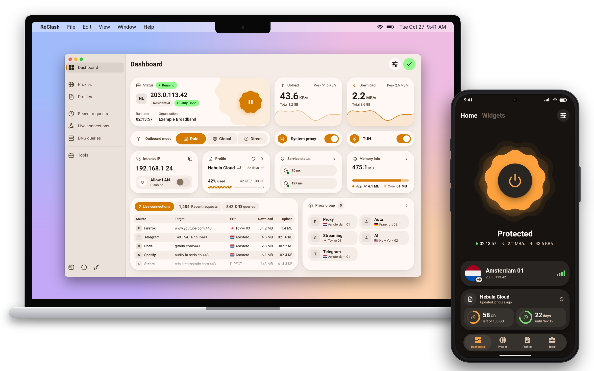
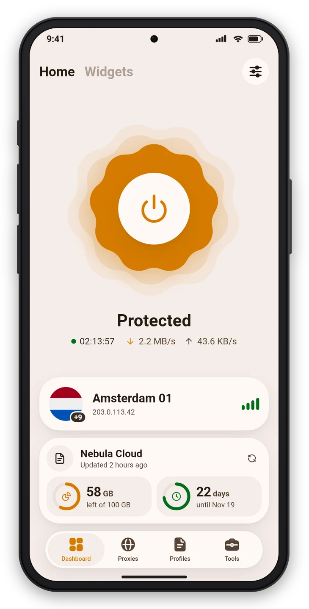
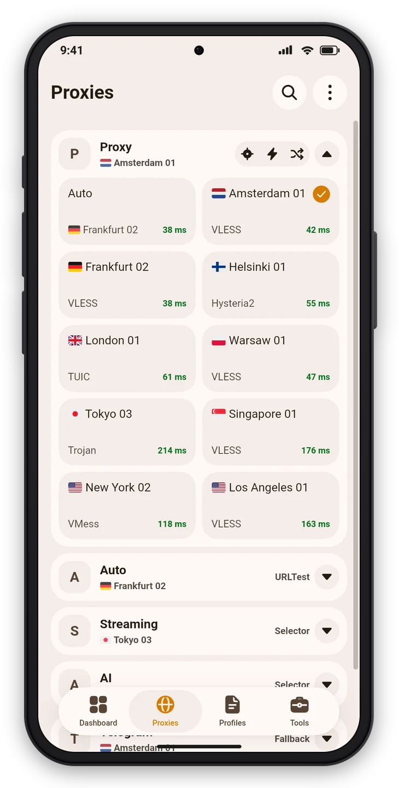
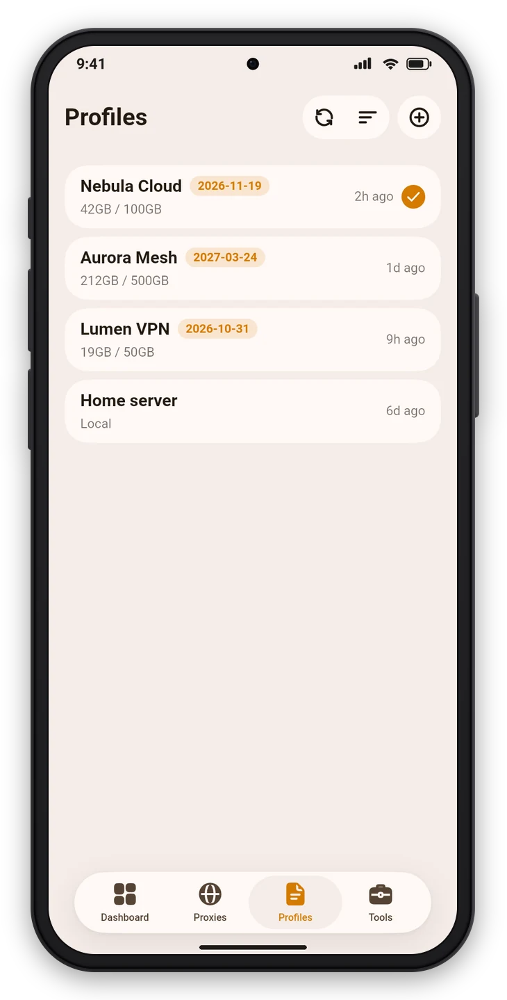
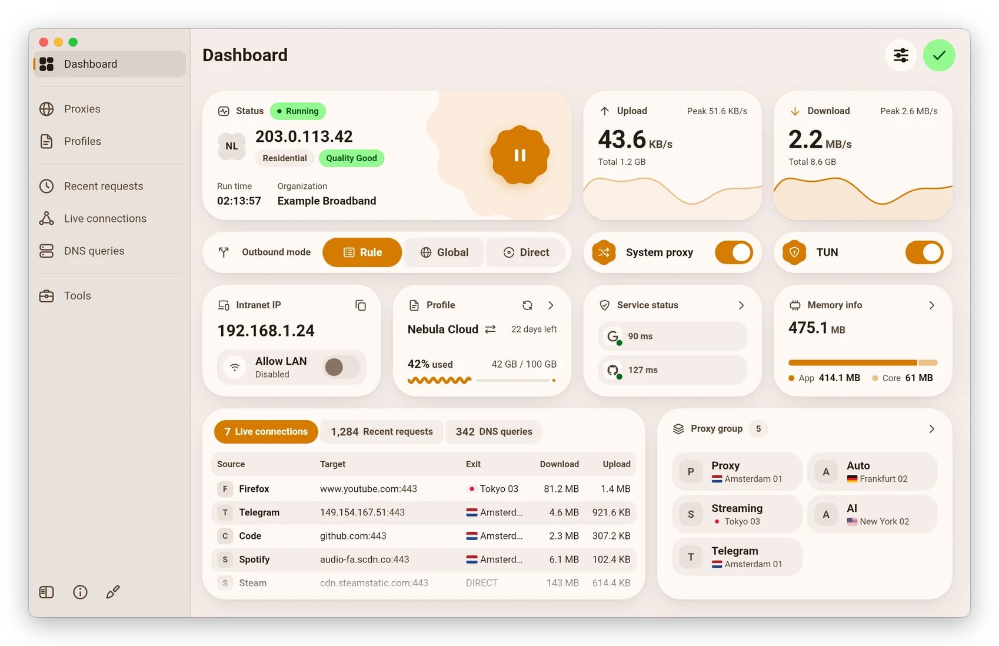
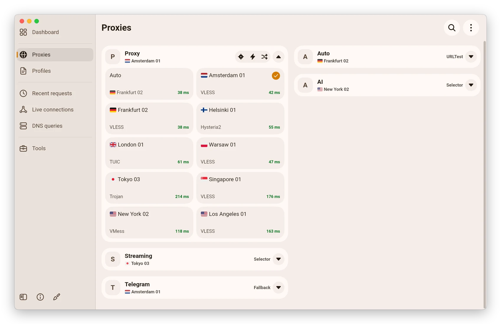
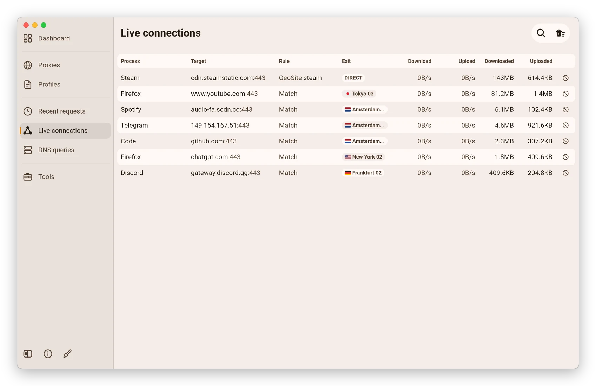
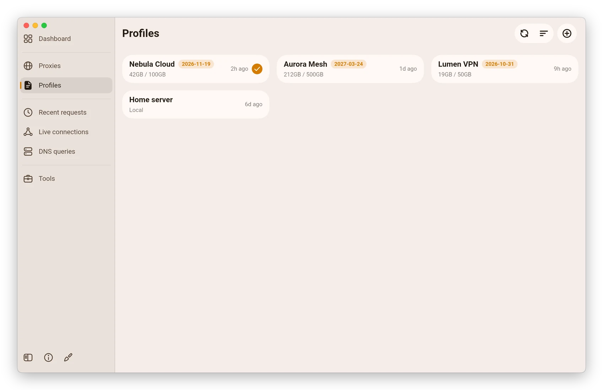

<div align="center">


# ReClash

A multi-platform proxy client based on Clash Meta (mihomo) that picks the route for you.
Simple to use, open source and ad-free.

**English** · [简体中文](README_zh_CN.md)

[](https://github.com/Hoxiee/ReClash/releases)
[](https://github.com/Hoxiee/ReClash/releases)
[](LICENSE)
[](https://t.me/ReClashApp)

[Download](#download) · [Screenshots](#screenshots) · [Auto routing](docs/en/auto-routing/README.md) ·
[Changelog](CHANGELOG.md) · [Build from source](#build-from-source)

</div>

<p align="center">
  <picture>
    <source media="(prefers-color-scheme: dark)" srcset="snapshots/preview-dark.png">
    
  </picture>
</p>

> [!NOTE]
> ReClash is in preview. Releases are published as `0.1.0-pre.N` pre-releases while the 0.1 line settles.

## Features

- **Auto routing.** A smart group chooses the server by a policy you can read: which servers are acceptable, in what
  order, and how eagerly to switch. It weighs latency, failures and the exit country per network, and shows why it
  picked the server in use. Scenarios set the tunnel mode per network and send chosen sites to their own group.
  [Read the guide](docs/en/auto-routing/README.md).
- **Two dashboards.** A simple one with a single connect button, the current location and what is left on the
  subscription, or a detailed one built from widgets: traffic, exit IP and its quality, service checks, connections and
  more.
- **Subscriptions that understand the provider.** Traffic and expiry from `Subscription-Userinfo`, profile titles,
  provider announcements, routing profiles and settings the provider offers and you approve. Clash, INCY and Happ
  links, plain proxy URIs and several config formats import directly. See
  [provider support](docs/en/PROVIDER_FEATURES.md).
- **Service checks.** See whether Google, YouTube, ChatGPT, Netflix and other services open through the current route,
  with their latency.
- **On-demand networks.** Pause the proxy on networks you trust and resume it everywhere else; ports stay open during a
  pause.
- **mihomo (Clash Meta) core** with rule routing, proxy groups, latency tests, system proxy and TUN mode.
- **Profiles** from a link or a file, with a built-in editor, override scripts, and custom rules, proxies and groups.
- **Live views** of connections, requests, DNS queries and logs.
- **Material You design with Apple-style interaction**: dynamic color, light and dark themes, continuous corners,
  sheets that snap between heights, and layouts that adapt from phones to desktops.
- **Backup and restore** through WebDAV or a local file.
- **Platform touches**: a Quick Settings tile, per-app proxy, launcher icon variants and Android TV support on Android;
  a tray menu and global hotkeys on the desktop.

## Screenshots

<table>
  <tr>
    <td width="33%"><picture><source media="(prefers-color-scheme: dark)" srcset="snapshots/screens/mobile-dashboard-dark.webp"></picture></td>
    <td width="33%"><picture><source media="(prefers-color-scheme: dark)" srcset="snapshots/screens/mobile-proxies-dark.webp"></picture></td>
    <td width="33%"><picture><source media="(prefers-color-scheme: dark)" srcset="snapshots/screens/mobile-profiles-dark.webp"></picture></td>
  </tr>
</table>

<table>
  <tr>
    <td width="50%"><picture><source media="(prefers-color-scheme: dark)" srcset="snapshots/screens/desktop-dashboard-dark.webp"></picture></td>
    <td width="50%"><picture><source media="(prefers-color-scheme: dark)" srcset="snapshots/screens/desktop-proxies-dark.webp"></picture></td>
  </tr>
  <tr>
    <td width="50%"><picture><source media="(prefers-color-scheme: dark)" srcset="snapshots/screens/desktop-connections-dark.webp"></picture></td>
    <td width="50%"><picture><source media="(prefers-color-scheme: dark)" srcset="snapshots/screens/desktop-profiles-dark.webp"></picture></td>
  </tr>
</table>

The subscriptions, servers and addresses in the screenshots are made up.

## Download

Get the latest build from [GitHub Releases](https://github.com/Hoxiee/ReClash/releases). Every release lists a
`SHA256SUMS` file to check the download against.

| Platform | Packages | Notes |
| --- | --- | --- |
| Android 7 and later | APK for `arm64-v8a`, `armeabi-v7a` and `x86_64` | Most phones use `arm64-v8a`. |
| Windows 10 and later | Installer (`-setup.exe`) or portable `.zip`, for x64 and ARM64 | Pick ARM64 on Snapdragon and other ARM laptops. |
| macOS 12 and later | DMG for Apple Silicon (`arm64`) and Intel (`amd64`) | |
| Linux | `.deb`, `.rpm` and Arch `.pkg.tar.xz` for x64 and ARM64; AppImage for x64 | See the tray note below. |

<p>
  <a href="https://github.com/Hoxiee/ReClash/releases"></a>
</p>

ReClash uses its own package name and data folder, so it installs next to FlClash without touching it.

**Linux tray icon**

The `.deb` package installs its own dependencies. With the AppImage or the `.rpm`, install the AyatanaAppIndicator
library so the tray icon can show:

```bash
sudo apt-get install libayatana-appindicator3-1   # Debian and Ubuntu
sudo dnf install libayatana-appindicator-gtk3     # Fedora
```

**Unattended desktop**

ReClash starts the core only after the disclaimer is accepted. Where nobody can click it, such as a container, set
`FLCLASH_ACCEPT_DISCLAIMER=1` in the app's environment to accept it on first launch.

## Usage

**Import a profile from a link.** Opening a link in this form imports the subscription. The `clash://` and
`clashmeta://` schemes work the same way, and so do INCY and Happ import links and plain proxy URIs such as `vless://`
or `hysteria2://`.

```text
reclash://install-config?url=<URL-encoded subscription link>
```

**Control the app with links.** `reclash://connect`, `reclash://disconnect` and `reclash://toggle` switch the proxy;
Tools › URL scheme lists the rest, including links that share an auto routing profile.

**Automate on Android.** Tasker, MacroDroid and similar apps can start, stop or toggle the proxy by starting an
activity with one of these actions:

```text
com.reclash.action.START
com.reclash.action.STOP
com.reclash.action.TOGGLE
```

From a computer, the same works over adb:

```bash
adb shell am start -a com.reclash.action.TOGGLE
```

## Documentation

- [Auto routing](docs/en/auto-routing/README.md): the mental model, profiles, scenarios, conditions and a cookbook.
- [Provider support](docs/en/PROVIDER_FEATURES.md) and [provider headers](docs/en/PROVIDER_HEADERS.md): what a
  subscription provider can tell the app.

## Build from source

You need [Flutter](https://docs.flutter.dev/get-started/install) 3.47 (release builds use 3.47.6),
[Go](https://go.dev/dl/) 1.27 and [Rust](https://rustup.rs/) installed through rustup. Each platform builds on its own
host, except Android, which builds anywhere.

```bash
git clone --recursive https://github.com/Hoxiee/ReClash.git
cd ReClash
flutter pub get
dart setup.dart android   # or windows, macos, linux
```

Packages land in `dist/`. The Go core and the Rust libraries are compiled as part of the Flutter build.

| Platform | Also needed |
| --- | --- |
| Android | Android SDK with the NDK. Add `--arch arm64` to build a single ABI. |
| Windows | GCC (MinGW-w64) for the core and [Inno Setup](https://jrsoftware.org/isinfo.php) 6 for the installer. |
| macOS | Xcode and Node.js. The script installs `appdmg` through npm. |
| Linux | Debian or Ubuntu. The script installs the build packages with apt and downloads `appimagetool`. |

Run `dart setup.dart --help` for the remaining options, such as `--targets` to build only some package formats.
The screenshots in this file are rendered from mock data with `tool/snapshots/render.sh`.

## Support

Starring the repository is the easiest way to support the project. Announcements go to the
[Telegram channel](https://t.me/ReClashApp); bugs and feature requests go to
[GitHub Issues](https://github.com/Hoxiee/ReClash/issues).

## Acknowledgements

ReClash is a fork of [FlClash](https://github.com/chen08209/FlClash) by chen08209 and runs the
[mihomo](https://github.com/MetaCubeX/mihomo) core. Thanks to both projects and their contributors.

## License

ReClash is released under the [GPL-3.0 license](LICENSE).
