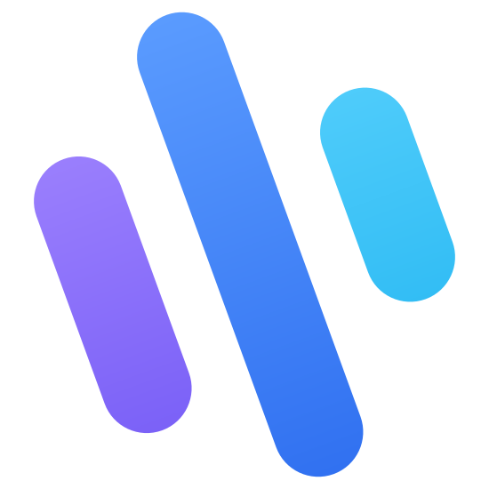
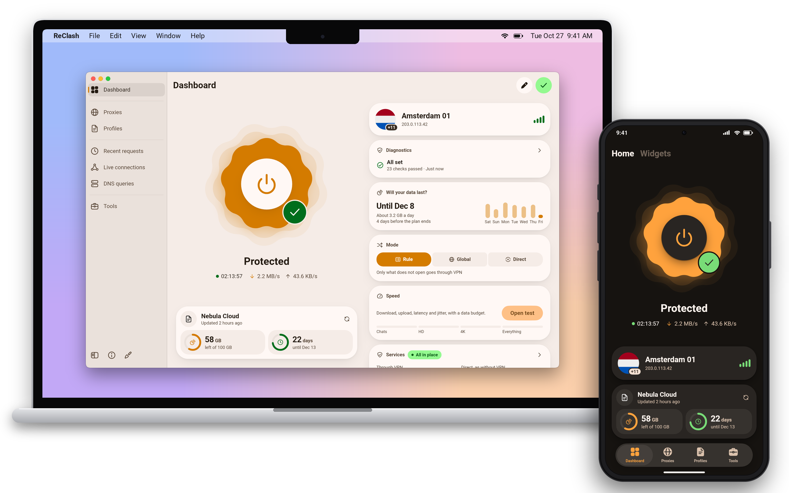
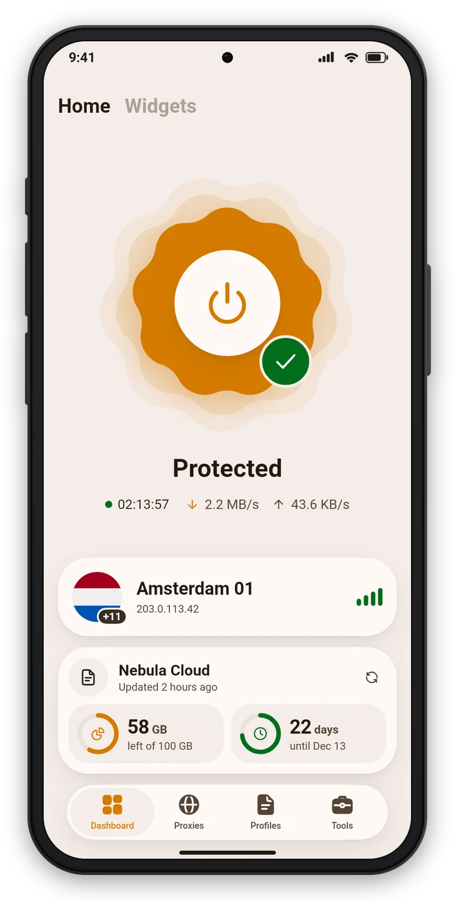
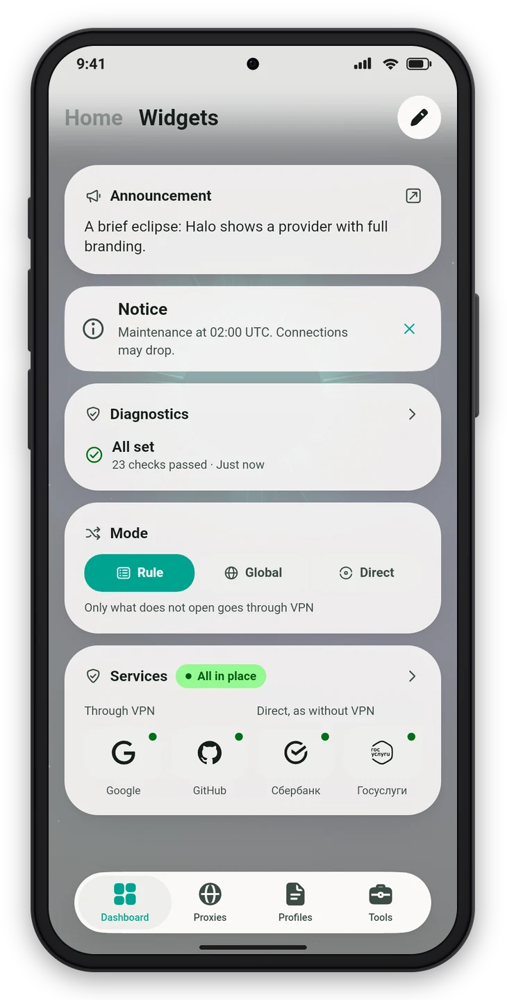
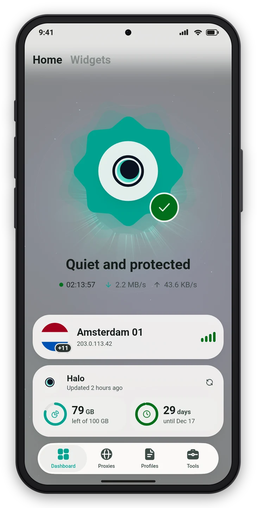
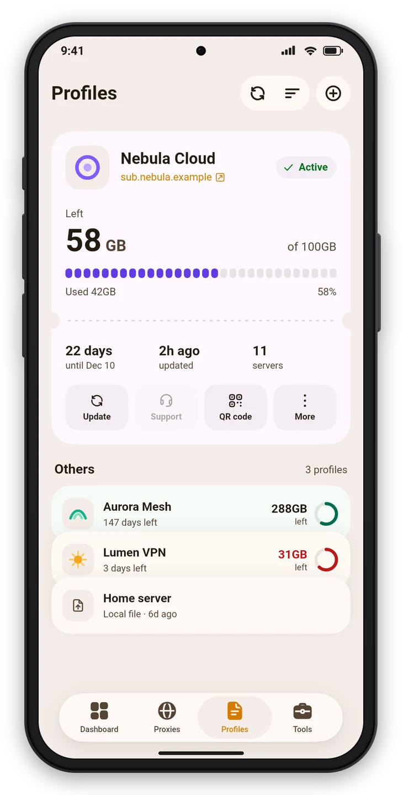
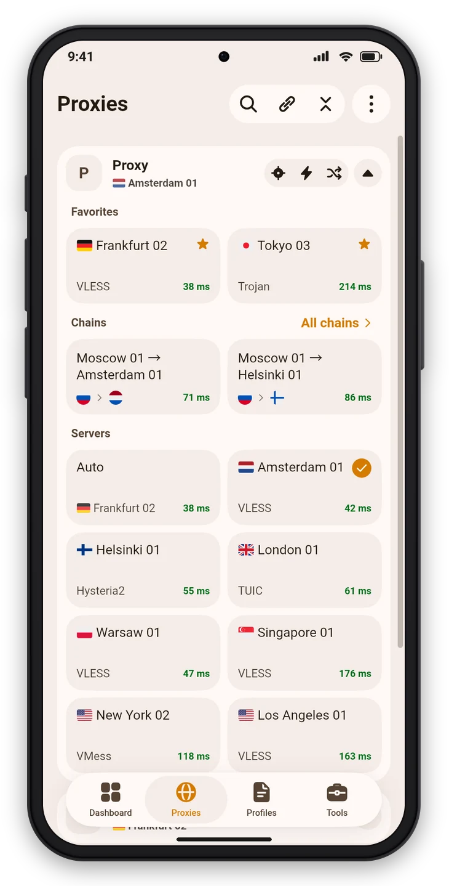
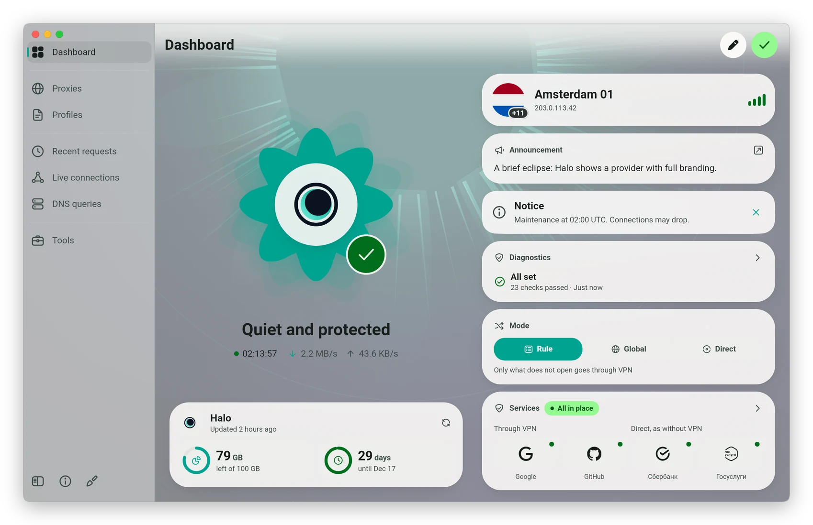
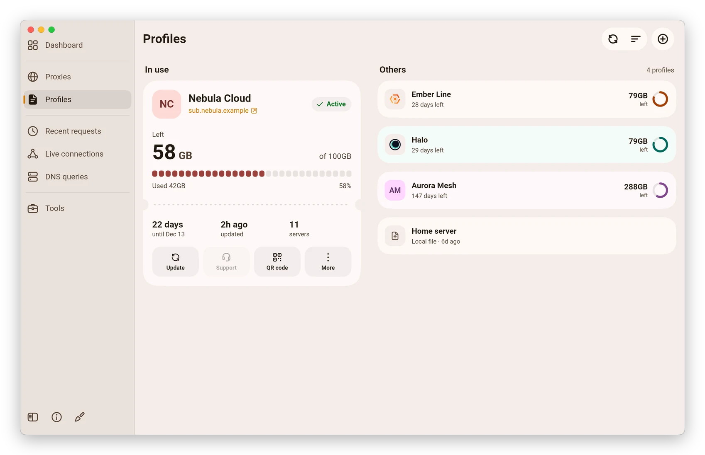

<div align="center">



# ReClash

**In touch with the internet — and with whoever provides it.**

A proxy client for Android, Windows, macOS and Linux on the mihomo (Clash Meta) core.
Free, open source and ad-free.

**English** · [Русский](README_ru.md) · [简体中文](README_zh_CN.md)

[](https://github.com/Hoxiee/ReClash/releases)
[](https://github.com/Hoxiee/ReClash/releases)
[](LICENSE)
[](https://t.me/ReClashApp)

[Website](https://reclash.pages.dev) · [Download](#download) · [Documentation](#documentation) · [Changelog](CHANGELOG.md) ·
[Build from source](#build-from-source)

</div>

<p align="center">
  <picture>
    <source media="(prefers-color-scheme: dark)" srcset="snapshots/preview-dark.png">
    
  </picture>
</p>

> [!NOTE]
> ReClash is in preview. Releases are published as `0.1.0-pre.N` pre-releases while the 0.1 line settles.

## What it does for you

- **ChatGPT never sees the wrong country.** [Site lock](docs/en/site-lock/README.md) sends chosen sites only through the
  exit servers you pick, or nowhere, whatever the mode or rules. Everything else keeps its usual route.
- **Won't load? You see why.** Service checks show whether Google, YouTube, ChatGPT, Netflix and other services open
  through the current route, and how fast, so you know whether the server or the site is at fault.
- **Know if your data will last.** Remaining traffic and expiry are in plain sight, and a forecast tells you
  whether the data will last the period. Profiles stack like cards in a wallet.
- **One button or every number.** The simple dashboard has the connect button, the current location and what is left on
  the subscription. The detailed one is built from widgets: traffic, exit IP and its quality, the data forecast, a speed
  test, diagnostics, connections and service checks.
- **Direct at home, proxied on the go.** The proxy pauses on networks you trust and resumes everywhere else.
- **No ads, no paywalls.** Free and open source, with no account or registration.

## For providers

Your logo, your announcements, your users — in touch, not in tickets. One `reclash-config` header in the subscription
response points to a manifest, and the client shows your logo, colors, wallpaper and connect button, your announcements
and maintenance notices, support and renewal links, and settings the user approves. No SDK and no app of your own.
Build the manifest on the [website](https://reclash.pages.dev) and read the
[provider integration guide](docs/en/providers/README.md).

## More

- mihomo (Clash Meta) core with rule routing, proxy groups, latency tests, system proxy and TUN mode.
- Clash, INCY and Happ links, plain proxy URIs and several config formats import directly.
- Favorite servers at the top of each group, and chains that reach a foreign exit through a domestic entry.
- Profiles from a link or a file, with a built-in editor, override scripts and custom rules, proxies and groups.
- [Auto routing](docs/en/auto-routing/README.md), still taking shape: smart groups that switch servers by a policy
  you set up, and scenarios that change the mode per network and send chosen sites to their own group.
- Live connections, requests, DNS queries and logs; known DNS leak paths are closed.
- Updates inside the app, verified by SHA-256; a provider can serve a signed mirror of the releases.
- Backup and restore through WebDAV or a local file.
- Material You with Apple-style interaction: dynamic color, light and dark themes, continuous corners, sheets that snap
  between heights, and layouts that adapt from phones to desktops.
- Android: Quick Settings tile, per-app proxy, the system kill switch, launcher icon variants and Android TV. Desktop: tray
  menu and global hotkeys.

## Screenshots

<table>
  <tr>
    <td width="20%" align="center" valign="top"><picture><source media="(prefers-color-scheme: dark)" srcset="snapshots/screens/mobile-dashboard-dark.webp"></picture><br><sub>One button</sub></td>
    <td width="20%" align="center" valign="top"><picture><source media="(prefers-color-scheme: dark)" srcset="snapshots/screens/mobile-widgets-dark.webp"></picture><br><sub>Provider announcements</sub></td>
    <td width="20%" align="center" valign="top"><picture><source media="(prefers-color-scheme: dark)" srcset="snapshots/screens/mobile-branded-dark.webp"></picture><br><sub>The provider's look</sub></td>
    <td width="20%" align="center" valign="top"><picture><source media="(prefers-color-scheme: dark)" srcset="snapshots/screens/mobile-profiles-dark.webp"></picture><br><sub>Wallet cards</sub></td>
    <td width="20%" align="center" valign="top"><picture><source media="(prefers-color-scheme: dark)" srcset="snapshots/screens/mobile-proxies-dark.webp"></picture><br><sub>Favorites and chains</sub></td>
  </tr>
</table>

<table>
  <tr>
    <td width="50%" align="center" valign="top"><picture><source media="(prefers-color-scheme: dark)" srcset="snapshots/screens/desktop-branded-dark.webp"></picture><br><sub>Provider branding on the desktop</sub></td>
    <td width="50%" align="center" valign="top"><picture><source media="(prefers-color-scheme: dark)" srcset="snapshots/screens/desktop-profiles-dark.webp"></picture><br><sub>Every subscription in one place</sub></td>
  </tr>
</table>

The subscriptions, servers and addresses in the screenshots are made up.

## Download

Get the latest build from [GitHub Releases](https://github.com/Hoxiee/ReClash/releases) or the
[website](https://reclash.pages.dev). Every release lists a `SHA256SUMS` file to check the download against.

| Platform | Packages | Notes |
| --- | --- | --- |
| Android 7 and later | APK for `arm64-v8a`, `armeabi-v7a` and `x86_64` | Most phones use `arm64-v8a`. |
| Windows 10 and later | Installer (`-setup.exe`) or portable `.zip`, for x64 and ARM64 | Pick ARM64 on Snapdragon and other ARM laptops. |
| macOS 12 and later | DMG for Apple Silicon (`arm64`) and Intel (`amd64`) | Not from the App Store: open it the first time with the context menu → Open. |
| Linux | `.deb`, `.rpm` and Arch `.pkg.tar.xz` for x64 and ARM64; AppImage for x64 | See the tray note below. |

<p>
  <a href="https://github.com/Hoxiee/ReClash/releases"></a>
</p>

ReClash uses its own package name and data folder, so it installs next to FlClash without touching it.

**Linux tray icon.** The `.deb` package installs its own dependencies. With the AppImage or the `.rpm`, install the
AyatanaAppIndicator library so the tray icon can show:

```bash
sudo apt-get install libayatana-appindicator3-1   # Debian and Ubuntu
sudo dnf install libayatana-appindicator-gtk3     # Fedora
```

**Unattended desktop.** ReClash starts the core only after the disclaimer is accepted. Where nobody can click it, such
as a container, set `FLCLASH_ACCEPT_DISCLAIMER=1` in the app's environment to accept it on first launch.

## Usage

**Import a subscription from a link.** Opening a link in this form imports the subscription. The `clash://` and
`clashmeta://` schemes work the same way, and so do INCY and Happ import links and plain proxy URIs such as `vless://`
or `hysteria2://`. The [website](https://reclash.pages.dev) builds such a link from a subscription URL.

```text
reclash://install-config?url=<URL-encoded subscription link>
```

**Control the app with links.** `reclash://connect`, `reclash://disconnect` and `reclash://toggle` switch the proxy;
Tools › URL scheme lists the rest, including links that share an auto routing profile.

**Automate on Android.** Tasker, MacroDroid and similar apps can start, stop or toggle the proxy by starting an
activity with one of these actions:

```text
com.reclash.action.START
com.reclash.action.STOP
com.reclash.action.TOGGLE
```

From a computer, the same works over adb:

```bash
adb shell am start -a com.reclash.action.TOGGLE
```

## Documentation

The [website](https://reclash.pages.dev) publishes the documentation in English and Russian; its source lives in
[`docs/`](docs/en/README.md).

- [Auto routing](docs/en/auto-routing/README.md): the mental model, profiles, scenarios, conditions and a cookbook.
- [Site lock](docs/en/site-lock/README.md): pinning sites to chosen exit servers and what each platform can enforce.
- [Provider integration](docs/en/providers/README.md) and [response headers](docs/en/providers/headers.md): what a
  subscription provider can tell the app and how it brands the client.

## Build from source

You need [Flutter](https://docs.flutter.dev/get-started/install) 3.47 (release builds use 3.47.6),
[Go](https://go.dev/dl/) 1.27 and [Rust](https://rustup.rs/) installed through rustup. Each platform builds on its own
host, except Android, which builds anywhere.

```bash
git clone --recursive https://github.com/Hoxiee/ReClash.git
cd ReClash
dart setup.dart android   # or windows, macos, linux
```

The script resolves dependencies, generates code and compiles the Go core and the Rust libraries as part of the Flutter
build. Packages land in `dist/`.

| Platform | Also needed |
| --- | --- |
| Android | Android SDK with the NDK. Add `--arch arm64` to build a single ABI. |
| Windows | GCC (MinGW-w64) for the core and [Inno Setup](https://jrsoftware.org/isinfo.php) 6 for the installer. |
| macOS | Xcode and Node.js. The script installs `appdmg` through npm. |
| Linux | Debian or Ubuntu. The script installs the build packages with apt and downloads `appimagetool`. |

Run `dart setup.dart --help` for the remaining options, such as `--targets` to build only some package formats.
The screenshots are rendered from mock data with `tool/snapshots/render.sh`.

## Support

Starring the repository is the easiest way to support the project. Announcements go to the
[Telegram channel](https://t.me/ReClashApp); bugs and feature requests go to
[GitHub Issues](https://github.com/Hoxiee/ReClash/issues).

## Acknowledgements

ReClash is a fork of [FlClash](https://github.com/chen08209/FlClash) by chen08209 and runs the
[mihomo](https://github.com/MetaCubeX/mihomo) core. Thanks to both projects and their contributors.

## License

ReClash is released under the [GPL-3.0 license](LICENSE).
