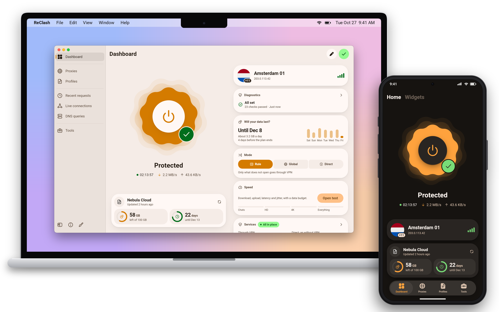
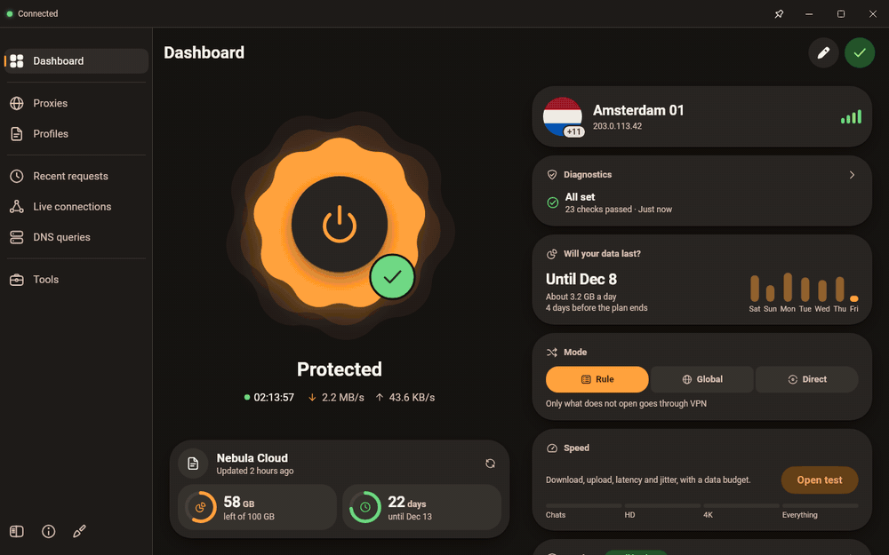
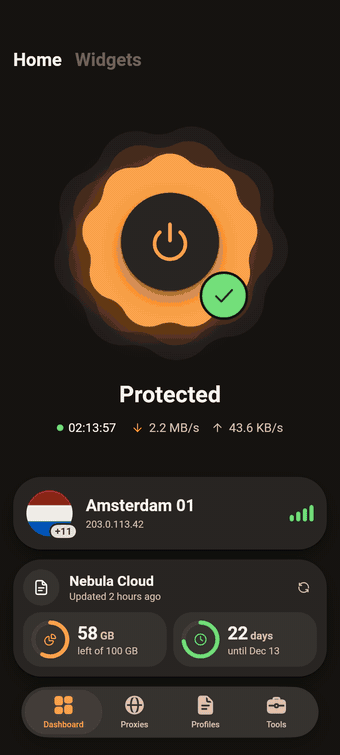
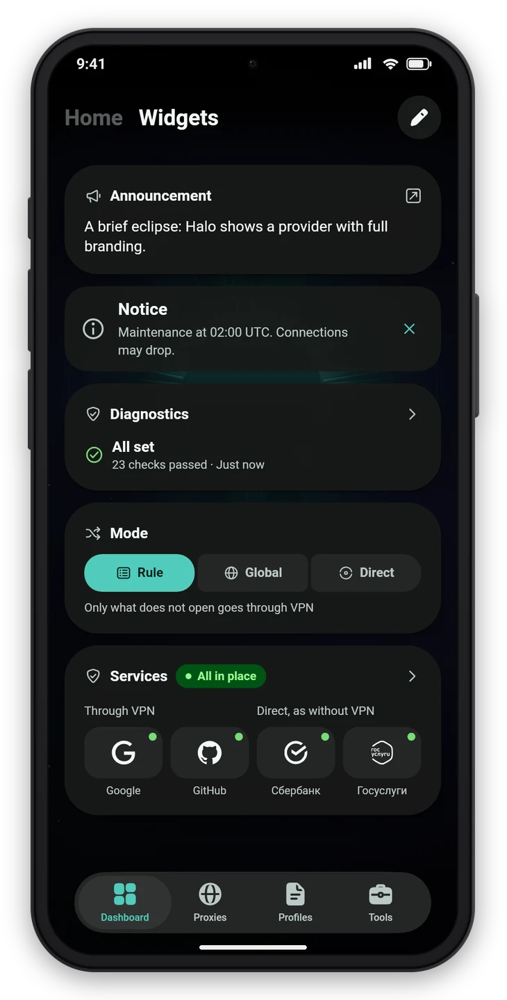
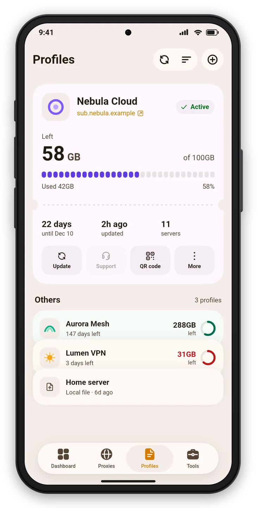
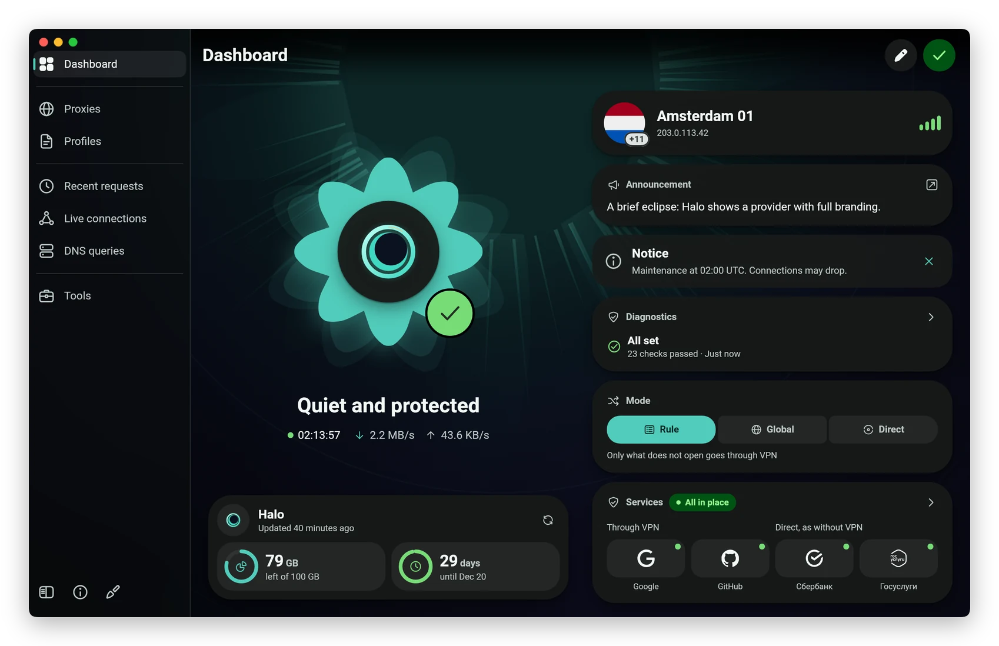

<div align="center">


# ReClash

**На связи с интернетом — и с тем, кто его даёт.**

Прокси-клиент для Android, Windows, macOS и Linux на ядре mihomo (Clash Meta).
Бесплатный, с открытым кодом и без рекламы.

[English](README.md) · **Русский** · [简体中文](README_zh_CN.md)

[](https://github.com/Hoxiee/ReClash/releases)
[](https://github.com/Hoxiee/ReClash/releases)
[](LICENSE)

[Сайт](https://reclash.pages.dev) · [Скачать](#скачать) · [Документация](#документация) · [Список изменений](CHANGELOG.md) ·
[Сборка из исходников](#сборка-из-исходников)

<a href="https://t.me/ReClashApp"></a>
<a href="https://t.me/+YcBp-q29GIU5ODcy"></a>

Новые версии сначала появляются в канале. Вопросы, настройки и идеи — в чате.

</div>

<p align="center">
  <picture>
    <source media="(prefers-color-scheme: dark)" srcset="snapshots/preview-dark.png">
    
  </picture>
</p>

> [!NOTE]
> ReClash в предварительной версии. Пока линия 0.1 не устоялась, релизы выходят как пре-релизы `0.1.0-pre.N`.

## Что ReClash делает за вас

- **ChatGPT, Claude и Gemini не увидят не ту страну.** [Привязка сайтов](docs/ru/site-lock/README.md) отправляет выбранные сайты только
  через выбранные серверы выхода — или никуда, при любом режиме и правилах. Остальной трафик идёт как обычно.
- **Не грузит — сразу видно почему.** Проверки сервисов показывают, открываются ли Google, YouTube, ChatGPT, Netflix и
  другие сервисы через текущий маршрут и с какой задержкой, так что понятно, виноват сервер или сайт.
- **Хватит ли трафика — знаешь заранее.** Остаток и срок видны сразу, а прогноз подскажет, хватит ли трафика до конца периода.
  Профили лежат стопкой, как карты в кошельке.
- **Одна кнопка или все цифры.** На простом главном экране — кнопка подключения, текущая страна и остаток подписки.
  Подробный собирается из виджетов: трафик, IP выхода и его качество, прогноз трафика, тест скорости, диагностика,
  соединения и проверки сервисов.
- **Дома напрямую, в дороге — через прокси.** В доверенных сетях прокси встаёт на паузу, в остальных включается снова.
- **Ни рекламы, ни платных функций.** Бесплатно и с открытым кодом, без аккаунта и регистрации.

## Для провайдеров

Ваш логотип, ваши объявления, ваши пользователи — на связи, а не в тикетах. Один заголовок `reclash-config` в ответе
подписки указывает на манифест, и клиент показывает ваш логотип, цвета, фон и кнопку подключения, объявления и
уведомления о работах, ссылки на поддержку и продление, а также настройки, которые одобрит пользователь. Ни SDK, ни
своего приложения. Манифест собирается на [сайте](https://reclash.pages.dev), подробности — в
[руководстве для провайдеров](docs/ru/providers/README.md).

## Ещё

- Ядро mihomo (Clash Meta): маршрутизация по правилам, группы прокси, тесты задержки, системный прокси и режим TUN.
- Ссылки Clash, INCY и Happ, обычные URI прокси и несколько форматов конфигов импортируются напрямую.
- Избранные серверы наверху каждой группы и цепочки, которые выводят на зарубежный выход через домашний вход.
- Профили по ссылке или из файла, со встроенным редактором, скриптами переопределения и своими правилами, прокси и
  группами.
- [Автомаршрутизация](docs/ru/auto-routing/README.md), пока в развитии: умные группы, которые переключают серверы по
  настроенной вами политике, и сценарии, которые меняют режим для каждой сети и отправляют выбранные сайты в свою группу.
- Соединения, запросы, DNS-запросы и логи в реальном времени; известные пути утечки DNS закрыты.
- Обновления внутри приложения с проверкой SHA-256; провайдер может раздавать подписанное зеркало релизов.
- Резервная копия и восстановление через WebDAV или локальный файл.
- Material You с поведением в духе Apple: динамические цвета, светлая и тёмная темы, плавные скругления, шторки с
  несколькими высотами и раскладка, которая подстраивается от телефона до компьютера.
- Android: плитка в быстрых настройках, прокси для отдельных приложений, системный kill switch, варианты значка и
  Android TV. Компьютер: меню в трее и глобальные горячие клавиши.

## Короткий обзор

<p align="center">
  
  <br><sub>Компьютер: обычная подписка, затем Ember Line и Halo в оформлении своих провайдеров</sub>
</p>

<p align="center">
  
  <br><sub>То же на телефоне</sub>
</p>

Подписки, серверы и адреса на скриншотах выдуманы.

<details>
<summary><b>Больше скриншотов</b></summary>
<br>

<table>
  <tr>
    <td width="20%" align="center" valign="top"><picture><source media="(prefers-color-scheme: dark)" srcset="snapshots/screens/mobile-dashboard-dark.webp"></picture><br><sub>Одна кнопка</sub></td>
    <td width="20%" align="center" valign="top"><br><sub>Объявления провайдера</sub></td>
    <td width="20%" align="center" valign="top"><br><sub>Клиент в цветах провайдера</sub></td>
    <td width="20%" align="center" valign="top"><picture><source media="(prefers-color-scheme: dark)" srcset="snapshots/screens/mobile-profiles-dark.webp"></picture><br><sub>Подписки как карты</sub></td>
    <td width="20%" align="center" valign="top"><picture><source media="(prefers-color-scheme: dark)" srcset="snapshots/screens/mobile-proxies-dark.webp"></picture><br><sub>Избранное и цепочки</sub></td>
  </tr>
</table>

<table>
  <tr>
    <td width="50%" align="center" valign="top"><br><sub>Оформление провайдера на компьютере</sub></td>
    <td width="50%" align="center" valign="top"><picture><source media="(prefers-color-scheme: dark)" srcset="snapshots/screens/desktop-profiles-dark.webp"></picture><br><sub>Все подписки в одном месте</sub></td>
  </tr>
</table>

</details>

## Скачать

Последняя сборка — на [GitHub Releases](https://github.com/Hoxiee/ReClash/releases) и на
[сайте](https://reclash.pages.dev). В каждом релизе есть файл `SHA256SUMS` для проверки загрузки.

| Платформа | Пакеты | Примечания |
| --- | --- | --- |
| Android 7 и новее | APK для `arm64-v8a`, `armeabi-v7a` и `x86_64` | Большинству телефонов нужен `arm64-v8a`. |
| Windows 10 и новее | Установщик (`-setup.exe`) или портативный `.zip`, для x64 и ARM64 | На Snapdragon и других ARM-ноутбуках берите ARM64. Сборки не подписаны, поэтому SmartScreen или Smart App Control могут предупредить или заблокировать запуск: в SmartScreen нажмите «Подробнее» → «Выполнить в любом случае». |
| macOS 12 и новее | DMG для Apple Silicon (`arm64`) и Intel (`amd64`) | Сборка не из App Store: На macOS 15 и новее «Открыть» в контекстном меню больше не обходит Gatekeeper: попробуйте открыть приложение один раз, затем зайдите в Системные настройки → Конфиденциальность и безопасность → «Всё равно открыть». |
| Linux | `.deb`, `.rpm` и `.pkg.tar.xz` для Arch, для x64 и ARM64; AppImage для x64 | См. примечание про трей ниже. |

<p>
  <a href="https://github.com/Hoxiee/ReClash/releases"></a>
</p>

У ReClash своё имя пакета и своя папка данных, поэтому он ставится рядом с FlClash и не трогает его.

**Значок в трее на Linux.** Пакет `.deb` сам ставит зависимости. С AppImage или `.rpm` установите библиотеку
AyatanaAppIndicator, чтобы значок в трее появился:

```bash
sudo apt-get install libayatana-appindicator3-1   # Debian и Ubuntu
sudo dnf install libayatana-appindicator-gtk3     # Fedora
```

**Компьютер без пользователя.** ReClash запускает ядро только после принятия дисклеймера. Где нажать некому, например в
контейнере, задайте в окружении приложения `FLCLASH_ACCEPT_DISCLAIMER=1`, чтобы принять его при первом запуске.

## Использование

**Импорт подписки по ссылке.** Ссылка такого вида импортирует подписку. Так же работают схемы `clash://` и
`clashmeta://`, ссылки импорта INCY и Happ и обычные URI прокси вроде `vless://` или `hysteria2://`.
[Сайт](https://reclash.pages.dev) собирает такую ссылку из адреса подписки.

```text
reclash://install-config?url=<URL-encoded ссылка на подписку>
```

**Управление ссылками.** `reclash://connect`, `reclash://disconnect` и `reclash://toggle` переключают прокси;
остальные, включая ссылки для обмена профилем автомаршрутизации, перечислены в Инструменты › URL-схема.

**Автоматизация на Android.** Tasker, MacroDroid и похожие приложения могут включать, выключать и переключать прокси,
запуская activity с одним из этих действий:

```text
com.reclash.action.START
com.reclash.action.STOP
com.reclash.action.TOGGLE
```

С компьютера то же самое работает через adb:

```bash
adb shell am start -a com.reclash.action.TOGGLE
```

## Документация

[Сайт](https://reclash.pages.dev) публикует документацию на русском и английском; её исходники лежат в
[`docs/`](docs/ru/README.md).

- [Автомаршрутизация](docs/ru/auto-routing/README.md): модель, профили, сценарии, условия и сборник рецептов.
- [Привязка сайтов](docs/ru/site-lock/README.md): как сайты закрепляются за серверами выхода и что может обеспечить
  каждая платформа.
- [Интеграция провайдера](docs/ru/providers/README.md) и [заголовки ответа](docs/ru/providers/headers.md): что провайдер
  подписки может сообщить приложению и как он оформляет клиент.

## Сборка из исходников

Нужны [Flutter](https://docs.flutter.dev/get-started/install) 3.47 (релизы собираются на 3.47.6),
[Go](https://go.dev/dl/) 1.27 и [Rust](https://rustup.rs/), установленный через rustup. Каждая платформа собирается на
своей системе, кроме Android, который собирается где угодно.

```bash
git clone --recursive https://github.com/Hoxiee/ReClash.git
cd ReClash
dart setup.dart android   # или windows, macos, linux
```

Скрипт подтягивает зависимости, генерирует код и в рамках сборки Flutter компилирует ядро на Go и библиотеки на Rust.
Пакеты появляются в `dist/`.

| Платформа | Что ещё нужно |
| --- | --- |
| Android | Android SDK с NDK. Добавьте `--arch arm64`, чтобы собрать один ABI. |
| Windows | GCC (MinGW-w64) для ядра и [Inno Setup](https://jrsoftware.org/isinfo.php) 6 для установщика. |
| macOS | Xcode и Node.js. Скрипт ставит `appdmg` через npm. |
| Linux | Debian или Ubuntu. Скрипт ставит пакеты для сборки через apt и скачивает `appimagetool`. |

Остальные параметры, например `--targets` для сборки только части форматов, — в `dart setup.dart --help`.
Скриншоты отрисованы из тестовых данных скриптом `tool/snapshots/render.sh`.

## Поддержка

Проще всего поддержать проект звездой репозитория. Релизы и новости — в [Telegram-канале](https://t.me/ReClashApp), вопросы и помощь
с настройкой — в [Telegram-чате](https://t.me/+YcBp-q29GIU5ODcy); ошибки и пожелания — в
[GitHub Issues](https://github.com/Hoxiee/ReClash/issues).

## Благодарности

ReClash существует благодаря работе этих проектов и их мейнтейнеров:

- [FlClash](https://github.com/chen08209/FlClash) от [chen08209](https://github.com/chen08209) — приложение, на котором основан ReClash.
- [FlClashX](https://github.com/pluralplay/FlClashX) от [pluralplay](https://github.com/pluralplay) — часть функций и идей для интеграции с провайдерами опирается на его работу.
  > «Да не сплю я» — pluralplay
- [FlClash-Patched](https://github.com/chenx-dust/FlClash-Patched) от [chenx-dust](https://github.com/chenx-dust) — за дополнительные функции, часть которых перенесена в ReClash.
- [mihomo](https://github.com/MetaCubeX/mihomo) от [MetaCubeX](https://github.com/MetaCubeX) — прокси-ядро приложения. ReClash использует слегка доработанный [форк](https://github.com/Hoxiee/mihomo/tree/ReClash); подробнее — [что изменено](https://github.com/Hoxiee/mihomo/blob/ReClash/README.ReClash.ru.md).

ReClash поддерживается независимо. Названия других проектов используются только для описания происхождения, совместимости и зависимостей и не означают одобрения ReClash их авторами.

Полный список зависимостей и соответствующих лицензий находится в приложении и репозитории.

## Лицензия

ReClash распространяется под [лицензией GPL-3.0](LICENSE).
