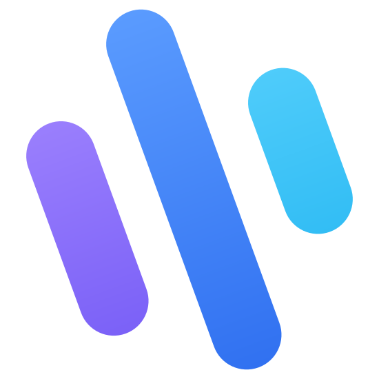
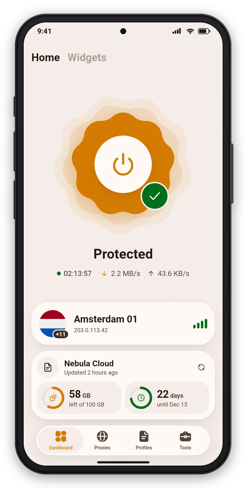
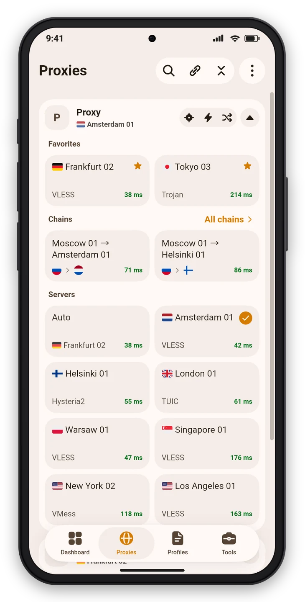
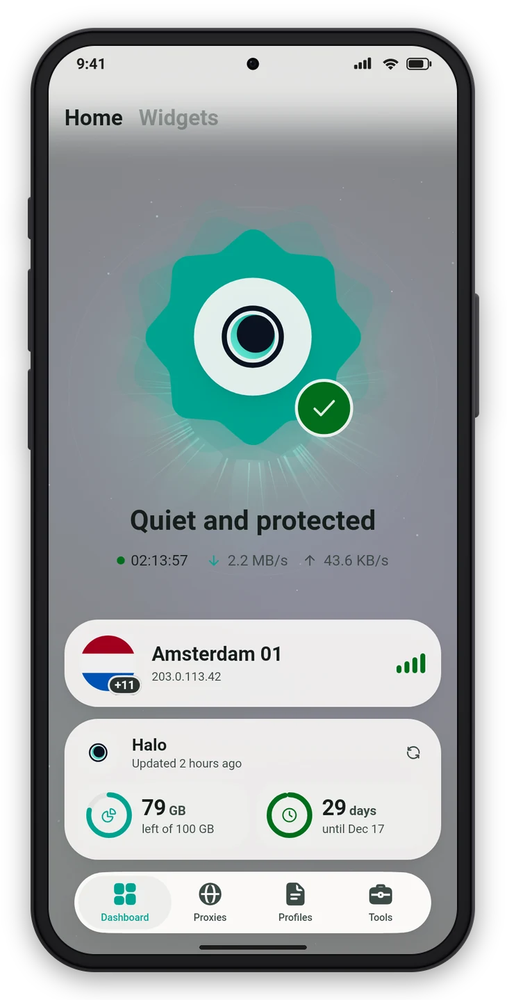
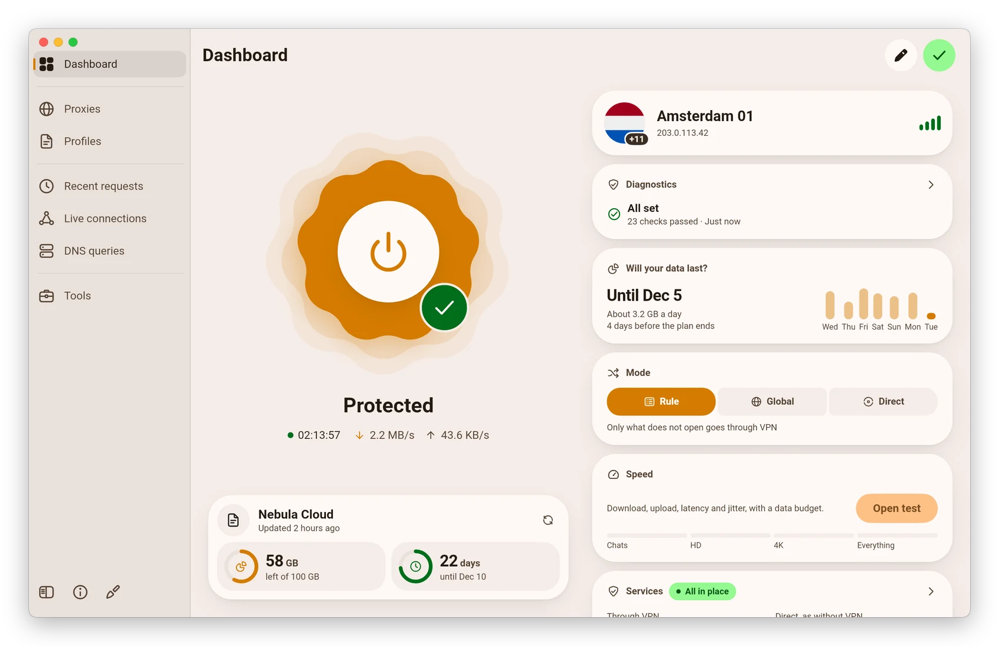
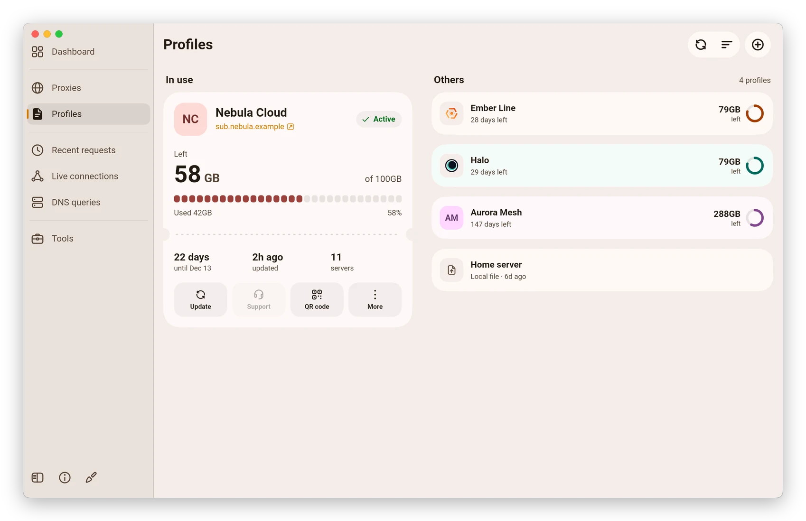
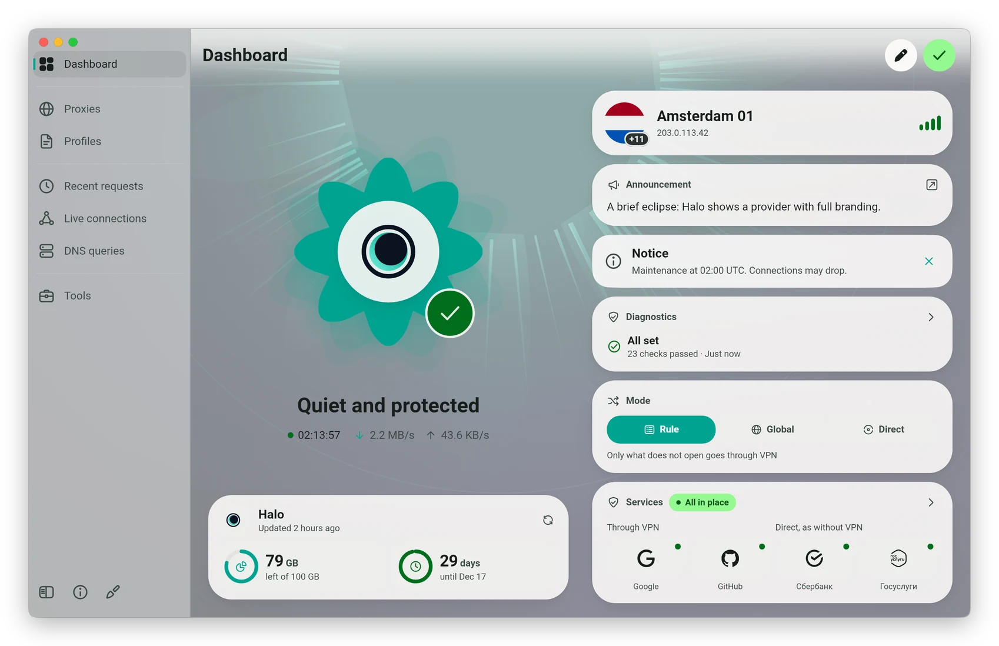

<div align="center">



# ReClash

Мультиплатформенный прокси-клиент на ядре Clash Meta (mihomo), который сам выбирает маршрут.
Простой в использовании, открытый и без рекламы.

[English](README.md) · [简体中文](README_zh_CN.md) · **Русский**

[](https://github.com/Hoxiee/ReClash/releases)
[](https://github.com/Hoxiee/ReClash/releases)
[](LICENSE)
[](https://t.me/ReClashApp)

[Скачать](#скачать) · [Скриншоты](#скриншоты) · [Автомаршрутизация](docs/ru/auto-routing/README.md) ·
[Журнал изменений](CHANGELOG.md) · [Сборка из исходников](#сборка-из-исходников)

</div>

<p align="center">
  <picture>
    <source media="(prefers-color-scheme: dark)" srcset="snapshots/preview-dark.png">
    
  </picture>
</p>

> [!NOTE]
> ReClash находится в стадии превью. Пока линейка 0.1 не стабилизировалась, релизы выходят как предрелизы
> `0.1.0-pre.N`.

## Возможности

- **Автомаршрутизация.** Умная группа выбирает сервер по читаемой политике: какие серверы допустимы, в каком
  порядке и насколько охотно переключаться. Она учитывает задержку, сбои и страну выхода для каждой сети и
  показывает, почему выбрала текущий сервер. Сценарии задают режим туннеля для каждой сети и отправляют выбранные
  сайты в свою группу. [Читать руководство](docs/ru/auto-routing/README.md).
- **Две панели.** Простая — с одной кнопкой подключения, текущим местоположением и остатком подписки; подробная —
  из виджетов: трафик, выходной IP и его качество, проверки сервисов, соединения и другое.
- **Подписки, которые понимают провайдера.** Трафик и срок из `Subscription-Userinfo`, названия профилей,
  объявления провайдера, профили маршрутизации и настройки, которые провайдер предлагает, а вы одобряете. Ссылки
  Clash, INCY и Happ, обычные прокси-URI и несколько форматов конфигурации импортируются напрямую. См.
  [интеграцию провайдера](docs/ru/providers/README.md).
- **Проверка сервисов.** Видно, открываются ли Google, YouTube, ChatGPT, Netflix и другие сервисы через текущий
  маршрут, и с какой задержкой.
- **Сети по требованию.** Прокси можно ставить на паузу в доверенных сетях и возобновлять в остальных; во время
  паузы порты остаются открытыми.
- **Ядро mihomo (Clash Meta)** с маршрутизацией по правилам, группами прокси, тестами задержки, системным прокси
  и режимом TUN.
- **Профили** из ссылки или файла, со встроенным редактором, скриптами переопределения, своими правилами,
  прокси и группами.
- **Живые представления** соединений, запросов, DNS-запросов и логов.
- **Дизайн Material You с взаимодействием в духе Apple**: динамический цвет, светлая и тёмная темы, непрерывные
  углы, шторки, прилипающие между высотами, и раскладки, адаптирующиеся от телефонов до десктопов.
- **Резервное копирование и восстановление** через WebDAV или локальный файл.
- **Платформенные штрихи**: плитка быстрых настроек, прокси для отдельных приложений, варианты иконки и поддержка
  Android TV на Android; меню в трее и глобальные горячие клавиши на десктопе.

## Скриншоты

<table>
  <tr>
    <td width="25%"><picture><source media="(prefers-color-scheme: dark)" srcset="snapshots/screens/mobile-dashboard-dark.webp"></picture></td>
    <td width="25%"><picture><source media="(prefers-color-scheme: dark)" srcset="snapshots/screens/mobile-profiles-dark.webp"></picture></td>
    <td width="25%"><picture><source media="(prefers-color-scheme: dark)" srcset="snapshots/screens/mobile-proxies-dark.webp"></picture></td>
    <td width="25%"><picture><source media="(prefers-color-scheme: dark)" srcset="snapshots/screens/mobile-branded-dark.webp"></picture></td>
  </tr>
</table>

<table>
  <tr>
    <td width="50%"><picture><source media="(prefers-color-scheme: dark)" srcset="snapshots/screens/desktop-dashboard-dark.webp"></picture></td>
    <td width="50%"><picture><source media="(prefers-color-scheme: dark)" srcset="snapshots/screens/desktop-profiles-dark.webp"></picture></td>
  </tr>
  <tr>
    <td width="50%" colspan="2" align="center"><picture><source media="(prefers-color-scheme: dark)" srcset="snapshots/screens/desktop-branded-dark.webp"></picture></td>
  </tr>
</table>

Подписки, серверы и адреса на скриншотах выдуманы.

## Скачать

Актуальную сборку смотрите в [GitHub Releases](https://github.com/Hoxiee/ReClash/releases). В каждом релизе есть файл
`SHA256SUMS` для проверки загрузки.

| Платформа | Пакеты | Примечания |
| --- | --- | --- |
| Android 7 и новее | APK для `arm64-v8a`, `armeabi-v7a` и `x86_64` | Большинству телефонов нужен `arm64-v8a`. |
| Windows 10 и новее | Установщик (`-setup.exe`) или портативный `.zip` для x64 и ARM64 | На Snapdragon и других ARM-ноутбуках выбирайте ARM64. |
| macOS 12 и новее | DMG для Apple Silicon (`arm64`) и Intel (`amd64`) | |
| Linux | `.deb`, `.rpm` и Arch `.pkg.tar.xz` для x64 и ARM64; AppImage для x64 | См. примечание о трее ниже. |

<p>
  <a href="https://github.com/Hoxiee/ReClash/releases"></a>
</p>

ReClash использует собственное имя пакета и папку данных, поэтому ставится рядом с FlClash и не трогает его.

**Значок в трее Linux**

Пакет `.deb` ставит свои зависимости. Для AppImage и `.rpm` установите библиотеку AyatanaAppIndicator, чтобы значок
в трее мог отображаться:

```bash
sudo apt-get install libayatana-appindicator3-1   # Debian и Ubuntu
sudo dnf install libayatana-appindicator-gtk3     # Fedora
```

**Десктоп без присмотра**

ReClash запускает ядро только после принятия дисклеймера. Там, где нажать некому, например в контейнере, задайте
`FLCLASH_ACCEPT_DISCLAIMER=1` в окружении приложения, чтобы принять его при первом запуске.

## Использование

**Импорт профиля по ссылке.** Открытие ссылки такого вида импортирует подписку. Схемы `clash://` и
`clashmeta://` работают так же, как импорт-ссылки INCY и Happ, и обычные прокси-URI вроде `vless://` или
`hysteria2://`.

```text
reclash://install-config?url=<URL-encoded subscription link>
```

**Управление приложением по ссылкам.** `reclash://connect`, `reclash://disconnect` и `reclash://toggle`
переключают прокси; раздел «Инструменты › URL-схема» перечисляет остальные, включая ссылки, которые делятся
профилем автомаршрутизации.

**Автоматизация на Android.** Tasker, MacroDroid и похожие приложения могут запускать, останавливать или
переключать прокси, запуская activity с одним из действий:

```text
com.reclash.action.START
com.reclash.action.STOP
com.reclash.action.TOGGLE
```

С компьютера то же работает через adb:

```bash
adb shell am start -a com.reclash.action.TOGGLE
```

## Документация

- [Автомаршрутизация](docs/ru/auto-routing/README.md): модель, профили, сценарии, условия и сборник рецептов.
- [Интеграция провайдера](docs/ru/providers/README.md) и [заголовки ответа](docs/ru/providers/headers.md): что
  провайдер подписки может сообщить приложению.

## Сборка из исходников

Нужны [Flutter](https://docs.flutter.dev/get-started/install) 3.47 (релизные сборки используют 3.47.6),
[Go](https://go.dev/dl/) 1.27 и [Rust](https://rustup.rs/), установленный через rustup. Каждая платформа
собирается на своём хосте, кроме Android, который собирается где угодно.

```bash
git clone --recursive https://github.com/Hoxiee/ReClash.git
cd ReClash
flutter pub get
dart setup.dart android   # или windows, macos, linux
```

Пакеты попадают в `dist/`. Ядро на Go и библиотеки на Rust компилируются в ходе сборки Flutter.

| Платформа | Что ещё нужно |
| --- | --- |
| Android | Android SDK с NDK. Добавьте `--arch arm64`, чтобы собрать один ABI. |
| Windows | GCC (MinGW-w64) для ядра и [Inno Setup](https://jrsoftware.org/isinfo.php) 6 для установщика. |
| macOS | Xcode и Node.js. Скрипт ставит `appdmg` через npm. |
| Linux | Debian или Ubuntu. Скрипт ставит пакеты для сборки через apt и скачивает `appimagetool`. |

Остальные параметры — в `dart setup.dart --help`, например `--targets` собирает только часть форматов пакетов.
Скриншоты в этом файле отрисованы из вымышленных данных через `tool/snapshots/render.sh`.

## Поддержка

Проще всего поддержать проект — поставить звезду репозиторию. Объявления публикуются в
[Telegram-канале](https://t.me/ReClashApp); баги и предложения — в
[GitHub Issues](https://github.com/Hoxiee/ReClash/issues).

## Благодарности

ReClash — форк [FlClash](https://github.com/chen08209/FlClash) от chen08209 и работает на ядре
[mihomo](https://github.com/MetaCubeX/mihomo). Спасибо обоим проектам и их участникам.

## Лицензия

ReClash распространяется по [лицензии GPL-3.0](LICENSE).
