<div align="center">

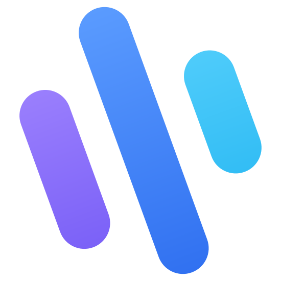

# ReClash

**与互联网保持联系——也与提供它的人保持联系。**

基于 mihomo（Clash Meta）内核的代理客户端，支持 Android、Windows、macOS 和 Linux。
免费、开源、无广告。

[English](README.md) · [Русский](README_ru.md) · **简体中文**

[](https://github.com/Hoxiee/ReClash/releases)
[](https://github.com/Hoxiee/ReClash/releases)
[](LICENSE)

[网站](https://reclash.pages.dev) · [下载](#下载) · [文档](#文档) · [更新日志](CHANGELOG.md) · [从源码构建](#从源码构建)

<a href="https://t.me/ReClashApp"></a>
<a href="https://t.me/+YcBp-q29GIU5ODcy"></a>

新版本会第一时间发布在频道；提问、配置和建议请到群组。

</div>

<p align="center">
  <picture>
    <source media="(prefers-color-scheme: dark)" srcset="snapshots/preview-dark.png">
    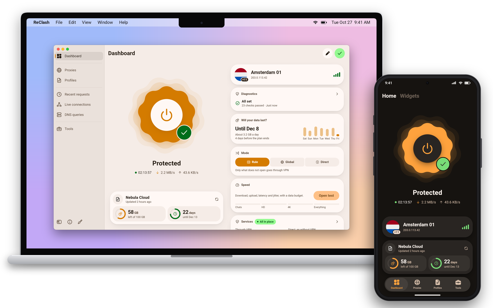
  </picture>
</p>

> [!NOTE]
> ReClash 目前处于预览阶段。在 0.1 版本线稳定之前，版本以 `0.1.0-pre.N` 预发布的形式发布。

## ReClash 替你做什么

- **ChatGPT、Claude 和 Gemini 不会看到错误的国家。** [站点锁定](docs/en/site-lock/README.md)只让指定网站经由你选的出口服务器发出，
  否则不发出，无论模式和规则如何。其余流量照常。
- **打不开？马上知道原因。** 服务检测显示 Google、YouTube、ChatGPT、Netflix 等服务能否通过当前线路打开以及延迟，
  一眼看出是服务器的问题还是网站的问题。
- **流量够不够，提前知道。** 剩余流量和到期时间一目了然，流量预测会告诉你能否撑到周期结束。配置像钱包里的卡片一样叠放。
- **一个按钮，或者全部数据。** 简洁仪表盘只有连接按钮、当前位置和订阅剩余用量；详细仪表盘由小组件组成：
  流量、出口 IP 及其质量、流量预测、测速、诊断、连接和服务检测。
- **在家直连，出门走代理。** 在信任的网络中代理自动暂停，在其他网络中自动恢复。
- **没有广告，没有付费功能。** 免费开源，无需账号或注册。

## 致服务商

你的标志、你的公告、你的用户——保持联系，而不是堆在工单里。订阅响应中的一个 `reclash-config` 头指向一份清单，
客户端就会显示你的标志、主题色、壁纸和连接按钮，你的公告与维护通知、客服与续费链接，以及经用户同意的设置。
不需要 SDK，也不需要自己开发应用。清单可以在[网站](https://reclash.pages.dev)上生成，详见
[服务商接入指南](docs/en/providers/README.md)（英文）。

## 更多

- mihomo（Clash Meta）内核，支持规则分流、代理组、延迟测试、系统代理与 TUN 模式。
- Clash、INCY、Happ 链接、普通代理 URI 和多种配置格式都能直接导入。
- 收藏的服务器排在每个代理组顶部；链式代理经国内入口转到海外出口。
- 配置可通过链接或文件导入，内置编辑器、覆写脚本，以及自定义规则、代理和代理组。
- [自动路由](docs/zh-CN/auto-routing/README.md)（仍在完善中）：智能代理组按你设定的策略切换服务器，
  场景可以按网络设置模式，并把指定的网站交给专门的代理组。
- 实时查看连接、请求、DNS 查询和日志；已知的 DNS 泄漏途径均已封堵。
- 应用内更新，并校验 SHA-256；服务商可以提供带签名的版本镜像。
- 备份与恢复，支持 WebDAV 或本地文件。
- Material You 设计，搭配 Apple 风格的交互：动态取色、浅色与深色主题、连续曲率圆角、可在多个高度间吸附的面板，
  以及从手机到桌面自适应的布局。
- Android：快捷设置磁贴、分应用代理、系统 kill switch、可选的启动器图标和 Android TV。桌面端：托盘菜单和全局快捷键。

## 快速导览

<p align="center">
  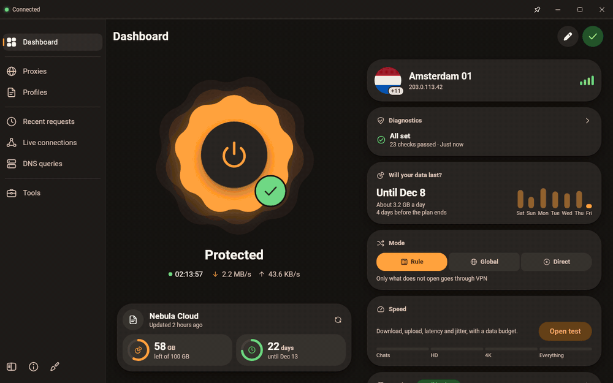
  <br><sub>桌面端：先是普通订阅，再是 Ember Line 和 Halo 各自的服务商外观</sub>
</p>

<p align="center">
  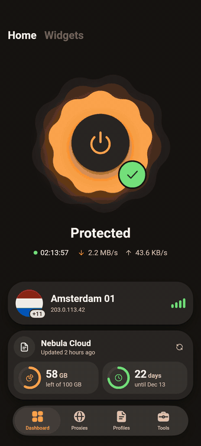
  <br><sub>手机端同样如此</sub>
</p>

截图中的订阅、服务器和地址均为虚构。

<details>
<summary><b>更多截图</b></summary>
<br>

<table>
  <tr>
    <td width="20%" align="center" valign="top"><picture><source media="(prefers-color-scheme: dark)" srcset="snapshots/screens/mobile-dashboard-dark.webp">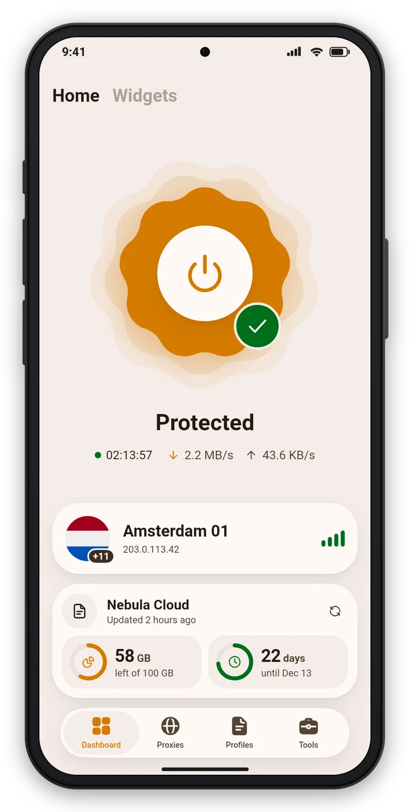</picture><br><sub>一键连接</sub></td>
    <td width="20%" align="center" valign="top">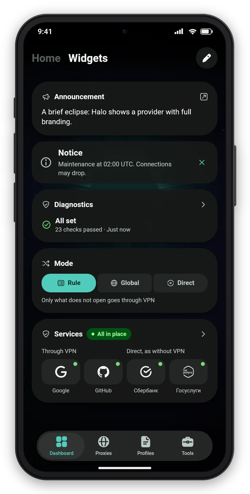<br><sub>服务商公告</sub></td>
    <td width="20%" align="center" valign="top">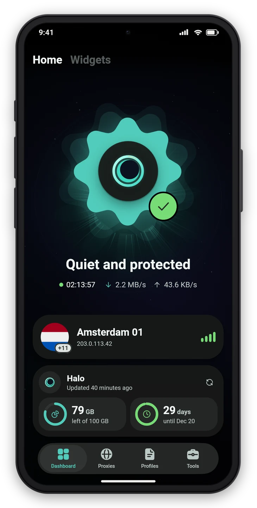<br><sub>服务商的外观</sub></td>
    <td width="20%" align="center" valign="top"><picture><source media="(prefers-color-scheme: dark)" srcset="snapshots/screens/mobile-profiles-dark.webp">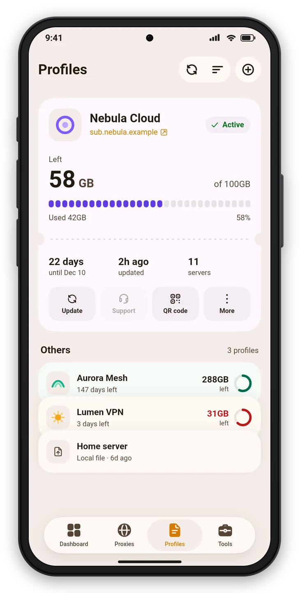</picture><br><sub>卡包式订阅</sub></td>
    <td width="20%" align="center" valign="top"><picture><source media="(prefers-color-scheme: dark)" srcset="snapshots/screens/mobile-proxies-dark.webp">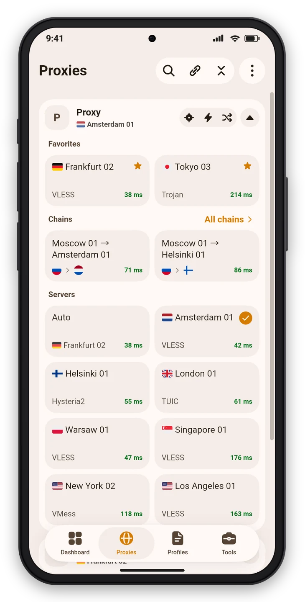</picture><br><sub>收藏与链式代理</sub></td>
  </tr>
</table>

<table>
  <tr>
    <td width="50%" align="center" valign="top">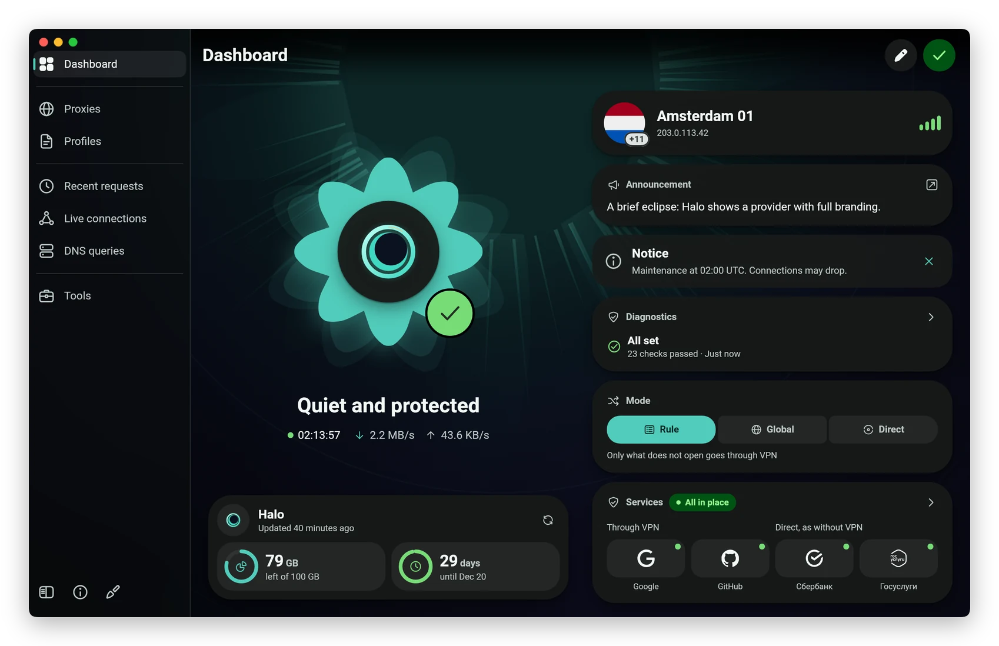<br><sub>桌面端同样有服务商外观</sub></td>
    <td width="50%" align="center" valign="top"><picture><source media="(prefers-color-scheme: dark)" srcset="snapshots/screens/desktop-profiles-dark.webp">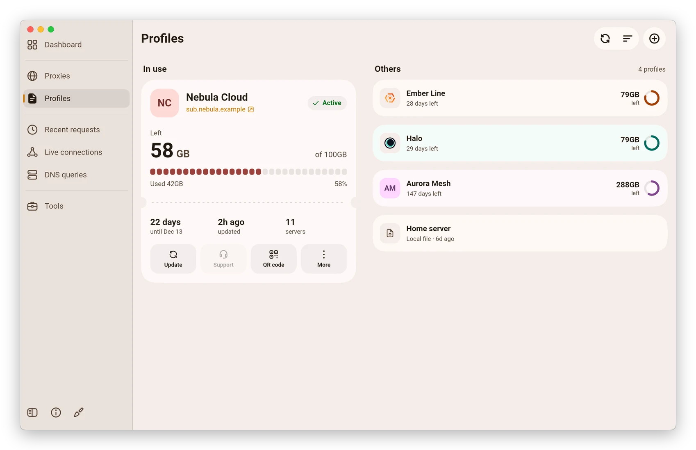</picture><br><sub>所有订阅一目了然</sub></td>
  </tr>
</table>

</details>

## 下载

在 [GitHub Releases](https://github.com/Hoxiee/ReClash/releases) 或[网站](https://reclash.pages.dev)获取最新版本。
每个版本都附带 `SHA256SUMS` 文件，可用来校验下载的文件。

| 平台 | 安装包 | 说明 |
| --- | --- | --- |
| Android 7 及以上 | `arm64-v8a`、`armeabi-v7a`、`x86_64` 的 APK | 大多数手机选 `arm64-v8a`。 |
| Windows 10 及以上 | 安装程序（`-setup.exe`）或便携版 `.zip`，x64 与 ARM64 | 骁龙等 ARM 笔记本请选 ARM64。安装包未经代码签名，SmartScreen 或智能应用控制可能会警告或拦截：在 SmartScreen 中选择“更多信息”→“仍要运行”。 |
| macOS 12 及以上 | Apple 芯片（`arm64`）与 Intel（`amd64`）的 DMG | 非 App Store 版本。开启 TUN 前请将 ReClash 移到 `/Applications`；安装器会拒绝 App Translocation。DMG 可使用 Developer ID 签名；没有该证书时使用自签名或 ad-hoc 签名。首次开启 TUN，以及更新更改内置 Helper/Core（或 ad-hoc 应用可执行文件）时，macOS 会要求输入一次管理员密码以安装或更新本地 launchd Helper，因此 TUN 无需公证。下载的版本仍会被 Gatekeeper 拦截，需在系统设置中“仍要打开”。macOS 15 及以上版本中，右键菜单“打开”不再能绕过 Gatekeeper：先尝试打开一次，然后前往系统设置 → 隐私与安全性 → “仍要打开”。 |
| Linux | x64 与 ARM64 的 `.deb`、`.rpm`、Arch `.pkg.tar.xz`；x64 的 AppImage | 见下方托盘说明。 |

<p>
  <a href="https://github.com/Hoxiee/ReClash/releases"></a>
</p>

ReClash 使用独立的包名和数据目录，可以与 FlClash 并存安装，互不影响。

**Linux 托盘图标。** `.deb` 安装包会自动安装所需依赖。使用 AppImage 或 `.rpm` 时，需要先安装 AyatanaAppIndicator
库，托盘图标才能显示：

```bash
sudo apt-get install libayatana-appindicator3-1   # Debian 与 Ubuntu
sudo dnf install libayatana-appindicator-gtk3     # Fedora
```

**无人值守的桌面环境。** ReClash 要在免责声明被接受后才会启动核心。在容器等无人点击的环境里，可在应用的环境变量中设置
`FLCLASH_ACCEPT_DISCLAIMER=1`，首次启动时即视为接受。

## 使用

**通过链接导入订阅。** 打开下面格式的链接，即可导入订阅。`clash://` 和 `clashmeta://` 开头的链接同样可用，
INCY、Happ 的导入链接以及 `vless://`、`hysteria2://` 等普通代理 URI 也都支持。[网站](https://reclash.pages.dev)
可以根据订阅地址生成这种链接。

```text
reclash://install-config?url=<经过 URL 编码的订阅链接>
```

**用链接控制应用。** `reclash://connect`、`reclash://disconnect` 和 `reclash://toggle` 用于开关代理；
其余链接（包括分享自动路由配置的链接）可在「工具 › URL 方案」中查看。

**Android 自动化。** Tasker、MacroDroid 等应用可以用下面的 Action 启动 Activity，从而启动、停止或切换代理：

```text
com.reclash.action.START
com.reclash.action.STOP
com.reclash.action.TOGGLE
```

在电脑上也可以通过 adb 触发：

```bash
adb shell am start -a com.reclash.action.TOGGLE
```

## 文档

[网站](https://reclash.pages.dev)以英文和俄文发布文档；源文件位于 [`docs/`](docs/en/README.md)。

- [自动路由](docs/zh-CN/auto-routing/README.md)：基本概念、配置、场景、条件与实用示例。
- [站点锁定](docs/en/site-lock/README.md)（英文）：把网站绑定到指定出口服务器，以及各平台能保证到什么程度。
- [服务商支持](docs/en/providers/README.md)与[响应头](docs/en/providers/headers.md)（英文）：订阅服务商可以向应用传达的信息，
  以及如何定制客户端外观。

## 从源码构建

需要 [Flutter](https://docs.flutter.dev/get-started/install) 3.50（正式版构建使用 3.50.1）、[Go](https://go.dev/dl/) 1.27，
以及通过 rustup 安装的 [Rust](https://rustup.rs/)。桌面端需要在对应系统上构建，Android 在任意系统上都能构建。

```bash
git clone --recursive https://github.com/Hoxiee/ReClash.git
cd ReClash
dart setup.dart android   # 或 windows、macos、linux
```

脚本会解析依赖、生成代码，并在 Flutter 构建过程中一并编译 Go 内核和 Rust 库。安装包输出到 `dist/`。

| 平台 | 额外依赖 |
| --- | --- |
| Android | 带 NDK 的 Android SDK。加上 `--arch arm64` 可以只构建单个 ABI。 |
| Windows | 编译内核用的 GCC（MinGW-w64），以及打包安装程序用的 [Inno Setup](https://jrsoftware.org/isinfo.php) 6。 |
| macOS | Xcode 与 Node.js。脚本会通过 npm 安装 `appdmg`。TUN 使用内置 Helper；没有 Developer ID 和 Team ID 时，应用以自签名或 ad-hoc 方式签名，并通过一次管理员密码提示安装 Helper。 |
| Linux | Debian 或 Ubuntu。脚本会用 apt 安装构建所需的软件包，并下载 `appimagetool`。 |

其余选项可以运行 `dart setup.dart --help` 查看，例如用 `--targets` 只构建部分安装包格式。
截图由 `tool/snapshots/render.sh` 根据模拟数据生成。

## 支持

给仓库点一个 Star 是支持项目最简单的方式。更新通知请关注 [Telegram 频道](https://t.me/ReClashApp)，提问与配置帮助请到 [Telegram 群组](https://t.me/+YcBp-q29GIU5ODcy)，
Bug 与功能建议请提交到 [GitHub Issues](https://github.com/Hoxiee/ReClash/issues)。

## 致谢

ReClash 的开发离不开以下项目及其维护者。

**应用**

- [FlClash](https://github.com/chen08209/FlClash)，由 [chen08209](https://github.com/chen08209) 维护，是 ReClash 的项目基础。
- [FlClashX](https://github.com/pluralplay/FlClashX)，由 [pluralplay](https://github.com/pluralplay) 维护，是 ReClash 的起点。
- [mihomo](https://github.com/MetaCubeX/mihomo)，由 [MetaCubeX](https://github.com/MetaCubeX) 维护，是本应用的代理核心。ReClash 随附 [rain-core](https://github.com/Hoxiee/rain-core)，它是 ReClash 的官方 mihomo 内核。
- [Koala Clash](https://github.com/coolcoala/koala-clash)，由 [coolcoala](https://github.com/coolcoala) 维护，是让我认识 mihomo 的客户端。

**内核**

- [ClashFest](https://github.com/Nemu-x/ClashFest)，由 [Nemu-x](https://github.com/Nemu-x) 维护：其中的补丁被移植到内核，带来 Xray 兼容与诊断能力，并保留原补丁编号。
- [Prizrak-Core](https://github.com/legiz-ru/Prizrak-Core)，由 [legiz-ru](https://github.com/legiz-ru) 维护：finalmask、Firefox 指纹、XDRIVE、REALITY 和 Xray 分享链接转换来自这里。
- [veles](https://github.com/Rerowros/veles)、[Citrus](https://github.com/getmikan/Citrus)、[SlothClash](https://github.com/Nemu-x/SlothClash) 和 [Xray-core](https://github.com/XTLS/Xray-core) 是部分补丁的来源；详见 [CREDITS.md](https://github.com/Hoxiee/rain-core/blob/main/CREDITS.md)。

**Remnawave** 是最好的订阅面板，我们也推荐使用。ReClash 与它紧密集成：能读取它的订阅响应头、`x-hwid` 设备标识和订阅页面，并为它的响应规则提供了[现成规则](docs/zh-CN/providers/rollout.md#remnawave)。ReClash 不含 Remnawave 的代码，订阅正文仍是普通 mihomo，其他面板也同样可用。

ReClash 把其他客户端的响应头当作别名读取，而不是移植它们的代码：Happ、INCY、v2RayTun 和 [Karing](https://github.com/KaringX/karing) 的响应头，以及 [3x-ui](https://github.com/MHSanaei/3x-ui) 和 [Marzban](https://github.com/Gozargah/Marzban) 的订阅页面。

ReClash 由独立维护者维护。文中提及其他项目仅用于说明技术来源、兼容性和依赖关系，并不表示这些项目或其维护者认可 ReClash。

完整的依赖列表及其许可证可在应用和仓库中查看。

## 许可证

ReClash 以 [GPL-3.0 协议](LICENSE)发布。
