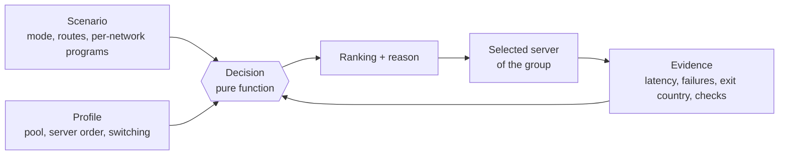

# Auto routing

Auto routing is the part of ReClash that chooses the server for you and keeps choosing it as the network changes.
Internally it is called **RCX**. You describe what a good server is, in a few lines of YAML or with the editor, and
the engine does the measuring, ranking and switching.

This page is the entry point: what auto routing is, a mental model, a glossary, a map of the documentation and a
five-minute YAML quick start.

## What it is

A normal proxy group asks you to pick a server by hand, or tests all of them on a timer and takes the fastest. Both
fail in familiar ways. The hand pick goes stale. The timer burns battery, switches back and forth on a latency
wobble, and condemns every server when the phone merely lost its signal.

Auto routing replaces that with three ideas.

- **A policy you can read.** A *profile* says which servers are acceptable, in what order of preference, and how
  eagerly to switch. It is a short YAML document, not a black box.
- **Evidence before verdicts.** The engine keeps latency, spread, failures and (optionally) the exit country of every
  server, per network. A failure while nothing at all gets through proves nothing and is held back.
- **A decision that explains itself.** Every decision is a pure function of the policy and the evidence. It returns a
  ranking, and that ranking is exactly what the app shows as the explanation of why this server is in use.

On top of that, a *scenario* controls the connection as a whole: the tunnel mode, per-network behaviour, and
*routes* that send chosen sites to their own group.

Auto routing is opt-in per group. A group that carries an `rcx` key is a **smart group**. Vanilla mihomo ignores the
key, so a config stays valid in other clients.

## Mental model



Read it left to right. A **profile** is the rulebook for one group. **Evidence** is what the engine has measured.
The **decision** combines them and produces a ranking with a reason; the winner becomes the group's selected server.
A **scenario** sits above the groups and may swap their rulebooks, for example on mobile data.

Three consequences are worth remembering.

1. The decision is repeatable. The same policy and the same evidence always give the same answer.
2. The engine spends little. It checks servers only when a check can change a decision, and it does so within hourly
   budgets, never with the screen off unless real traffic is failing.
3. You stay in control. Picking a server by hand pins it, and the engine stops moving it.

## Glossary

| Term | Meaning |
| --- | --- |
| Smart group | A `select` proxy group that carries an `rcx` key. The engine owns its selected server. |
| Profile | One YAML policy for one group: pool, server order, ranking, switching, checks. Also called a behaviour. |
| Scenario | A connection-wide document: tunnel mode, per-group programs, per-network overrides and routes. |
| Program | What a scenario gives a group: a `profile`, a narrower `pool`, a `prefer` server order, or a fixed `to`. |
| Route | A traffic match (sites, countries, ports, apps) that gets its own group or a fixed target. Lives in a scenario. |
| Pool | The servers a group may use at all. Layers can only narrow it. |
| Server order, ladder, tiers | The `prefer` list. Each entry is a **step**; the first step with a live server wins. |
| Step | One entry of `prefer`: a label and a condition. |
| Condition | A small expression such as `country = NO and not dead`. See [conditions](conditions.md). |
| Evidence | Measured facts about a server on a network: latency, spread, failures, checks, exit country. |
| Check | A named test a profile defines, for example "does this server open Telegram". |
| Escrow | Holding failures aside while nothing is getting through, so no server is condemned for a dead link. |
| Control | Who decides now: **Auto**, **Pinned** or **Manual**. |
| Layer | Where a rule comes from: built-in, provider or user. Layers only narrow the pool. |
| Consent | The user's approval before a provider profile contacts third-party hosts. |
| Network kind | A label for the current network (for example `cell`, `wifi`, `whitelist`) derived from conditions. |
| Bundle | One file holding several profiles and scenarios, for export and import. |

## Documentation map

Concepts and reference:

| Page | Read it for |
| --- | --- |
| [Engine](engine.md) | How it works end to end: evidence, checks and budgets, escrow, the decision pipeline, control, layers, network kinds, scenarios, routes and the journal. |
| [Profiles](profiles.md) | Reference for every key of a group profile, with the built-in profiles annotated in full. |
| [Conditions](conditions.md) | The condition language: grammar, operators, fields, three-valued logic, regular expressions. |
| [Scenarios](scenarios.md) | Reference for scenario YAML: programs, targets, per-network overrides, routes and every match type. |
| [Sharing](sharing.md) | Bundles, provider delivery, `reclash://` links, the JSON schema and the `rcxlint` tool. |
| [Cookbook](cookbook.md) | Worked recipes, from goal to the finished YAML to what you see in the app. |

The app editor guide:

| Page | Read it for |
| --- | --- |
| [Editor guide](editor/README.md) | Overview of the editor screens. |
| [Hub](editor/hub.md) | The routing hub: the active scenario, groups and status. |
| [Routes](editor/routes.md) | Creating and ordering routes. |
| [Groups](editor/groups.md) | Per-group behaviour, server order and control. |
| [Studio](editor/studio.md) | The text editor with live validation. |
| [Sharing in the app](editor/sharing.md) | Export, import and links from the UI. |
| [Troubleshooting](editor/troubleshooting.md) | Problems the app reports and what to do about them. |

## Quick start in five minutes

This takes you from nothing to a working behaviour with a server order. You need a subscription with a `select`
group and servers whose names carry a country flag or country code.

### 1. Write a profile

A profile is a YAML file. This one prefers Germany, otherwise takes anything that works, and switches calmly.

```yaml
rcx: 1
title: Fast Germany
description: Prefers Germany, falls back to anything that works.
prefer:
  - label: Germany
    when: country = DE
  - label: Anything
    when: not dead
rank:
  by: latency
switch:
  feel: calm
```

Line by line:

- `rcx: 1` is the format version. It is required for documents the engine reads from outside.
- `title` and `description` are what the app shows in the list of behaviours.
- `prefer` is the server order. The engine tries the steps top to bottom and uses the first one that has a live
  server. `country = DE` matches servers in Germany; `not dead` matches every server not known to be down.
- `rank.by: latency` picks the fastest server inside the winning step.
- `switch.feel: calm` makes the engine move rarely: it waits 30 minutes between voluntary switches and wants a clear
  gain before moving.

### 2. Give it to a group

In the app, open the hub, choose the group and select your behaviour (see [Groups](editor/groups.md)). In a
provider subscription, bind it by name (see [Sharing](sharing.md)).

### 3. Add a route (optional)

A route sends some sites to their own group, with their own server order. Routes live in a scenario:

```yaml
rcx: 1
title: Streaming via Germany
groups:
  $main: {}
routes:
  - name: YouTube
    match: [GEOSITE,youtube]
    prefer:
      - label: Germany
        when: country = DE
      - label: Anything
        when: not dead
```

`$main: {}` keeps your main group on its own profile. Routes apply only in rule mode. The engine creates a `select` group named `YouTube` and puts the matching rule in
front of your own rules. Details are in [Scenarios](scenarios.md#routes).

### 4. Check it

Validate any file before importing it:

```text
cd core
go run ./rcx/cmd/rcxlint path/to/file.yaml
```

No output and exit code 0 means the file is accepted. See [Sharing](sharing.md#the-rcxlint-tool).

### 5. Read the explanation

Open the group in the app. The ranking shows each server, its step and why the current one is in use. If something
looks wrong, [Troubleshooting](editor/troubleshooting.md) lists what the app reports.

## Guarantees

The fork contract for auto routing (`.fork/features/routing.auto.yaml`) makes promises that this documentation
repeats where they matter. In short: the decision is a pure function; checks respect energy budgets; failures are
held in escrow while the link is unproven; layers only narrow; a manual pick pins; the fork touches mihomo thinly;
direct split and provider consent stay with the user. [Engine](engine.md#guarantees) lists them in full.
