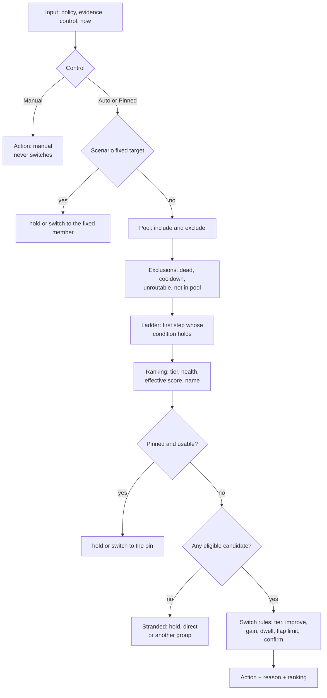
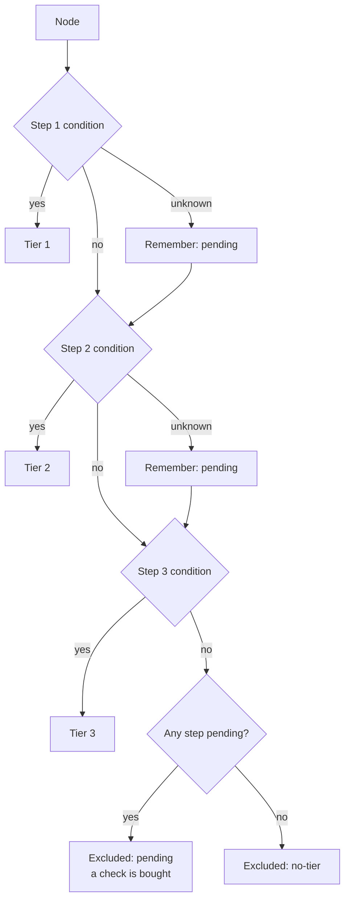
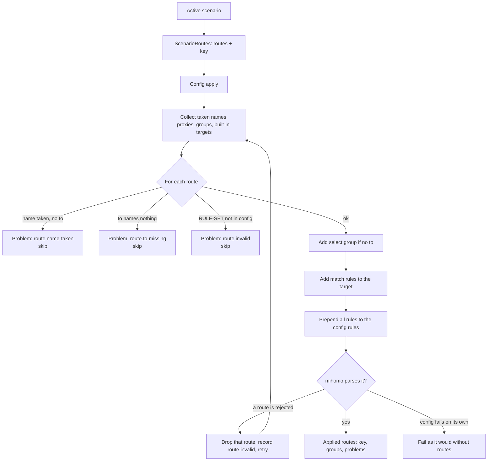

# How the engine works

This page follows one decision from the first measurement to the server the app shows. Reference pages for the
language are [Profiles](profiles.md), [Conditions](conditions.md) and [Scenarios](scenarios.md); this page explains
why the engine behaves as it does.

Contents: [groups](#groups-and-members) · [evidence](#evidence) · [checks and energy](#when-checks-run-and-the-energy-budgets) ·
[escrow](#escrow) · [the decision](#the-decision) · [explanation](#the-explanation-the-app-shows) ·
[control](#control) · [layers](#layers) · [consent](#consent-for-provider-profiles) ·
[network kinds](#network-kinds) · [direct split](#direct-split) · [scenarios](#scenarios) ·
[routes](#routes) · [journal](#the-journal) · [guarantees](#guarantees)

## Groups and members

A **smart group** is a `select` proxy group with an `rcx` key. The engine owns the group's selected server (mihomo
calls it `now`). Every server the group can reach, directly or through a provider, is a **member**. Members keep
their name, their server address and the chain they go through.

Each smart group is driven by exactly one profile. Which one is decided by the group's **binding**:

1. the profile the user chose for this group;
2. otherwise the default the provider declared;
3. otherwise `builtin/simple`.

If the chosen profile is missing, invalid or needs consent, the group does not silently fall back. It runs
`builtin/simple` and shows a visible problem: `profile.missing`, `profile.invalid` or `profile.consent`. A group with
no usable members reports `group.unavailable` or `group.empty`.

## Evidence

Evidence is what the engine knows about a member on a particular network. It is kept per member and per **network
environment** (up to 16 environments, least recently used dropped first), because a server that is fast at home may
be blocked on mobile data.

| Fact | How it is kept |
| --- | --- |
| Latency | The median (p50) of up to 8 recent samples within 6 hours. |
| Spread | p90 minus p50 of the same samples. A wobbly server has a large spread. |
| Episodes | Failures grouped in time, counted over 24 hours (up to 16). |
| Health | `alive`, `stale`, `unknown` or `dead`. |
| Exit country | The country traffic really leaves from, once enough independent sources agree. |
| Entry country | The country of the server's own address. |
| Check results | Pass, fail or soft-fail for each named check of the profile. |

Sources of evidence, from weakest to strongest: a periodic URL test by mihomo, a probe the engine buys itself, and
real traffic that moved through the node. Real traffic is the strongest signal, so it also refreshes health without
any request of its own.

**Freshness.** A sample is fresh for 45 minutes. After the network has been stable for two hours, the engine trusts
samples for 3 hours, because nothing is likely to have changed. Check results are kept for 6 hours.

**Failure needs confirmation.** Three failed dials in 20 seconds make the current node *suspect*, which buys one
confirming check. A passed check is overturned only by a second consecutive failure; until then its result is
simply unknown.

**Exit country.** A profile that mentions `exit.country` makes the engine ask echo services (by default
`https://www.cloudflare.com/cdn-cgi/trace` and `https://ipinfo.io/json`) which country they see. The answer counts
only when `agree` distinct sources (default 2, at most 3) name the same ISO country code. Placeholders such as `XX`,
`T1` and `EU` are rejected. A verified answer lives 24 hours; after a failed lookup the engine retries after 2 hours.
See [`egress-verify`](profiles.md#egress-verify).

**Country by name.** The `country` field uses the verified exit country when there is one, and otherwise reads the
server name: a flag emoji first, then an upper-case ISO code as a whole word, then an English country name or
alias such as `USA`, `UK` or `Korea`. It is never "unknown", so it never costs a check. See
[conditions](conditions.md#country-fields).

## When checks run and the energy budgets

A check costs a request, battery and sometimes the provider's patience. The planner therefore buys a check only when
it can change a decision. Concretely, a check is worth buying for:

- a member whose tier is still *pending* because of unknown facts (a "confirm-better" check);
- a stale current member or stale standbys (maintenance);
- the best stale candidates in a profile that wants to improve (discovery);
- a group with nothing known to work (recovery);
- a suspect current member (a confirming check, paired with the best standby);
- network diagnostics, when a profile or scenario declares them.

### Modes

The machine is always in one mode. The first matching row wins.

| Mode | When | Checks allowed |
| --- | --- | --- |
| Stopped | Core is not running | none |
| Sleep | The device is in Doze | none |
| Background | Screen is off | only recovery after real traffic failed |
| Eco | Metered network, power-save, low battery or running on battery | maintenance and recovery; discovery off; diagnostics once after a network change |
| Active | A use window is open (see below) | all kinds, within the budget |
| Idle | Nothing recent | recovery only, when a group has nothing known to work |

A **use window** opens when real traffic flows (10 seconds) or the network changes (30 seconds). A glance at the
screen does not open it: after a wake, the engine waits a 10-second debounce and a window must open before it checks
anything.

### Budgets

Each kind of check is paid from its own **bucket**, refilled hourly. The allowance depends on the energy level of the
group (`eco`, `balanced`, `precise`; default `balanced`). The engine takes the highest level among its groups, and
any eco signal forces `eco`.

| Level | maintain | discover | recover | network | Standby check interval |
| --- | --- | --- | --- | --- | --- |
| `eco` | 4 | 0 | 12 | 8 | 2 h |
| `balanced` | 10 | 12 | 24 | 12 | 45 min |
| `precise` | 20 | 40 | 40 | 20 | 30 min |

Numbers are requests per hour. On top of that:

- a **daily cap of 20 MiB** applies (6 KiB are charged per probe); only user actions and recovery may spend past it;
- at most **2 checks run at once**, each times out after 5 seconds, and the same member is not probed again within a
  minute;
- **user actions are never rationed**: pressing "Check" in the app uses the user bucket;
- the fork contract guarantees that no check runs with the screen off unless real traffic fails, that nothing runs in
  Doze or sleep, and that simple profiles stay within 30 requests an hour and advanced ones within 80. A simulated
  24-hour day on 250 nodes peaks at about 43 requests an hour for the advanced built-ins.

## Escrow

Escrow is the rule that keeps a dead link from condemning healthy servers.

The engine tracks whether *anything* got through in the last minute (the **link is proven**). A failed probe marks a
node dead only when the link is proven, and only after two consecutive failures. If the link is not proven, the
failure is held, not charged: no node is condemned.

For the current node the engine uses a confirmation round. It sends a check to the suspect node and, together with
it, one to the best standby. If both fail, the network is down, not the node. The journal records
`network.suspect` and the group backs off with 0, 5, 10, 20, 40 minutes between recovery passes. If only the current
node fails, it is marked dead (`failure.confirmed`) and the decision fails over.

After a laptop resumes, the proven state is reset so that the first failures on a new network wait for traffic to
prove the link.

## The decision

The decision is the function `Decide(input) → Decision`. It has no clock of its own and no hidden state: policy,
evidence, control and "now" go in; an action, a reason and a full ranking come out. That is the *pure decision*
guarantee, and it is what makes simulations in the studio trustworthy.

### Step 1: pool

The **pool** is the set of members the group may use. `pool.include` must hold and `pool.exclude` must not.
Conditions over unknown facts *admit* the node, because a pool that excluded on a guess would hide servers. A node
outside the pool is excluded with the code `pool.no-match` or `pool.excluded`. Nodes that cannot carry traffic at all
(reject, pass, direct and DNS types) are excluded as `pool.unroutable`.

### Step 2: exclusions

A member is also excluded when it is `dead`, or on a 15-minute `cooldown` after the user pressed "Change server"
for it. Excluded members stay in the ranking, with the reason, so the explanation is complete.

### Step 3: the ladder

The **ladder** is the profile's `prefer` list. A node lands in the first step whose condition is *yes*. If an earlier
step is *unknown* for the node, the node is marked **pending** (it might belong higher). If no step matches and one
was pending, the node is excluded as `pending`; otherwise as `no-tier`. When no `prefer` is given, there is one step,
"Working", with the condition `not dead`.

**Fall-through.** Because dead nodes are excluded before ranking, a step whose servers are all dead has no
candidates. The ranking then simply contains the next step's nodes first. This is the *ladder* guarantee: a server
order falls through to the next step once every server on a step is down.

**Last resort.** A step marked `last-resort: true` yields to every other step, including steps written below it: when
the profile compiles, last-resort steps move after all the others and keep their relative order. Such a step is also
allowed to be empty without a studio warning.

### Step 4: ranking

Eligible nodes sort by, in order: step number, health (`alive`, `stale`, `unknown`, `dead`), **effective score**,
then name (so the order is deterministic). The score depends on `rank.by`:

| `rank.by` | Score |
| --- | --- |
| `latency` | p50 + spread / 2 + episodes × 50 |
| `stability` | p50 + spread + episodes × 300 |
| unmeasured node | about one million, so it sorts last in its step |

The current node is credited the `rank.tolerance` (milliseconds): a challenger must beat it by more than that to rank
above it. This is the first brake on flapping.

### Step 5: pin and scenario target

Before the switch rules run, two overrides are checked. A scenario program with `to` sets a **fixed** member and
holds the group on it (`hold.fixed`, `switch.fixed`); if the member does not exist the group is stranded
(`fixed.missing`). A user **pin** holds the group on the pinned member (`hold.pinned`, `switch.pinned`) as long as it
exists, is not dead and is not excluded; otherwise the pin is added to the checks wanted and the decision falls back
to auto. A pin also wins over a scenario's fixed target.

### Step 6: stranded

If no candidate is eligible, the group is **stranded**. The profile's `stranded` setting decides the action:

| `stranded` | Result |
| --- | --- |
| `hold` (default) | Keep the current server (`stranded.no-candidates`). |
| `direct` | Switch the group to `DIRECT` (`switch.stranded`), if it has such a member. |
| `group:<name>` | Switch to that member (another group), if present. |

A group whose incumbent is on cooldown reports `hold.no-alternative`.

### Step 7: switch rules

With a candidate in hand, the engine decides whether to move. These checks run in order and the first that applies
gives the reason.

| Situation | Reason |
| --- | --- |
| The group has no current member | `switch.initial` |
| The user pressed "Change server" | `switch.change-server` |
| The current node is dead | `switch.failover` (open connections are closed) |
| The current node left the pool | `switch.out-of-pool` |
| The best is already the current | `hold.best` |
| A better step has a fresh alive check (5 min) | `switch.better-tier` |
| A better step exists but its check is old | `hold.checking`, until the check returns |
| `switch.improve` is false | `hold.working` |
| The challenger is unmeasured | `hold.best` |
| The gain is below the bar | `hold.best` |
| The dwell time has not elapsed | `hold.dwell` |
| The hourly switch limit is reached | `hold.flap-limit` |
| Fewer than `confirm` fresh samples beat the bar | `hold.confirming` |
| Otherwise | `switch.faster` |

The **bar** is `max(min-gain-ms, score × min-gain-pct / 100, tolerance)`. The numbers come from the `feel` preset
unless overridden:

| Feel | dwell | min-gain-ms | min-gain-pct | confirm | max-per-hour |
| --- | --- | --- | --- | --- | --- |
| `calm` | 30m | 60 | 30 | 3 | 2 |
| `balanced` | 10m | 30 | 20 | 2 | 4 |
| `eager` | 2m | 15 | 10 | 2 | 8 |

Failover and "better step" are not subject to dwell or the gain bar. A dead server is always replaced, and a better
step with a fresh alive check is always taken. Performance tuning (`improve`) applies only inside the step the group
already uses.

## The explanation the app shows

The ranking *is* the explanation. Each row carries the member, its step number and label, health, latency, spread,
score, episode count, when it was last checked, whether it is current, why it was excluded (if so), its exit country,
its check results and whether it is pending. The decision adds the action, a reason code and, for a hold, what it is
waiting for (`until.dwell`, `until.check-better-tier`). The app turns the codes into sentences in the user's
language.

Because the same function produces the answer and the rows, the explanation cannot disagree with the behaviour. The
studio can run it on a sample of your nodes without touching anything.

## Control

Each group has a **control**. It decides who may move the selected server.

| Control | Who moves | Behaviour |
| --- | --- | --- |
| Auto | The engine | Full decision pipeline. |
| Pinned | The user | The pinned member stays until it is dead or excluded. "This network only" reverts to Auto on other networks. |
| Manual | The user | The engine never switches and spends no checks on the group. |

A **manual pick in a smart group pins it**. When the user taps a server in the app, the engine records a pin to that
server. Only an explicit "Manual" mode leaves the group entirely alone, and the group then neither switches nor
checks. "Auto" clears a pin. "Change server" excludes the current server for 15 minutes, clears any pin and forces a
switch.

## Layers

A profile can come from three layers, in this order of authority:

1. **Built-in**: shipped with the app (`builtin/...`).
2. **Provider**: from the subscription (`provider/...`).
3. **User**: written or imported by the user (`user/...`).

A bare profile name resolves to `provider/<name>`. Layers *only narrow the pool*. A provider can restrict which
servers a group uses, but cannot widen them. A user's choices replace the provider's (profile, pool, feel, energy and
a `prefer` server order), and a scenario's program beats the user's binding for a group it names. The order of
authority for a server order is therefore **scenario program > user binding > profile**.

Direct split is honoured only from the user layer. A profile that is invalid or unusable is always a visible problem,
never a silent substitution.

`extends` inherits another profile (up to 4 levels): pools join (includes with `and`, excludes with `or`, so they
only narrow), tags merge by name, a child `prefer` replaces the parent's, and a child `feel` resets the other switch
values to the preset. See [Profiles](profiles.md#extends).

## Consent for provider profiles

A provider profile may define checks, diagnostics or echo services. If those contact hosts outside the provider's
registrable domain and the endpoints of the built-in profiles, the profile needs the user's consent. Until then the
group runs `builtin/simple` with the problem `profile.consent` and the app asks which hosts to allow. Allowed hosts
are stored per subscription. The same applies to a provider scenario whose network diagnostics contact third-party
hosts. User-written profiles do not need consent.

## Network kinds

A **network kind** is a label such as `cell`, `wifi` or `whitelist`, computed from conditions by the profile (or the
scenario) so behaviour can differ per network.

- A profile or scenario declares `network.kinds`: a list tried top to bottom; the first whose `when` holds names the
  kind. A kind with `pause: true` holds the group (`hold.paused`) while it applies, for example a captive portal.
- The facts available are `network.kind`, `network.transport`, `network.portal`, `metered`, and **diagnostics**: the
  results of named probes (`home ok`, `foreign fail`).
- A new kind needs **two agreeing rounds** before it takes effect, unless the group had none yet, so a single noisy
  probe does not flip behaviour. A rule that yields unknown leaves the kind undecided.
- The kind is remembered per network and per policy.
- `on.<kind>` blocks (in a profile: pool, prefer, rank, switch, stranded, energy; in a scenario: mode and groups)
  override the base only while that kind is active. Declaring `on.x` without a kind `x` is an error.
- Diagnostics are direct requests that bypass the tunnel, shared by all groups (the same endpoint is asked once).
  They run only while the user is active, or once after a network change in eco, and back off 5, 10 and then 30
  minutes.

## Direct split

Direct split sends local and domestic destinations out directly while the network condition says the tunnel is
pointless or harmful. It is controlled by a condition (`direct-split`) in a profile, for example
`home fail and foreign ok`.

- Only the user turns it on. A provider cannot.
- States: off, standby (condition false) and active (condition true). The first group whose user turned it on and
  whose condition holds supplies the rules.
- Local destinations and the final MATCH rule never leave through the tunnel.

## Scenarios

A scenario sits above the groups. It holds the **tunnel mode**, gives groups **programs**, and may carry **routes**.
Full syntax is in [Scenarios](scenarios.md).

**Mode holding.** The scenario sets the mode (`rule`, `global` or `direct`) only until the user picks one. The
effective mode is the scenario's wish, else the user's mode, else `rule`. A mode the user sets by hand wins until
they press **Auto** again, which returns control to the scenario ("back to auto").

**Idle groups.** A group that the effective mode routes nothing through is idle: no decisions, no checks, reason
`hold.idle`. `GLOBAL` is idle outside global mode, and every group is idle in direct mode.

**Programs per group.** A program targets a group by name, `$main` (the group the final MATCH rule uses), `*` (every
other select group) or `GLOBAL`. A program may replace the profile, narrow the pool, replace the server order or hold
the group on one member with `to`. An exact name beats `$main`, which beats `*`. Groups the scenario does not name
keep their own profile.

**Per-network behaviour.** A scenario has its own network kind (remembered as `scenario:<id>`). When it changes,
bindings are rebuilt, and the `on.<kind>` override replaces the base entry of the same group key whole.

## Routes

A **route** sends traffic that matches a list of rules to its own group. The group is created from the scenario,
not by hand.

### Rules of the game

- Routes are applied **at config apply**, not live. The engine hands the routes to the config builder, which
  appends groups and prepends rules.
- They steer traffic only in **rule mode**. In global or direct mode the routes stay in the scenario but do nothing,
  and the status shows `route.not-rule-mode`.
- A route without `to` becomes one `select` group named after the route, with `include-all: true`. It then is a
  smart group and can carry a program.
- A route with `to` makes no group; its rules go to that target (`DIRECT`, an existing group, a server).
- The rules are **prepended** in route order, so the first route that matches wins and routes win over the config's
  own rules.
- A route never takes over a group the config already has (`route.name-taken`).

### Config-apply flow

If mihomo rejects a particular route's rules or group, only that route is dropped and the parse is retried. If the
failure cannot be traced to a route, every route is marked invalid and the plain config is used, so a bad route can
never break the connection.

### Live changes and the reload flag

The applied routes carry a **key**: a hash of every route's name, match list and `to`. A change to a route's
*program* (its profile, pool or server order) is not in the key, so it applies live without a new config. A change to
a name, a match or a `to` changes the key. The status then reports `reload: true`, and the app performs **one**
debounced re-apply. If a route was rejected, it still counts as applied (the key covers the routes *offered*), so a
rejected route does not cause a reload loop.

### Why these constraints

Routes need real groups and rules inside mihomo's config, which only exist after parsing. Applying them at config
time keeps the fork thin: the engine adds ordinary groups and rules and needs no hook in the router.

## The journal

The engine keeps a ring of the last **200** events, saved with the rest of its state on screen-off, stop and flush.
Entry kinds include `switch`, `stranded`, `change`, `pin`, `auto`, `manual`, `network`, `mode`, `split` and
`failure`. Each entry has a time, the group, the old and new member and a reason code with arguments. The app shows
it as the history of why the server changed; it is the audit trail for "why did my server change at 3 a.m.".

## Guarantees

These come from the fork contract `.fork/features/routing.auto.yaml` and are covered by tests.

| Key | Guarantee |
| --- | --- |
| `pure-decision` | The decision is a pure function of policy, evidence and context, and its explanation is the ranking it decided on. |
| `energy` | No check runs with the screen off unless real traffic fails, nothing runs in Doze or sleep, simple profiles stay within 30 requests an hour and advanced ones within 80. |
| `escrow` | Failures seen while no traffic gets through condemn no node. |
| `layers` | Provider and user layers only narrow a profile's pool; an invalid profile or unusable group is a visible problem, never a silent fallback. |
| `manual-control` | A manual pick in a smart group pins it; manual mode never switches. |
| `thin-fork` | The mihomo fork carries only per-provider health-check suppression, the endpoint fingerprint and the direct-split hook for routing. |
| `direct-split` | Only the user turns direct-split on; local destinations and the final MATCH rule never leave through the tunnel. |
| `consent` | A provider profile contacts hosts beyond its provider's site and the built-in endpoints only after the user allows them; until then its group runs `builtin/simple` and says why. |
| `studio` | Lint, simulation, format and merge are read-only; a profile changes what a group runs only once saved. |
| `profile-text` | A profile carries its own translations; the app shows the user's language and falls back to the source text. |
| `scenario` | A scenario sets the tunnel mode only until the user picks one, and drives only the groups it names; the rest keep their own profile. |
| `routes` | A scenario's routes become groups and rules only at a config apply and steer traffic only in rule mode, never over a group the config already has; a route that cannot apply is a visible problem. |
| `ladder` | A server order falls through to the next step once every server on a step is down; a scenario program's order beats the user's, which beats the profile's. |
| `bundle` | An exported setup carries every non-built-in profile it references, and importing it never replaces a profile the user already has. |
