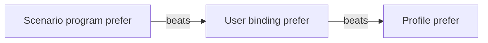

# Scenarios

A **scenario** is auto routing for the connection as a whole. Where a [profile](profiles.md) governs one group, a
scenario can set the tunnel mode, give several groups a program at once, change behaviour per network kind and send
chosen traffic to its own groups with **routes**.

Examples marked `# fragment` are partial. All other examples are complete scenarios that pass
[`rcxlint`](sharing.md#the-rcxlint-tool). Note that `rcxlint` recognises a document as a scenario by a top-level
`groups` or `mode` key; a routes-only scenario therefore needs `groups` (even `groups: { $main: {} }`) to be linted.

Contents: [shape](#shape-of-a-scenario) · [keys](#keys) · [groups and programs](#groups-and-programs) ·
[server-order precedence](#server-order-precedence) · [mode](#mode) · [network kinds](#network-kinds-and-on) ·
[routes](#routes) · [match types](#match-types) · [limits](#limits) · [reserved names](#reserved-names) ·
[errors](#validation-errors) · [tags and l10n](#tags-and-l10n)

## Shape of a scenario

```yaml
rcx: 1
title: Evening streaming
description: Fastest servers for the main group and a Dutch pool for video.
mode: rule
groups:
  $main:
    profile: builtin/fastest
routes:
  - name: Video
    match: [GEOSITE,youtube]
    prefer:
      - label: Netherlands
        when: country = NL
      - label: Anything
        when: not dead
```

A scenario is chosen by the user, or shipped by the provider as the default. Groups it does not name keep their own
profile (the `scenario` guarantee).

## Keys

| Key | Type | Default | Meaning |
| --- | --- | --- | --- |
| `rcx` | integer | 1 | Format version. |
| `title`, `description` | string | none | Shown in the list; translatable through `l10n`. |
| `tags` | map name → condition | none | Named conditions for program pools (max 32). Scenario tags cannot use `tag()`. |
| `network` | `{diagnose, kinds}` | none | Probes and kinds for the scenario's own network behaviour. Same shape as in a profile. |
| `mode` | `rule`, `global`, `direct` | empty | Tunnel mode the scenario wants. Empty leaves the user's mode alone. |
| `groups` | map target → program | none | Programs per group (max 32 entries). |
| `routes` | list of routes | none | Traffic matches with their own groups (max 32). |
| `on` | map kind → `{mode, groups}` | none | Overrides while a network kind is active. Max 8 kinds. |
| `l10n` | map language → strings | none | Translations of title, description and labels. |

A scenario file is at most 64 KiB.

## Groups and programs

`groups` maps a **target** to a **program**.

```yaml
rcx: 1
title: Targets
groups:
  $main: { profile: builtin/fastest }
  '*': { profile: builtin/stable }
  GLOBAL: { to: DIRECT }
  Netflix: { pool: { include: 'country in [NL, DE]' } }
```

### Targets

| Target | Meaning |
| --- | --- |
| a group name | That exact group, for example `Netflix`. Beats `$main` and `*`. |
| `$main` | The `select` group the config's final `MATCH` rule routes to. |
| `*` | Every other `select` group, but never `GLOBAL`. |
| `GLOBAL` | mihomo's built-in `GLOBAL` group, used in global mode. |

Precedence: an exact name wins over `$main`, which wins over `*`. The name of a route group is a valid target by
itself (unless a group of that name already exists in the config); a route's own program does the same job.

### Program keys

| Key | Meaning |
| --- | --- |
| `profile` | A profile id (`builtin/fastest`, `provider/x`, `user/x`). Replaces the group's own profile. |
| `pool` | `{include, exclude}`. Only narrows the group's pool. |
| `prefer` | A server order (list of `{label, when}` steps) that replaces the profile's. |
| `to` | Hold the group on one member: a server, or a nested group such as a load balancer. No search. |

`to` excludes `profile`, `pool` and `prefer` ("to holds one member, so profile, pool and prefer do not apply").
`{}` drives the group with its own profile. A program that has `pool` or `prefer` but no `profile` is validated when
the group runs, because the group's profile is not known until then.

```yaml
rcx: 1
title: Hold and narrow
groups:
  $main:
    pool:
      exclude: name ~ /(?i)test/
    prefer:
      - label: Norway
        when: country = NO
      - label: Anything
        when: not dead
  Backup: { to: DIRECT }
```

## Server-order precedence

For the server order of a group, the highest wins:

1. the scenario program's `prefer` (including an `on.<kind>` program);
2. the user's binding `prefer`;
3. the profile's own `prefer`.



A user can therefore always choose differently for a group the scenario does not name, and a scenario or a
provider-shipped scenario can still give a group a specific order for the time it applies.

## Mode

`mode` sets the tunnel mode. The scenario **holds** the mode only until the user picks one by hand.

- The effective mode is the scenario's wish, else the user's mode, else `rule`.
- Once the user changes the mode, the scenario stops holding it. Choosing **Auto** returns control to the scenario.
- A group that the effective mode routes nothing through is idle (reason `hold.idle`): `GLOBAL` outside global mode,
  and every group in direct mode.

Routes steer traffic only in rule mode. If the effective mode is not `rule` while the scenario has routes, the
status shows `route.not-rule-mode`.

## Network kinds and `on`

The scenario can classify the network with `network.kinds` (and `network.diagnose`) exactly like a profile, then
override per kind with `on.<kind>`. Each `on.<kind>` can set `mode` and `groups`. A group entry under `on.<kind>`
**replaces** the base entry for the same key whole; other base entries still apply. Using `on.x` without declaring
kind `x` is an error.

```yaml
rcx: 1
title: Calm on mobile
description: Fastest on Wi-Fi, stable on mobile data.
network:
  kinds:
    - { kind: cell, when: 'network.transport = cellular' }
groups:
  $main: { profile: builtin/fastest }
on:
  cell:
    groups:
      $main: { profile: builtin/stable }
```

A scenario remembers its kind per network (`scenario:<id>`). When it changes, the bindings are rebuilt. A new kind
needs two agreeing rounds, as for profiles.

## Routes

`routes` is an ordered list. A route has a `name`, an optional `description` (max 240 bytes), a `match` list, and a
program inline: `profile` (default `builtin/simple`), `pool`, `prefer`, or `to`.

```yaml
rcx: 1
title: Work and play
groups:
  $main: {}
routes:
  - name: Chat
    description: Messengers through a nearby server.
    match: [GEOSITE,telegram]
    prefer:
      - label: Finland
        when: country = FI
      - label: Anything
        when: not dead
  - name: Government
    match: [GEOSITE,category-gov-ru]
    to: DIRECT
```

- A route **without `to`** becomes a `select` group named after the route, with `include-all: true`. It is then a
  smart group driven by the route's own program.
- A route **with `to`** makes no group. Its rules go to that target: `DIRECT`, `REJECT`, an existing group or a
  server.
- Rules are **prepended** to the config's rules, in route order. The first route that matches wins.
- Routes apply at **config apply**, in **rule mode** only. See [the engine](engine.md#routes) for the flow, the
  `reload` flag and the one re-apply.
- Because a route's program is not part of the applied key, changing a route's `profile`, `pool` or `prefer` applies
  live. Changing a route's `name`, `match` or `to` triggers one re-apply.

### Writing `match`

Entries are mihomo rule heads **without** the target. The usual form is a string `"TYPE,value"` per list item. A YAML
flow list also works, because `[GEOSITE,youtube]` is read as the two items `GEOSITE` and `youtube`; the engine joins
a type with the payload that follows it, and absorbs a following `no-resolve`.

```yaml
rcx: 1
title: Match forms
groups:
  $main: {}
routes:
  - name: Block style
    match:
      - GEOSITE,youtube
      - DOMAIN-SUFFIX,anthropic.com
    to: DIRECT
  - name: Flow style
    match: [GEOSITE,telegram, GEOIP,RU,no-resolve]
    to: DIRECT
```

Quote entries that contain YAML syntax characters.

### Match types

| Type | Payload | Example | `no-resolve` |
| --- | --- | --- | --- |
| `DOMAIN` | exact host | `DOMAIN,www.example.com` | no |
| `DOMAIN-SUFFIX` | domain and subdomains | `DOMAIN-SUFFIX,example.com` | no |
| `DOMAIN-KEYWORD` | substring of the host | `DOMAIN-KEYWORD,video` | no |
| `DOMAIN-WILDCARD` | host with `*` and `?` | `DOMAIN-WILDCARD,*.cdn.example.com` | no |
| `DOMAIN-REGEX` | regular expression (whole rest of the entry, commas allowed) | `DOMAIN-REGEX,^api[0-9]+\.example\.com$` | no |
| `GEOSITE` | category in `GEOSITE.dat` | `GEOSITE,youtube` | no |
| `GEOIP` | ISO country code | `GEOIP,RU` | yes |
| `IP-CIDR` | IPv4 range | `IP-CIDR,10.0.0.0/8` | yes |
| `IP-CIDR6` | IPv6 range | `IP-CIDR6,fd00::/8` | yes |
| `IP-ASN` | autonomous system number | `IP-ASN,13335` | yes |
| `SRC-IP-CIDR` | client address range | `SRC-IP-CIDR,192.168.1.50/32` | no |
| `DST-PORT` | port or range, several with `/` | `DST-PORT,443` or `DST-PORT,8000-8100` | no |
| `PROCESS-NAME` | executable name | `PROCESS-NAME,firefox` | no |
| `PROCESS-PATH` | full executable path | `PROCESS-PATH,/usr/bin/curl` | no |
| `RULE-SET` | name of a rule provider already in the config | `RULE-SET,my-ads` | yes |

`no-resolve` makes mihomo skip DNS for that rule; use it on address rules when the destination is usually a name.
It is rejected on other types ("takes no option").

`RULE-SET` needs the rule provider to exist in the config; if it does not, that route is skipped with a problem
(`route.invalid`: "rule set X is not in the config"). `GEOSITE` needs the category to exist in the geosite database the app ships (`assets/data/GEOSITE.dat`); the editor
does not check this for you, so test the route after adding it.

```yaml
rcx: 1
title: Every match type
groups:
  $main: {}
routes:
  - name: Domains
    match:
      - DOMAIN,www.example.com
      - DOMAIN-SUFFIX,example.org
      - DOMAIN-KEYWORD,videocdn
      - DOMAIN-WILDCARD,*.static.example.net
      - DOMAIN-REGEX,^api[0-9]+\.example\.com$
    to: DIRECT
  - name: Lists
    match:
      - GEOSITE,youtube
      - GEOIP,RU,no-resolve
    to: DIRECT
  - name: Addresses
    match:
      - IP-CIDR,10.0.0.0/8,no-resolve
      - IP-CIDR6,fd00::/8,no-resolve
      - IP-ASN,13335,no-resolve
      - SRC-IP-CIDR,192.168.1.50/32
    to: DIRECT
  - name: Ports and apps
    match:
      - DST-PORT,8000-8100
      - DST-PORT,22/2222
      - PROCESS-NAME,firefox
      - PROCESS-PATH,/usr/bin/curl
    to: DIRECT
```

## Limits

| Limit | Value |
| --- | --- |
| Scenario size | 64 KiB |
| Programs in `groups` | 32 |
| Target name | 64 characters |
| Routes | 32 |
| Match entries per route | 128 |
| Route name | 64 bytes |
| Route description | 240 bytes |
| Tiers in a program's `prefer` | 16 |
| Tags | 32 |
| Network kinds / `on` entries | 8 |

## Reserved names

A route name cannot be: `$main`, `*`, `GLOBAL`, `DIRECT`, `REJECT`, `REJECT-DROP`, `PASS`, `COMPATIBLE`. It also must
be non-empty, unique among the routes, free of commas and control characters, and not also used under `groups`
(a route takes its program on the route).

At apply time a route whose name is already a proxy or group in the config is skipped (`route.name-taken`). A route
whose `to` names nothing is skipped (`route.to-missing`).

## Validation errors

Errors carry a path to the offending item. Typical messages:

| Path | Message |
| --- | --- |
| `routes.2.match.0` | `GEOSITE needs a value`, `"X" is not a match type a route can use`, `IP-CIDR "x" is not an address range like 10.0.0.0/8` |
| `routes.1.name` | `two routes are named X`, `route name "X" is reserved`, `route X takes its program on the route, not under groups` |
| `groups.$main` | `to holds one member, so profile, pool and prefer do not apply` |
| `on.cell` | `the scenario declares no network kind cell` |
| `mode` | `mode "x" is not rule, global or direct` |

Problems found only at apply time are shown in the scenario status instead: `route.name-taken`, `route.to-missing`,
`route.invalid` and `route.not-rule-mode`.

## Tags and l10n

`tags` define named conditions for `pool` and `prefer` inside programs:

```yaml
rcx: 1
title: Starred only
tags:
  star: 'name ~ /\*/'
groups:
  $main:
    pool:
      include: tag(star)
```

`l10n` translates `title`, `description` and step labels like a profile's:

```yaml
rcx: 1
title: Work
groups:
  $main: {}
l10n:
  ru:
    Work: Работа
```
