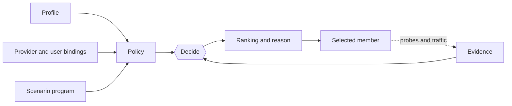

# Auto routing

RCX is the ReClash server-selection engine: smart groups pick their own server by profile, and a scenario steers the whole connection.

## Model

RCX works on the select groups of the running config. Selection never changes a group's members: the engine picks one as a manual tap would, and records why. Only scenario routes add groups and rules, at config apply.

| Object | What it is | Where it comes from |
| --- | --- | --- |
| Smart group | A select group whose member the engine chooses. | A binding from the subscription, the user or the running scenario. |
| Profile | How one group chooses: pool, tiers, ranking, switching, checks, network kinds. | Built in, provider, or user. |
| Scenario | Whole-connection behavior: group programs, routes, tunnel mode per network kind. | Same three sources; one per subscription. |
| Route | Rules placed before the config's rules; matched traffic goes to its own group, an existing target, or `DIRECT`. | The running scenario, at config apply. |
| Evidence | Per-server latency samples, failures, check results and exit country. | Probes, URL tests and real traffic. |



A group's policy is its profile plus the bindings and scenario program. The decision is a pure function of policy,
evidence and context; its explanation is the ranking it decided on. See [Engine](engine.md).

### Profile and scenario

| | Profile | Scenario |
| --- | --- | --- |
| Scope | One group | The connection |
| Chooses | A server among the group's members | Profile, pool, order or fixed member per named group; tunnel mode |
| Network kinds | `on.<kind>` changes the profile's tiers, rank, switching, pool, stranded and energy | `on.<kind>` replaces group programs and the mode |
| Adds rules | No | Yes, via `routes` (rule mode only) |
| Reference | [Profiles](profiles.md) | [Scenarios](scenarios.md) |

A group the running scenario does not name keeps its binding. With no binding and no program, it is a plain selector.

### Identifiers

Profiles and scenarios have separate namespaces, keyed as `<source>/<name>`.

| Source | Prefix | Editable |
| --- | --- | --- |
| Built in | `builtin/` | No; edits go to a copy. |
| Subscription provider | `provider/` | No; edits go to a copy. A bare `fast` means `provider/fast`. |
| User | `user/` | Yes. Profiles are shared by all subscriptions; the user layer (bindings, scenario, allowed hosts) belongs to one subscription. |

## Built-in profiles and scenarios

| Id | Level | Behavior |
| --- | --- | --- |
| `builtin/simple` | simple | One tier `not dead`; latency rank, tolerance 50; `improve: false`, feel calm. Default for groups without a usable profile. |
| `builtin/fastest` | simple | Latency rank, tolerance 20; `improve: true`, feel balanced. |
| `builtin/stable` | simple | Stability rank, tolerance 100; `improve: true`, feel calm. |
| `builtin/from-list` | simple | `extends: builtin/simple`; for hand-picked servers, which get pinned. |
| `builtin/bypass-ru` | advanced | Tiers: passes `open` (`https://api.telegram.org/`) with a non-RU exit; any non-RU exit; any working server last. Kinds `portal` (paused) and `open`; direct split on `home fail and foreign ok`. |
| `builtin/bypass-ir`, `builtin/bypass-cn` | advanced | Same tiers for IR and CN, checked on `youtube.com` and `google.com` `generate_204`; kind `portal` only. |
| `builtin/whitelist-ru` | advanced | Extends `bypass-ru`; adds tag `bypass` and kind `whitelist` (`home ok and foreign fail`); `bypass` servers first. |
| `builtin/every-group` (scenario) | — | `groups: {'*': {}}`: every select group except `GLOBAL` becomes smart with its binding's profile. The app runs it when auto routing is turned on and no scenario was chosen. |
| `builtin/whitelist-ru` (scenario) | — | `$main` runs `bypass-ru` without `bypass` servers; on kind `whitelist` the mode becomes global and `GLOBAL` runs `simple` over `bypass` servers. |

## Glossary

| Term | Meaning |
| --- | --- |
| Binding | Attaches a profile to a group: `profile`, `default`, `pool`, `prefer`, `feel`, `energy`, `chips`. See [Bindings](profiles.md#bindings). |
| Program | Scenario action on one group: `profile`, `pool`, `prefer` or `to`. |
| Pool | Members a group may choose from, after `include` and `exclude`. |
| Tier | One `prefer` entry: a label and a condition; in the app, a server-order step. |
| Last resort | A tier used only when no other tier has a working server. |
| Tolerance | Ranking bonus in milliseconds for the current server, against flapping. |
| Stranded | No eligible member; `stranded` says what to do. |
| Network kind | Named network class (`portal`, `whitelist`, …) recognized by network conditions. |
| Diagnostic | Direct device probe, outside the tunnel, that recognizes network kinds. |
| Check | Request through a server to see whether it opens something (`passes(id)`). |
| Exit country | Country a server's traffic leaves from, agreed by independent sources. |
| Direct split | Routing `DIRECT`-matched connections through a smart group while direct access is broken. |
| Control | Auto, pinned or manual, per group. |
| Journal | The last 200 engine events: switches, failures, control, network, mode and direct-split changes. |

## Minimal example

```yaml title="nearest.rcx.yaml"
rcx: 1
title: Nearest working
prefer:
  - { label: Fast, when: 'latency < 150ms' }
  - { label: Any, when: 'not dead' }
rank: { by: latency, tolerance: 30 }
switch: { improve: true, feel: balanced }
```

The group takes a server under 150 ms if one is measured, else any working server, and switches to a faster one only past
the `balanced` thresholds. Import it in the app or serve it from a subscription; see [Sharing](sharing.md).
