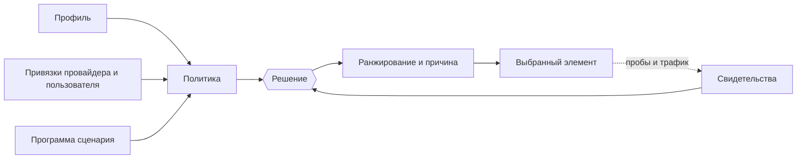

# Автомаршрутизация

RCX — движок выбора серверов ReClash: умные группы сами выбирают сервер по профилю, а сценарий управляет всем подключением.

## Модель

RCX работает с группами-селекторами текущего конфига. Выбор никогда не меняет состав группы: движок выбирает элемент так же, как ручное нажатие, и записывает причину. Группы и правила добавляют только маршруты сценария при применении конфига.

| Объект | Что это | Откуда берётся |
| --- | --- | --- |
| Умная группа | Группа-селектор, элемент которой выбирает движок. | Привязка от подписки, пользователя или работающего сценария. |
| Профиль | Как выбирает одна группа: пул, уровни, ранжирование, переключения, проверки, типы сетей. | Встроенный, от провайдера или от пользователя. |
| Сценарий | Поведение всего подключения: программы групп, маршруты, режим туннеля по типам сетей. | Те же три источника; на подписку — один. |
| Маршрут | Ставит правила перед правилами конфига; совпавший трафик идёт в свою группу, существующую цель или `DIRECT`. | Работающий сценарий, при применении конфига. |
| Свидетельства | Замеры задержки, сбои, результаты проверок и страна выхода по каждому серверу. | Пробы, URL-тесты и реальный трафик. |



Политика группы — её профиль плюс привязки и программа сценария. Решение — чистая функция политики, свидетельств и контекста;
его объяснение — ранжирование, по которому оно принято. См. [Движок](engine.md).

### Профиль и сценарий

| | Профиль | Сценарий |
| --- | --- | --- |
| Область | Одна группа | Подключение |
| Выбирает | Сервер среди элементов группы | Профиль, пул, порядок или фиксированный элемент для каждой названной группы; режим туннеля |
| Типы сетей | `on.<kind>` меняет собственные уровни, ранжирование, переключения, пул, `stranded` и `energy` профиля | `on.<kind>` заменяет программы групп и режим |
| Добавляет правила | Нет | Да, через `routes` (только в режиме правил) |
| Справочник | [Профили](profiles.md) | [Сценарии](scenarios.md) |

Группа, которую сценарий не называет, сохраняет свою привязку. Без привязки и программы группа — обычный селектор.

### Идентификаторы

Профили и сценарии имеют отдельные пространства имён; ключ — `<source>/<name>`.

| Источник | Префикс | Можно менять |
| --- | --- | --- |
| Встроенный | `builtin/` | Нет; правки идут в копию. |
| Провайдер подписки | `provider/` | Нет; правки идут в копию. Голое `fast` означает `provider/fast`. |
| Пользователь | `user/` | Да. Профили общие для всех подписок; пользовательский слой (привязки, сценарий, разрешённые узлы) принадлежит одной подписке. |

## Встроенные профили и сценарии

| Id | Уровень | Поведение |
| --- | --- | --- |
| `builtin/simple` | simple | Один уровень `not dead`; ранжирование по задержке, допуск 50; `improve: false`, характер calm. По умолчанию для групп без пригодного профиля. |
| `builtin/fastest` | simple | Ранжирование по задержке, допуск 20; `improve: true`, характер balanced. |
| `builtin/stable` | simple | Ранжирование по стабильности, допуск 100; `improve: true`, характер calm. |
| `builtin/from-list` | simple | `extends: builtin/simple`; для серверов, выбранных вручную, которые закрепляются. |
| `builtin/bypass-ru` | advanced | Уровни: проходит `open` (`https://api.telegram.org/`) с выходом не из RU; любой выход не из RU; любой рабочий сервер последним. Типы `portal` (пауза) и `open`; прямой обход при `home fail and foreign ok`. |
| `builtin/bypass-ir`, `builtin/bypass-cn` | advanced | Те же уровни для IR и CN, проверки `generate_204` на `youtube.com` и `google.com`; только тип `portal`. |
| `builtin/whitelist-ru` | advanced | Расширяет `bypass-ru`; добавляет тег `bypass` и тип `whitelist` (`home ok and foreign fail`); серверы `bypass` идут первыми. |
| `builtin/every-group` (сценарий) | — | `groups: {'*': {}}`: каждая группа-селектор, кроме `GLOBAL`, становится умной с профилем своей привязки. Приложение запускает его при включении автомаршрутизации, если сценарий не выбран. |
| `builtin/whitelist-ru` (сценарий) | — | `$main` работает на `bypass-ru` без серверов `bypass`; при типе `whitelist` режим становится global, а `GLOBAL` работает на `simple` поверх серверов `bypass`. |

## Глоссарий

| Термин | Значение |
| --- | --- |
| Привязка | Прикрепляет профиль к группе: `profile`, `default`, `pool`, `prefer`, `feel`, `energy`, `chips`. См. [Привязки](profiles.md#bindings). |
| Программа | Действие сценария над одной группой: `profile`, `pool`, `prefer` или `to`. |
| Пул | Элементы, из которых группа может выбирать, после `include` и `exclude`. |
| Уровень | Одна запись `prefer`: метка и условие; в приложении — шаг порядка серверов. |
| Запасной уровень | Уровень, который используется, только если ни на одном другом нет рабочего сервера. |
| Допуск | Бонус текущему серверу при ранжировании, в миллисекундах; против метаний. |
| Безвыходное положение | Ни один элемент не подходит; `stranded` говорит, что делать. |
| Тип сети | Именованный класс сети (`portal`, `whitelist`, …), распознаваемый по сетевым условиям. |
| Диагностика | Прямая проба с устройства мимо туннеля, которая распознаёт типы сетей. |
| Проверка | Запрос через сервер, чтобы узнать, открывает ли он что-то (`passes(id)`). |
| Страна выхода | Страна, из которой выходит трафик сервера, согласованная независимыми источниками. |
| Прямой обход | Направление соединений с явным правилом `DIRECT` через умную группу, пока прямой доступ сломан. |
| Управление | Авто, закрепление или вручную, для каждой группы. |
| Журнал | Последние 200 событий движка: переключения, сбои, управление, сеть, режим и изменения прямого обхода. |

## Минимальный пример

```yaml title="nearest.rcx.yaml"
rcx: 1
title: Nearest working
prefer:
  - { label: Fast, when: 'latency < 150ms' }
  - { label: Any, when: 'not dead' }
rank: { by: latency, tolerance: 30 }
switch: { improve: true, feel: balanced }
```

Группа берёт сервер быстрее 150 мс, если такой измерен, иначе любой рабочий, и переходит на более быстрый только за порогами
`balanced`. Импортируйте профиль в приложении или раздайте его из подписки; см. [Обмен](sharing.md).
