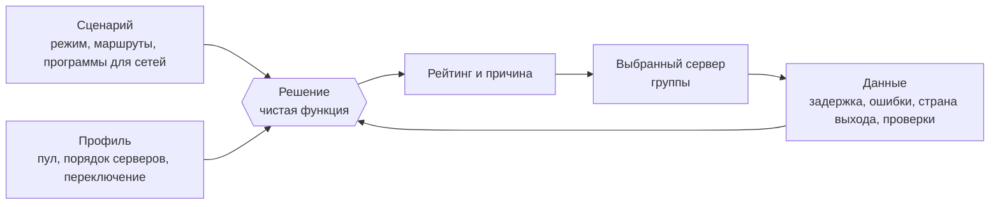

# Автоматическая маршрутизация

Автоматическая маршрутизация — часть ReClash, которая сама выбирает сервер и продолжает подбирать его при изменении сети. Внутри проекта она называется **RCX**. Опишите, каким должен быть хороший сервер, в нескольких строках YAML или с помощью редактора — движок выполнит измерения, ранжирование и переключение.

Эта страница служит отправной точкой: здесь объясняется, что такое автоматическая маршрутизация, приводятся ментальная модель, глоссарий, карта документации и быстрый пятиминутный старт с YAML.

## Что это такое

Обычная proxy-группа предлагает выбрать сервер вручную либо периодически проверяет все серверы и выбирает самый быстрый. Оба варианта имеют знакомые недостатки. Ручной выбор устаревает. Периодические проверки расходуют батарею, вызывают переключения туда-сюда из-за колебаний задержки и объявляют все серверы неисправными, если у телефона просто пропал сигнал.

Автоматическая маршрутизация опирается на три идеи.

- **Понятная политика.** *Профиль* описывает, какие серверы подходят, в каком порядке их предпочитать и насколько охотно переключаться. Это короткий YAML-документ, а не чёрный ящик.
- **Сначала данные, затем решение.** Движок хранит для каждого сервера и каждой сети задержку, разброс, ошибки и (опционально) страну выхода. Если ничего не проходит, отдельный сбой не считается доказательством и откладывается.
- **Объяснимое решение.** Решение — чистая функция политики и накопленных данных. Она возвращает рейтинг, который приложение показывает как объяснение выбора текущего сервера.

Поверх этого *сценарий* управляет подключением целиком: режимом туннеля, поведением в разных сетях и *маршрутами*, отправляющими выбранные сайты в отдельные группы.

Автоматическую маршрутизацию нужно включать отдельно для каждой группы. Группа с ключом `rcx` называется **умной группой**. Обычный mihomo игнорирует этот ключ, поэтому конфигурация остаётся допустимой и в других клиентах.

## Ментальная модель



Читайте схему слева направо. **Профиль** — набор правил для одной группы. **Данные** — измерения движка. **Решение** объединяет их и формирует рейтинг с объяснением; сервер-победитель становится выбранным сервером группы. **Сценарий** находится над группами и может менять их правила, например при переходе на мобильную сеть.

Важно помнить о трёх последствиях.

1. Решение воспроизводимо: одинаковые политика и данные всегда дают одинаковый результат.
2. Движок экономно расходует ресурсы. Он проверяет серверы только тогда, когда проверка может повлиять на решение, соблюдает часовые лимиты и не проверяет серверы при выключенном экране, если только реальный трафик не перестал проходить.
3. Вы сохраняете контроль. Ручной выбор закрепляет сервер, и движок прекращает его менять.

## Глоссарий

| Термин | Значение |
| --- | --- |
| Умная группа | Proxy-группа `select` с ключом `rcx`. Движок управляет выбранным в ней сервером. |
| Профиль | Политика YAML для одной группы: пул, порядок серверов, ранжирование, переключение и проверки. Также называется поведением. |
| Сценарий | Документ для всего подключения: режим туннеля, программы групп, переопределения для разных сетей и маршруты. |
| Программа | То, что сценарий назначает группе: `profile`, более узкий `pool`, порядок серверов `prefer` или фиксированная цель `to`. |
| Маршрут | Совпадение по трафику (сайты, страны, порты, приложения), которому назначается отдельная группа или фиксированная цель. Маршруты находятся в сценарии. |
| Пул | Серверы, которыми группа может пользоваться. Каждый уровень может только сузить пул. |
| Порядок серверов, лестница, уровни | Список `prefer`. Каждая запись — **шаг**; выбирается первый шаг с доступным сервером. |
| Шаг | Одна запись `prefer`: метка и условие. |
| Условие | Простое выражение, например `country = NO and not dead`. См. [условия](conditions.md). |
| Данные | Измеренные сведения о сервере в сети: задержка, разброс, ошибки, проверки, страна выхода. |
| Проверка | Именованный тест профиля, например «может ли этот сервер открыть Telegram». |
| Отложенные сбои | Сбои временно удерживаются, пока соединение не проверено, чтобы не признать сервер неисправным из-за отключённого соединения. |
| Управление | Кто сейчас принимает решение: **Auto**, **Закреплено** или **Вручную**. |
| Уровень | Источник правила: встроенный, провайдер или пользователь. Каждый уровень может только сузить пул. |
| Согласие | Разрешение пользователя до того, как профиль провайдера свяжется со сторонними узлами. |
| Тип сети | Метка текущей сети (например, `cell`, `wifi`, `whitelist`), определённая условиями. |
| Пакет | Один файл с несколькими профилями и сценариями для экспорта и импорта. |

## Карта документации

Понятия и справочник:

| Страница | Что на ней описано |
| --- | --- |
| [Движок](engine.md) | Полный цикл работы: данные, проверки и лимиты, отложенные сбои, конвейер решений, управление, уровни, типы сетей, сценарии, маршруты и журнал. |
| [Профили](profiles.md) | Справочник всех ключей профиля группы с подробным описанием встроенных профилей. |
| [Условия](conditions.md) | Язык условий: грамматика, операторы, поля, трёхзначная логика и регулярные выражения. |
| [Сценарии](scenarios.md) | Справочник YAML сценариев: программы, цели, сетевые переопределения, маршруты и типы совпадений. |
| [Обмен](sharing.md) | Пакеты, доставка провайдером, ссылки `reclash://`, JSON-схема и инструмент `rcxlint`. |
| [Примеры](cookbook.md) | Готовые рецепты: от задачи до YAML и результата в приложении. |

Руководство по редактору приложения:

| Страница | Что на ней описано |
| --- | --- |
| [Руководство редактора](editor/README.md) | Обзор экранов редактора. |
| [Центр маршрутизации](editor/hub.md) | Активный сценарий, группы и статус. |
| [Маршруты](editor/routes.md) | Создание маршрутов и изменение их порядка. |
| [Группы](editor/groups.md) | Поведение групп, порядок серверов и управление. |
| [Студия](editor/studio.md) | Текстовый редактор с проверкой в реальном времени. |
| [Обмен в приложении](editor/sharing.md) | Экспорт, импорт и ссылки в интерфейсе. |
| [Устранение неполадок](editor/troubleshooting.md) | Сообщения приложения и способы их устранения. |

## Быстрый старт за пять минут

Создадим поведение с порядком серверов с нуля. Нужна подписка с группой `select` и серверами, в названиях которых указаны флаги стран или коды стран.

### 1. Создайте профиль

Профиль — YAML-файл. В примере сначала выбирается Германия, затем любой работающий сервер; переключения выполняются плавно.

```yaml
rcx: 1
title: Fast Germany
description: Prefers Germany, falls back to anything that works.
prefer:
  - label: Germany
    when: country = DE
  - label: Anything
    when: not dead
rank:
  by: latency
switch:
  feel: calm
```

Разбор по строкам:

- `rcx: 1` — версия формата. Она обязательна в документах, которые читает движок.
- `title` и `description` отображаются в списке поведений приложения.
- `prefer` задаёт порядок серверов. Движок проверяет шаги сверху вниз и выбирает первый, в котором есть доступный сервер. `country = DE` соответствует серверам Германии, а `not dead` — серверам, которые не признаны неисправными.
- `rank.by: latency` выбирает сервер с наименьшей задержкой внутри подходящего шага.
- `switch.feel: calm` задаёт редкие переключения: движок ждёт 30 минут между добровольными переключениями и требует заметного улучшения.

### 2. Назначьте профиль группе

В приложении откройте центр маршрутизации, выберите группу и назначьте поведение (см. [Группы](editor/groups.md)). В подписке провайдера привязка задаётся по имени (см. [Обмен](sharing.md)).

### 3. Добавьте маршрут (необязательно)

Маршрут отправляет некоторые сайты в отдельную группу со своим порядком серверов. Маршруты задаются в сценарии:

```yaml
rcx: 1
title: Streaming via Germany
groups:
  $main: {}
routes:
  - name: YouTube
    match: [GEOSITE,youtube]
    prefer:
      - label: Germany
        when: country = DE
      - label: Anything
        when: not dead
```

`$main: {}` оставляет основную группу на её собственном профиле. Маршруты работают только в режиме `rule`. Движок создаёт группу `select` с именем `YouTube` и ставит совпадающее правило перед вашими правилами. Подробности — в разделе [Сценарии](scenarios.md#маршруты).

### 4. Проверьте файл

Перед импортом проверьте любой файл:

```text
cd core
go run ./rcx/cmd/rcxlint path/to/file.yaml
```

Отсутствие вывода и код завершения 0 означают, что файл принят. См. [Обмен](sharing.md#инструмент-rcxlint).

### 5. Прочитайте объяснение

Откройте группу в приложении. В рейтинге показаны серверы, их шаги и причина выбора текущего сервера. Если что-то выглядит неправильно, в [устранении неполадок](editor/troubleshooting.md) перечислены сообщения приложения.

## Гарантии

Контракт форка для автоматической маршрутизации (`.fork/features/routing.auto.yaml`) содержит гарантии, которые повторяются в этой документации в нужных местах. Кратко: решение является чистой функцией; проверки соблюдают лимиты расхода ресурсов; сбои удерживаются, пока соединение не проверено; уровни только сужают пул; ручной выбор закрепляет сервер; изменения mihomo минимальны; разделение прямого трафика и согласие на действия провайдера остаются под контролем пользователя. Полный список приведён в разделе [Движок](engine.md#гарантии).
