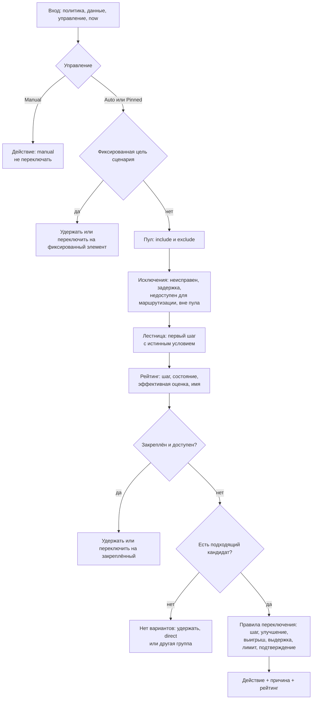
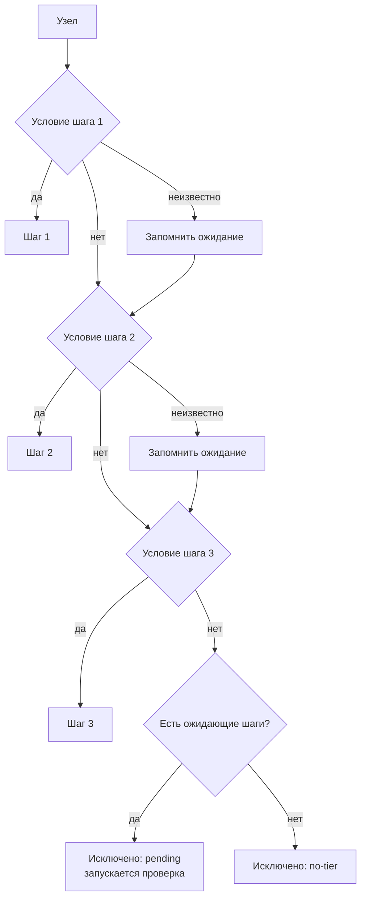
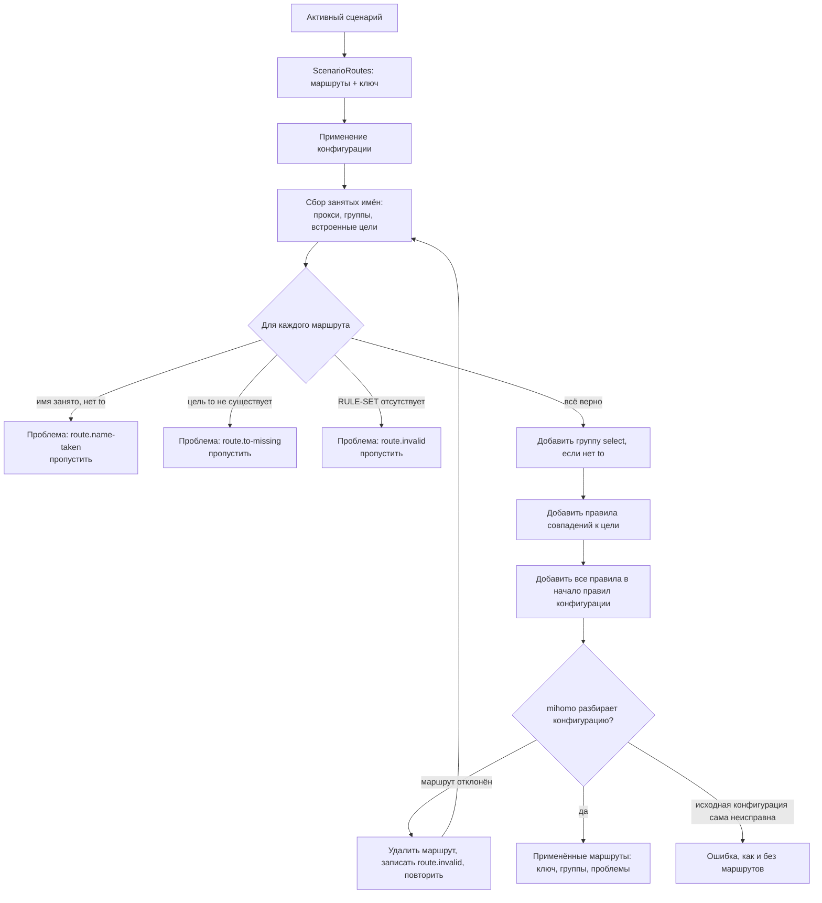

# Как работает движок

На этой странице прослеживается путь одного решения: от первого измерения до сервера, который показывает приложение. Справочные страницы языка: [Профили](profiles.md), [Условия](conditions.md) и [Сценарии](scenarios.md); здесь объясняется, почему движок работает именно так.

Содержание: [группы](#группы-и-участники) · [данные](#данные) · [проверки и энергопотребление](#когда-выполняются-проверки-и-лимиты-ресурсов) · [отложенные сбои](#отложенные-сбои) · [решение](#решение) · [объяснение](#объяснение-в-приложении) · [управление](#управление) · [уровни](#уровни) · [согласие](#согласие-для-профилей-провайдера) · [типы сетей](#типы-сетей) · [разделение прямого трафика](#разделение-прямого-трафика) · [сценарии](#сценарии) · [маршруты](#маршруты) · [журнал](#журнал) · [гарантии](#гарантии)

## Группы и участники

**Умная группа** — proxy-группа `select` с ключом `rcx`. Движок управляет выбранным сервером группы (mihomo называет его `now`). Каждый сервер, доступный группе напрямую или через провайдера, — это **участник**. Участник сохраняет имя, адрес сервера и цепочку, через которую проходит трафик.

У каждой умной группы ровно один профиль. Он определяется **привязкой** группы:

1. профиль, выбранный пользователем для этой группы;
2. иначе вариант по умолчанию, объявленный провайдером;
3. иначе `builtin/simple`.

Если выбранный профиль отсутствует, недействителен или требует согласия, группа не переключается молча на другой профиль. Она использует `builtin/simple` и показывает проблему: `profile.missing`, `profile.invalid` или `profile.consent`. Для группы без доступных участников указывается `group.unavailable` или `group.empty`.

## Данные

**Данные** — сведения, известные движку об участнике в конкретной сети. Они хранятся отдельно для каждого участника и **сетевой среды** (до 16 сред; сначала удаляется та, к которой дольше всего не обращались), поскольку сервер может быть быстрым дома, но заблокированным в мобильной сети.

| Факт | Хранение |
| --- | --- |
| Задержка | Медиана (p50) до 8 последних измерений за период до 6 часов. |
| Разброс | p90 минус p50 тех же измерений. У нестабильного сервера разброс велик. |
| Эпизоды | Сбои, сгруппированные по времени и подсчитанные за 24 часа (не более 16). |
| Состояние | `alive`, `stale`, `unknown` или `dead`. |
| Страна выхода | Страна, из которой фактически выходит трафик, после согласия достаточного числа независимых источников. |
| Страна входа | Страна, в которой расположен адрес самого сервера. |
| Результаты проверок | Успех, ошибка или мягкая ошибка каждой именованной проверки профиля. |

Источники данных от слабого к сильному: периодическая проверка URL в mihomo, проверка, запущенная движком, и реальный трафик через узел. Реальный трафик — самый сильный сигнал; он также обновляет состояние без отдельного запроса.

**Актуальность.** Измерение считается свежим 45 минут. Если сеть была стабильна два часа, движок доверяет измерениям 3 часа, поскольку изменения маловероятны. Результаты проверок хранятся 6 часов.

**Сбой нужно подтвердить.** Три неудачных подключения за 20 секунд делают текущий узел *подозрительным* и запускают одну подтверждающую проверку. Успешную проверку отменяет только вторая последовательная ошибка; до этого её результат считается неизвестным.

**Страна выхода.** Если профиль использует `exit.country`, движок обращается к echo-сервисам (по умолчанию `https://www.cloudflare.com/cdn-cgi/trace` и `https://ipinfo.io/json`), чтобы узнать, какую страну они видят. Ответ принимается, только если `agree` различных источников (по умолчанию 2, максимум 3) указывают один и тот же код страны ISO. Заглушки вроде `XX`, `T1` и `EU` отклоняются. Подтверждённый ответ хранится 24 часа; после неудачного запроса движок повторяет его через 2 часа. См. [`egress-verify`](profiles.md#egress-verify).

**Страна по имени.** Поле `country` использует подтверждённую страну выхода, если она известна; иначе анализирует имя сервера в таком порядке: эмодзи-флаг, отдельный заглавный код ISO, английское название страны или псевдоним (например, `USA`, `UK`, `Korea`). Значение никогда не бывает «неизвестно», поэтому проверка не требуется. См. [Условия](conditions.md#поля-страны).

## Когда выполняются проверки и лимиты ресурсов

Проверка расходует запросы, батарею, а иногда и терпение провайдера. Поэтому планировщик запускает её, только если результат может повлиять на решение. Проверка нужна для:

- участника, чья ступень ещё *ожидает* из-за неизвестных фактов (проверка «может ли стать лучше»);
- устаревшего текущего участника или запасных кандидатов (обслуживание);
- лучших устаревших кандидатов в профиле, который стремится улучшить результат (поиск);
- группы, в которой нет ни одного заведомо работающего сервера (восстановление);
- подозрительного текущего участника (подтверждающая проверка вместе с лучшим запасным);
- диагностики сети, если профиль или сценарий объявляет её.

### Режимы

Движок всегда работает в одном режиме. Используется первая подходящая строка.

| Режим | Условие | Разрешённые проверки |
| --- | --- | --- |
| Остановлен | Core не запущен | нет |
| Сон | Устройство находится в Doze | нет |
| Фон | Экран выключен | только восстановление после сбоя реального трафика |
| Eco | Тарифицируемая сеть, энергосбережение, низкий заряд или работа от батареи | обслуживание и восстановление; поиск выключен; диагностика один раз после смены сети |
| Активен | Открыто окно использования (см. ниже) | все виды в пределах бюджета |
| Простой | Недавней активности нет | только восстановление, если группа не знает ни одного работающего сервера |

**Окно использования** открывается, когда проходит реальный трафик (10 секунд) или меняется сеть (30 секунд). Простое включение экрана его не открывает: после пробуждения движок ждёт 10 секунд, и перед проверками должно открыться окно.

### Бюджеты

Каждый вид проверки оплачивается из отдельного **лимита**, который пополняется каждый час. Допуск зависит от уровня энергопотребления группы (`eco`, `balanced`, `precise`; по умолчанию `balanced`). Движок выбирает наивысший уровень среди групп; любой сигнал Eco принудительно задаёт `eco`.

| Уровень | обслуживание | поиск | восстановление | сеть | Интервал проверки запасных |
| --- | --- | --- | --- | --- | --- |
| `eco` | 4 | 0 | 12 | 8 | 2 ч |
| `balanced` | 10 | 12 | 24 | 12 | 45 мин |
| `precise` | 20 | 40 | 40 | 20 | 30 мин |

Значения — запросы в час. Дополнительно:

- действует **дневной лимит 20 МиБ** (за каждую проверку списывается 6 КиБ); превышать его могут только действия пользователя и восстановление;
- одновременно выполняется не более **2 проверок**, каждая завершается по тайм-ауту через 5 секунд; одному участнику нельзя запускать повторную проверку чаще раза в минуту;
- **действия пользователя не ограничиваются**: кнопка «Проверить» использует пользовательский лимит;
- контракт форка гарантирует, что проверки не выполняются при выключенном экране, кроме восстановления после сбоя реального трафика; в Doze и во сне проверки отсутствуют; простые профили не превышают 30 запросов в час, расширенные — 80. В смоделированном дне на 250 узлах встроенные расширенные профили достигают пика около 43 запросов в час.

## Отложенные сбои

Механизм отложенных сбоев не позволяет неработающему каналу заставить движок признать исправные серверы неисправными.

Движок отслеживает, проходил ли какой-либо трафик за последнюю минуту (**канал подтверждён**). Проверка помечает узел неисправным, только если канал подтверждён и только после двух последовательных ошибок. Если канал не подтверждён, ошибка удерживается и не учитывается: ни один узел не объявляется неисправным.

Для текущего узла выполняется раунд подтверждения. Движок проверяет подозрительный узел и одновременно лучший запасной. Если не проходят оба, проблема в сети, а не в узле. Журнал фиксирует `network.suspect`, группа делает паузы 0, 5, 10, 20 и 40 минут между попытками восстановления. Если ошибку показывает только текущий узел, он помечается неисправным (`failure.confirmed`), и решение переключается на запасной.

После выхода ноутбука из сна статус подтверждённого канала сбрасывается, поэтому первые сбои в новой сети откладываются до появления подтверждающего трафика.

## Решение

Решение — функция `Decide(input) → Decision`. У неё нет собственных часов или скрытого состояния: на вход подаются политика, данные, управление и «текущий момент»; на выходе — действие, причина и полный рейтинг. Это гарантия **чистого решения**, благодаря которой симуляции в студии заслуживают доверия.

### Шаг 1: пул

**Пул** — набор участников, которые могут использоваться группой. Условие `pool.include` должно быть истинным, а `pool.exclude` — ложным. Условия с неизвестными фактами **допускают** узел: иначе пул исключал бы серверы на основании предположения. Узел за пределами пула исключается с кодом `pool.no-match` или `pool.excluded`. Узлы, которые вообще не могут переносить трафик (типы reject, pass, direct и DNS), исключаются как `pool.unroutable`.

### Шаг 2: исключения

Участник также исключается, если он помечен как `dead` или находится в 15-минутной **задержке** после команды пользователя «Сменить сервер». Исключённые участники остаются в рейтинге с объяснением, чтобы оно было полным.

### Шаг 3: лестница

**Лестница** — список `prefer` профиля. Узел попадает в первый шаг, условие которого истинно. Если условие более раннего шага для узла неизвестно, он помечается как **ожидающий** (возможно, ему место выше). Если ни один шаг не подошёл, но какой-либо ожидал результата, узел исключается как `pending`; иначе — как `no-tier`. Если `prefer` не задан, используется один шаг «Working» с условием `not dead`.

**Переход к следующему шагу.** Неисправные узлы исключаются до ранжирования, поэтому шаг, на котором все серверы неисправны, не даёт кандидатов. В рейтинге тогда первыми оказываются узлы следующего шага. Это гарантия **лестницы**: если все серверы шага отказали, порядок серверов переходит к следующему шагу.

**Крайний случай.** Шаг с `last-resort: true` уступает любому другому шагу, даже записанному ниже: при компиляции профиля такие шаги перемещаются после всех остальных с сохранением взаимного порядка. Для такого шага также допускается отсутствие подходящих серверов без предупреждения студии.

### Шаг 4: рейтинг

Подходящие узлы сортируются по шагу, состоянию (`alive`, `stale`, `unknown`, `dead`), **эффективной оценке**, а затем имени (для детерминированного порядка). Оценка зависит от `rank.by`:

| `rank.by` | Оценка |
| --- | --- |
| `latency` | p50 + разброс / 2 + эпизоды × 50 |
| `stability` | p50 + разброс + эпизоды × 300 |
| неизмеренный узел | около миллиона, поэтому в своём шаге он оказывается последним |

Для текущего узла учитывается допуск `rank.tolerance` (мс): претендент должен превзойти его больше этого значения, чтобы подняться выше. Это первый механизм защиты от частых переключений.

### Шаг 5: закрепление и цель сценария

До применения правил переключения проверяются два переопределения. Программа сценария с `to` задаёт **фиксированный** элемент и удерживает на нём группу (`hold.fixed`, `switch.fixed`); если элемента нет, группа остаётся без подходящего варианта (`fixed.missing`). Пользовательское **закрепление** удерживает группу на выбранном элементе (`hold.pinned`, `switch.pinned`), пока он существует, не неисправен и не исключён; иначе закреплённый узел включается в список требуемых проверок, а решение возвращается к автоматическому. Закрепление имеет приоритет и над фиксированной целью сценария.

### Шаг 6: нет доступных вариантов

Если подходящих кандидатов нет, группа **не имеет доступного варианта**. Действие определяется параметром `stranded` профиля:

| `stranded` | Результат |
| --- | --- |
| `hold` (по умолчанию) | Оставить текущий сервер (`stranded.no-candidates`). |
| `direct` | Переключить группу на `DIRECT` (`switch.stranded`), если такой участник есть. |
| `group:<name>` | Переключиться на указанный элемент (другую группу), если он существует. |

Если текущий узел на задержке, указывается `hold.no-alternative`.

### Шаг 7: правила переключения

Если кандидат найден, движок решает, нужно ли переключаться. Проверки выполняются по порядку; первая подходящая определяет причину.

| Ситуация | Причина |
| --- | --- |
| У группы нет текущего участника | `switch.initial` |
| Пользователь нажал «Сменить сервер» | `switch.change-server` |
| Текущий узел неисправен | `switch.failover` (активные подключения закрываются) |
| Текущий узел вышел из пула | `switch.out-of-pool` |
| Лучший кандидат уже текущий | `hold.best` |
| Для лучшего шага есть свежая (5 минут) успешная проверка | `switch.better-tier` |
| Лучший шаг есть, но проверка устарела | `hold.checking` до результата проверки |
| `switch.improve` выключен | `hold.working` |
| Кандидат ещё не измерен | `hold.best` |
| Выигрыш меньше порога | `hold.best` |
| Не прошло время выдержки | `hold.dwell` |
| Достигнут часовой лимит переключений | `hold.flap-limit` |
| Меньше `confirm` свежих измерений выше порога | `hold.confirming` |
| Иначе | `switch.faster` |

**Порог** — максимум из `min-gain-ms`, `score × min-gain-pct / 100` и `tolerance`. Значения берутся из пресета `feel`, если не заданы явно:

| `feel` | выдержка | min-gain-ms | min-gain-pct | confirm | max-per-hour |
| --- | --- | --- | --- | --- | --- |
| `calm` | 30 мин | 60 | 30 | 3 | 2 |
| `balanced` | 10 мин | 30 | 20 | 2 | 4 |
| `eager` | 2 мин | 15 | 10 | 2 | 8 |

Аварийное переключение и переход на лучший шаг не ограничиваются выдержкой или порогом выигрыша. Неисправный сервер заменяется всегда, а лучший шаг со свежей успешной проверкой выбирается сразу. Настройка производительности (`improve`) действует только внутри текущего шага.

## Объяснение в приложении

Рейтинг **и есть объяснение**. Каждая строка содержит участника, номер и метку шага, состояние, задержку, разброс, оценку, число эпизодов, время последней проверки, признак текущего узла, причину исключения (если применимо), страну выхода, результаты проверок и состояние ожидания. Решение дополняет рейтинг действием, кодом причины и, если группа удерживается, тем, чего она ждёт (`until.dwell`, `until.check-better-tier`). Приложение преобразует коды в предложения на языке пользователя.

Поскольку поведение и строки рейтинга создаются одной функцией, объяснение не может противоречить работе движка. Студия может прогнать её на примере ваших узлов, ничего не меняя.

## Управление

У каждой группы есть **режим управления**, определяющий, кто может менять выбранный сервер.

| Режим | Кто выбирает | Поведение |
| --- | --- | --- |
| Auto | Движок | Полный конвейер принятия решения. |
| Pinned | Пользователь | Закреплённый участник сохраняется, пока не станет неисправным или не будет исключён. «Только эта сеть» возвращает Auto в других сетях. |
| Manual | Пользователь | Движок не переключает сервер и не тратит проверки на группу. |

**Ручной выбор в умной группе закрепляет сервер.** Когда пользователь нажимает сервер в приложении, движок закрепляет этот сервер. Только явный режим Manual полностью оставляет группу без управления: она не переключается и не проверяется. Auto снимает закрепление. «Сменить сервер» исключает текущий сервер на 15 минут, снимает закрепление и принудительно переключает.

## Уровни

Профиль может поступать из трёх уровней, от низшего приоритета к высшему:

1. **Встроенный**: поставляется с приложением (`builtin/...`).
2. **Провайдер**: из подписки (`provider/...`).
3. **Пользовательский**: создан или импортирован пользователем (`user/...`).

Имя профиля без префикса разрешается как `provider/<name>`. Уровни могут **только сужать пул**. Провайдер может ограничить серверы группы, но не расширить их набор. Выбор пользователя заменяет настройки провайдера (профиль, пул, `feel`, `energy` и порядок `prefer`), а программа сценария имеет приоритет над привязкой пользователя для указанной группы. Поэтому порядок серверов имеет приоритет **программа сценария > привязка пользователя > профиль**.

Разделение прямого трафика доступно только на пользовательском уровне. Недействительный или неприменимый профиль всегда вызывает видимую проблему и не заменяется молча.

`extends` наследует другой профиль (до 4 уровней): пулы объединяются (условия include — через `and`, exclude — через `or`, то есть пул только сужается); метки объединяются по имени; дочерний `prefer` заменяет родительский; дочерний `feel` сбрасывает остальные параметры переключения к значениям пресета. См. [Профили](profiles.md#extends).

## Согласие для профилей провайдера

Профиль провайдера может задавать проверки, диагностику и echo-сервисы. Если они обращаются к узлам за пределами регистрационного домена провайдера и эндпоинтов встроенных профилей, требуется согласие пользователя. До его получения группа использует `builtin/simple`, показывает проблему `profile.consent`, а приложение спрашивает, каким узлам разрешить доступ. Разрешённые узлы сохраняются отдельно для каждой подписки. То же правило применяется к диагностике сети в сценарии провайдера, если она обращается к сторонним узлам. Пользовательские профили в согласии не нуждаются.

## Типы сетей

**Тип сети** — метка вроде `cell`, `wifi` или `whitelist`, вычисляемая по условиям профиля или сценария, чтобы менять поведение в разных сетях.

- Профиль или сценарий объявляет `network.kinds`: список проверяется сверху вниз, и первый истинный `when` задаёт тип. Тип с `pause: true` приостанавливает группу (`hold.paused`), например при captive portal.
- Доступны факты `network.kind`, `network.transport`, `network.portal`, `metered` и **диагностика** — результаты именованных проверок (`home ok`, `foreign fail`).
- Новый тип должен быть подтверждён **двумя последовательными циклами**, если до этого у группы не было типа. Это защищает от разового шумного результата проверки. Неизвестный результат оставляет тип неопределённым.
- Тип запоминается отдельно для каждой сети и политики.
- Блоки `on.<kind>` (в профиле: `pool`, `prefer`, `rank`, `switch`, `stranded`, `energy`; в сценарии: `mode` и `groups`) заменяют основные значения только при активном типе. `on.x` без объявления типа `x` — ошибка.
- Диагностика — прямые запросы в обход туннеля, общие для всех групп (один эндпоинт запрашивается один раз). Она работает только при активности пользователя или однократно после смены сети в режиме eco; интервалы повторов — 5, 10, затем 30 минут.

## Разделение прямого трафика

Разделение прямого трафика отправляет локальные и внутренние назначения напрямую, когда условие сети указывает, что туннель бесполезен или мешает. Оно задаётся условием `direct-split` профиля, например `home fail and foreign ok`.

- Включить его может только пользователь, не провайдер.
- Состояния: off, standby (условие ложно) и active (условие истинно). Правила предоставляет первая группа, в которой пользователь включил функцию и условие которой истинно.
- Локальные назначения и итоговое правило MATCH никогда не проходят через туннель.

## Сценарии

Сценарий управляет группами сверху: удерживает **режим туннеля**, назначает группам **программы** и может содержать **маршруты**. Полный синтаксис описан в разделе [Сценарии](scenarios.md).

**Удержание режима.** Сценарий задаёт режим (`rule`, `global` или `direct`), только пока пользователь не выбрал другой. Эффективный режим — желание сценария, иначе режим пользователя, иначе `rule`. Ручной выбор действует до повторного нажатия **Auto**, возвращающего управление сценарию («снова автоматически»).

**Неактивные группы.** Группа, через которую текущий режим не направляет трафик, простаивает: решения и проверки не выполняются, причина `hold.idle`. `GLOBAL` простаивает вне режима global; в режиме direct простаивают все группы.

**Программы групп.** Цель программы — имя группы, `$main` (группа итогового MATCH), `*` (все остальные группы select) или `GLOBAL`. Программа может заменить профиль, сузить пул, заменить порядок серверов или закрепить группу на одном элементе через `to`. Точное имя важнее `$main`, а `$main` важнее `*`. Неуказанные группы сохраняют собственный профиль.

**Поведение в разных сетях.** Сценарий имеет собственный тип сети (запоминается как `scenario:<id>`). При его смене привязки перестраиваются; переопределение `on.<kind>` целиком заменяет базовую запись той же группы.

## Маршруты

**Маршрут** направляет трафик, совпавший со списком правил, в собственную группу. Группу создаёт сценарий, а не пользователь вручную.

### Правила

- Маршруты применяются **при применении конфигурации**, не в реальном времени. Движок передаёт их сборщику конфигурации, который добавляет группы и помещает правила в начало.
- Трафик направляется только в режиме **rule**. В режимах global и direct маршруты остаются в сценарии, но не действуют; статус показывает `route.not-rule-mode`.
- Маршрут без `to` создаёт группу `select` с именем маршрута и `include-all: true`. Это умная группа, которой можно назначить программу.
- Маршрут с `to` не создаёт группу: правила направляются к цели (`DIRECT`, существующая группа или сервер).
- Правила добавляются **в начало** в порядке маршрутов. Первое совпадение побеждает, поэтому маршруты имеют приоритет над собственными правилами конфигурации.
- Маршрут не может присвоить себе группу, уже существующую в конфигурации (`route.name-taken`).

### Применение конфигурации

Если mihomo отклоняет правила или группу конкретного маршрута, удаляется только этот маршрут и разбор повторяется. Если причину ошибки нельзя связать с маршрутом, все маршруты помечаются недействительными и используется исходная конфигурация. Поэтому ошибочный маршрут не может нарушить подключение.

### Изменения без перезагрузки и флаг reload

Для применённых маршрутов вычисляется **ключ** — хеш имён, списков совпадений и значений `to` всех маршрутов. Изменение **программы** маршрута (профиля, пула или порядка серверов) не меняет ключ, поэтому применяется сразу без новой конфигурации. Изменение имени, совпадения или `to` меняет ключ. Статус сообщает `reload: true`, и приложение выполняет **одно** отложенное повторное применение. Отклонённый маршрут всё равно считается применённым (ключ содержит **предложенные** маршруты), поэтому он не вызывает бесконечный цикл перезагрузок.

### Зачем нужны эти ограничения

Маршрутам нужны настоящие группы и правила в конфигурации mihomo, которые появляются только после разбора. Применение при сборке конфигурации позволяет не раздувать форк: движок добавляет обычные группы и правила, не вмешиваясь в маршрутизатор.

## Журнал

Движок хранит кольцевой буфер из последних **200** событий; состояние сохраняется вместе с остальными данными при выключении экрана, остановке и сбросе. Типы событий: `switch`, `stranded`, `change`, `pin`, `auto`, `manual`, `network`, `mode`, `split`, `failure`. Запись содержит время, группу, старого и нового участников, код причины и параметры. Приложение показывает журнал как историю смены серверов и ответ на вопрос «почему сервер изменился в три часа ночи?».

## Гарантии

Гарантии определены контрактом форка `.fork/features/routing.auto.yaml` и покрыты тестами.

| Ключ | Гарантия |
| --- | --- |
| `pure-decision` | Решение — чистая функция политики, данных и контекста; объяснение совпадает с полученным рейтингом. |
| `energy` | При выключенном экране проверки не выполняются, кроме восстановления после сбоя реального трафика; в Doze и во сне их нет; простые профили ограничены 30 запросами в час, расширенные — 80. |
| `escrow` | Сбои при отсутствии проходящего трафика не объявляют узлы неисправными. |
| `layers` | Уровни провайдера и пользователя только сужают пул профиля; недействительный профиль или непригодная группа всегда являются видимой проблемой, а не молчаливым резервным вариантом. |
| `manual-control` | Ручной выбор в умной группе закрепляет сервер; в ручном режиме переключений нет. |
| `thin-fork` | Форк mihomo содержит только отключение проверки здоровья для отдельных провайдеров, отпечаток эндпоинта и хук маршрутизации для direct-split. |
| `direct-split` | Включить direct-split может только пользователь; локальные назначения и итоговое правило MATCH не проходят через туннель. |
| `consent` | Профиль провайдера обращается к узлам за пределами своего сайта и встроенных эндпоинтов только после разрешения пользователя; до этого группа использует `builtin/simple` и показывает причину. |
| `studio` | Проверка, симуляция, форматирование и объединение не меняют состояние; профиль влияет на группу только после сохранения. |
| `profile-text` | Профиль содержит собственные переводы; приложение показывает язык пользователя и при необходимости исходный текст. |
| `scenario` | Сценарий задаёт режим туннеля только до ручного выбора пользователя и управляет только указанными группами; остальные сохраняют собственные профили. |
| `routes` | Маршруты сценария становятся группами и правилами только при применении конфигурации, работают только в rule mode и не переопределяют существующую группу; неприменимый маршрут отображается как проблема. |
| `ladder` | Если все серверы шага неисправны, порядок переходит к следующему; порядок программы сценария важнее пользовательского, а пользовательский важнее профиля. |
| `bundle` | Экспорт включает все используемые невстроенные профили; импорт никогда не заменяет существующий профиль пользователя. |
