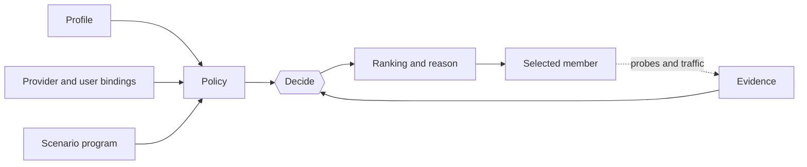

# 自动路由

RCX 是 ReClash 的服务器选择引擎：智能组按配置自行选择服务器，场景则引导整个连接。

## 模型

RCX 作用于运行中配置的 select 组。选择永远不会改变组的成员：引擎像手动点击一样挑选其中一个，并记录原因。只有场景路由会在应用配置时添加组和规则。

| 对象 | 是什么 | 来源 |
| --- | --- | --- |
| 智能组 | 成员由引擎选择的 select 组。 | 来自订阅、用户或运行中场景的绑定。 |
| 配置 | 单个组如何选择（应用中称为行为）：池、层级、排名、切换、检查、网络类型。 | 内置、服务商或用户。 |
| 场景 | 整个连接的行为：组程序、路由、按网络类型划分的隧道模式。 | 同样的三种来源；每个订阅一个。 |
| 路由 | 放在配置自带规则之前的规则；匹配的流量进入它自己的组、现有目标或 `DIRECT`。 | 运行中的场景，在应用配置时生成。 |
| 证据 | 每台服务器的延迟样本、失败、检查结果和出口国家。 | 探测、URL 测试和真实流量。 |



组的策略是它的配置加上绑定和场景程序。决策是策略、证据和上下文的纯函数；其解释就是它所决定的排名。参见[引擎](engine.md)。

### 配置与场景

| | 配置 | 场景 |
| --- | --- | --- |
| 范围 | 一个组 | 整个连接 |
| 选择 | 在组的成员中选一台服务器 | 为每个命名组选择配置、池、顺序或固定成员；隧道模式 |
| 网络类型 | `on.<kind>` 改变配置的层级、排名、切换、池、stranded 和 energy | `on.<kind>` 替换组程序和模式 |
| 添加规则 | 否 | 是，通过 `routes`（仅规则模式） |
| 参考 | [配置](profiles.md) | [场景](scenarios.md) |

运行中的场景未提及的组保留其绑定。既无绑定也无程序的组就是普通选择器。

### 标识符

配置和场景使用各自独立的命名空间，键为 `<source>/<name>`。

| 来源 | 前缀 | 可编辑 |
| --- | --- | --- |
| 内置 | `builtin/` | 否；编辑会作用于副本。 |
| 订阅服务商 | `provider/` | 否；编辑会作用于副本。单独的 `fast` 表示 `provider/fast`。 |
| 用户 | `user/` | 是。配置由所有订阅共享；用户层（绑定、场景、允许的主机）属于某一个订阅。 |

## 内置配置与场景

| Id | 级别 | 行为 |
| --- | --- | --- |
| `builtin/simple` | simple | 一个层级 `not dead`；延迟排名，容差 50；`improve: false`，手感平稳。没有可用配置的组默认使用它。 |
| `builtin/fastest` | simple | 延迟排名，容差 20；`improve: true`，手感均衡。 |
| `builtin/stable` | simple | 稳定性排名，容差 100；`improve: true`，手感平稳。 |
| `builtin/from-list` | simple | `extends: builtin/simple`；用于手选的服务器，它们会被固定。 |
| `builtin/bypass-ru` | advanced | 层级：通过 `open`（`https://api.telegram.org/`）检查且出口非 RU；任意非 RU 出口；最后是任意可用服务器。类型为 `portal`（暂停）和 `open`；在 `home fail and foreign ok` 时进行直连分流。 |
| `builtin/bypass-ir`、`builtin/bypass-cn` | advanced | IR 和 CN 使用相同的层级，分别在 `youtube.com` 和 `google.com` 的 `generate_204` 上检查；仅有 `portal` 类型。 |
| `builtin/whitelist-ru` | advanced | 扩展 `bypass-ru`；增加标签 `bypass` 和类型 `whitelist`（`home ok and foreign fail`）；`bypass` 服务器优先。 |
| `builtin/every-group`（场景） | — | `groups: {'*': {}}`：除 `GLOBAL` 外的每个 select 组都成为智能组，使用其绑定的配置。开启自动路由且未选择场景时，应用会运行它。 |
| `builtin/whitelist-ru`（场景） | — | `$main` 运行不含 `bypass` 服务器的 `bypass-ru`；在 `whitelist` 类型下，模式变为全局，`GLOBAL` 在 `bypass` 服务器上运行 `simple`。 |

## 术语表

| 术语 | 含义 |
| --- | --- |
| 绑定（Binding） | 把配置附加到组：`profile`、`default`、`pool`、`prefer`、`feel`、`energy`、`chips`。参见[绑定](profiles.md#bindings)。 |
| 程序（Program） | 场景对单个组的动作：`profile`、`pool`、`prefer` 或 `to`。 |
| 池（Pool） | 经过 `include` 和 `exclude` 之后，组可以从中选择的成员。 |
| 层级（Tier） | 一条 `prefer` 条目：一个标签和一个条件；应用中称为**服务器顺序**的一个步骤。 |
| 兜底（Fallback） | 最后手段步骤（`last-resort`）：仅当其他步骤都没有可用服务器时使用。 |
| 容差（Tolerance） | 以毫秒计、给当前服务器的排名加成，用于防止抖动。 |
| Stranded | 没有符合条件的成员；`stranded` 指定该怎么做。 |
| 网络类型（Network kind） | 由网络条件识别的命名网络类别（`portal`、`whitelist` 等）。 |
| 诊断（Diagnostic） | 在隧道之外对设备直接进行的探测，用于识别网络类型。 |
| 检查（Check） | 通过某台服务器发出请求，看它能否打开某个目标（`passes(id)`）。 |
| 出口国家（Exit country） | 服务器流量离开时所在的国家，由多个独立来源确认一致。 |
| 直连分流（Direct split） | 在直连不通时，把匹配 `DIRECT` 的连接改经智能组路由。 |
| 控制（Control） | 每个组的自动、固定或手动。 |
| 日志（Journal） | 引擎最近 200 条事件：切换、失败、控制、网络、模式和直连分流的变化。 |

## 最小示例

```yaml title="nearest.rcx.yaml"
rcx: 1
title: Nearest working
prefer:
  - { label: Fast, when: 'latency < 150ms' }
  - { label: Any, when: 'not dead' }
rank: { by: latency, tolerance: 30 }
switch: { improve: true, feel: balanced }
```

如果测得有延迟低于 150 ms 的服务器，组就选用它，否则选用任意可用服务器，并且只有超过 `balanced` 阈值时才会切换到更快的服务器。可在应用中导入它，或通过订阅提供；参见[分享](sharing.md)。
