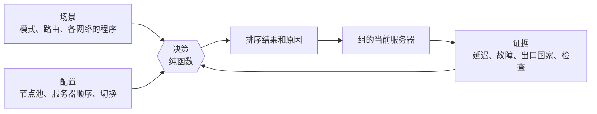

# 自动路由

自动路由是 ReClash 中负责为你选择服务器，并在网络变化时持续重新选择的功能。它在项目内部称为 **RCX**。你可以用几行 YAML 或编辑器描述理想服务器的条件，随后由引擎完成测量、排序和切换。

本页是入门入口，介绍自动路由的概念、思维模型、术语表、文档导航，以及五分钟 YAML 快速上手。

## 自动路由是什么

普通代理组要么让你手动选择服务器，要么定时测试所有服务器并选择最快的一个。这两种方式都有常见问题：手动选择会过时；定时测试耗电，还会因为延迟波动来回切换，甚至在手机只是暂时没信号时就判定所有服务器都不可用。

自动路由基于三个理念：

- **规则清晰可读。** *配置*说明哪些服务器符合条件、优先顺序如何，以及切换积极程度。它是简短的 YAML 文档，而不是黑盒。
- **先有证据，再下结论。** 引擎按网络记录每台服务器的延迟、波动、故障，以及（可选的）出口国家。如果此时完全没有流量通过，单次故障不构成证据，会先暂存起来。
- **决策可以解释。** 决策是规则和证据的纯函数，返回排序结果；应用会用该排序解释当前服务器为何正在使用。

在此之上，*场景*负责控制整个连接：隧道模式、不同网络下的行为，以及将选定网站发送到独立代理组的*路由*。

自动路由需要逐组启用。带有 `rcx` 键的组称为**智能组**。标准 mihomo 会忽略此键，因此配置在其他客户端中仍然有效。

## 思维模型



从左向右阅读。**配置**是某个组的规则集。**证据**是引擎测得的信息。**决策**将两者结合，生成排序及原因；排名第一的服务器成为该组当前选中的服务器。**场景**位于各组之上，可以切换它们所使用的规则，例如在移动网络下使用不同规则。

请记住三点：

1. 决策可重复：相同规则和证据始终产生相同结果。
2. 引擎尽量节省资源。只有检查结果可能改变决策时才会检查服务器，并遵守每小时预算；屏幕关闭时不主动检查，除非实际流量出现故障。
3. 控制权在你手中。手动选择会固定服务器，引擎不会再切换它。

## 术语表

| 术语 | 含义 |
| --- | --- |
| 智能组 | 带有 `rcx` 键的 `select` 代理组。引擎负责其当前选中的服务器。 |
| 配置 | 面向单个组的 YAML 规则：节点池、服务器顺序、排序、切换和检查。也称为行为。 |
| 场景 | 面向整个连接的文档：隧道模式、各组程序、网络覆盖设置和路由。 |
| 程序 | 场景分配给组的内容：`profile`、更窄的 `pool`、`prefer` 服务器顺序或固定目标 `to`。 |
| 路由 | 根据流量特征（网站、国家、端口、应用）匹配，并分配独立组或固定目标。定义在场景中。 |
| 节点池 | 某个组可使用的服务器集合。各层只能缩小范围。 |
| 服务器顺序、阶梯、优先级 | `prefer` 列表。每个条目是一个**步骤**；选择第一个含有可用服务器的步骤。 |
| 步骤 | `prefer` 中的一项，由标签和条件组成。 |
| 条件 | 简短表达式，例如 `country = NO and not dead`。参见[条件](conditions.md)。 |
| 证据 | 某台服务器在某个网络下测得的信息：延迟、波动、故障、检查和出口国家。 |
| 检查 | 配置定义的命名测试，例如“此服务器能否打开 Telegram”。 |
| 故障暂存 | 在尚未确认连接是否可用时先暂存故障，避免因链路本身中断就判定服务器不可用。 |
| 控制方式 | 当前由谁决定：**Auto**、**固定**或**手动**。 |
| 层 | 规则来源：内置、服务商或用户。各层只能缩小节点池。 |
| 授权 | 服务商配置连接第三方主机前取得用户同意。 |
| 网络类型 | 根据条件识别当前网络的标签，例如 `cell`、`wifi`、`whitelist`。 |
| 配置包 | 用于导入和导出的单个文件，可包含多个配置和场景。 |

## 文档导航

概念与参考：

| 页面 | 内容 |
| --- | --- |
| [引擎](engine.md) | 完整工作流程：证据、检查与预算、故障暂存、决策流程、控制、层、网络类型、场景、路由和日志。 |
| [配置](profiles.md) | 组配置的全部键，以及内置配置的完整注释。 |
| [条件](conditions.md) | 条件语言：语法、运算符、字段、三值逻辑和正则表达式。 |
| [场景](scenarios.md) | 场景 YAML 参考：程序、目标、网络覆盖、路由和所有匹配类型。 |
| [共享](sharing.md) | 配置包、服务商分发、`reclash://` 链接、JSON Schema 和 `rcxlint` 工具。 |
| [示例集](cookbook.md) | 从目标、成品 YAML 到应用中效果的完整示例。 |

应用编辑器指南：

| 页面 | 内容 |
| --- | --- |
| [编辑器指南](editor/README.md) | 编辑器各个界面的概览。 |
| [路由中心](editor/hub.md) | 路由中心：当前场景、组和状态。 |
| [路由](editor/routes.md) | 创建路由并调整顺序。 |
| [组](editor/groups.md) | 每个组的行为、服务器顺序和控制。 |
| [工作台](editor/studio.md) | 带实时校验的文本编辑器。 |
| [在应用中共享](editor/sharing.md) | 在界面中导出、导入和使用链接。 |
| [故障排查](editor/troubleshooting.md) | 应用报告的问题及处理方式。 |

## 五分钟快速上手

从零开始创建带有服务器顺序的行为。你需要包含 `select` 组的订阅，并且服务器名称中带有国家旗帜或国家代码。

### 1. 编写配置

配置是一个 YAML 文件。下面的示例优先选择德国服务器，否则选择任意可用服务器，并平稳切换。

```yaml
rcx: 1
title: Fast Germany
description: Prefers Germany, falls back to anything that works.
prefer:
  - label: Germany
    when: country = DE
  - label: Anything
    when: not dead
rank:
  by: latency
switch:
  feel: calm
```

逐项说明：

- `rcx: 1` 是格式版本。引擎读取外部文档时必须提供此字段。
- `title` 和 `description` 会显示在应用的行为列表中。
- `prefer` 定义服务器顺序。引擎从上到下尝试各步骤，并使用第一个有可用服务器的步骤。`country = DE` 匹配德国服务器，`not dead` 匹配未确认宕机的服务器。
- `rank.by: latency` 会在当前步骤中选择延迟最低的服务器。
- `switch.feel: calm` 让引擎尽量少切换：主动切换之间至少等待 30 分钟，并且只有明显改善时才切换。

### 2. 将配置分配给组

在应用中打开路由中心，选择组并指定行为（参见[组](editor/groups.md)）。服务商订阅则通过名称绑定（参见[共享](sharing.md)）。

### 3. 添加路由（可选）

路由会将部分网站流量发送到独立组，并使用单独的服务器顺序。路由定义在场景中：

```yaml
rcx: 1
title: Streaming via Germany
groups:
  $main: {}
routes:
  - name: YouTube
    match: [GEOSITE,youtube]
    prefer:
      - label: Germany
        when: country = DE
      - label: Anything
        when: not dead
```

`$main: {}` 表示主组继续使用自己的配置。路由仅在 `rule` 模式下生效。引擎会创建名为 `YouTube` 的 `select` 组，并将匹配规则放在你自己的规则之前。详情参见[场景](scenarios.md#路由)。

### 4. 检查配置

导入前先验证文件：

```text
cd core
go run ./rcx/cmd/rcxlint path/to/file.yaml
```

没有输出且退出码为 0，表示文件通过验证。参见[共享](sharing.md#rcxlint-工具)。

### 5. 查看解释

在应用中打开该组。排序结果会显示各服务器、所属步骤以及当前服务器被选中的原因。如果结果看起来不对，[故障排查](editor/troubleshooting.md)列出了应用报告的各种情况。

## 保证

自动路由的 fork 契约（`.fork/features/routing.auto.yaml`）规定了本文在相关位置重申的保证。简而言之：决策是纯函数；检查遵守资源预算；链路尚未验证时故障会暂存；各层只能缩小范围；手动选择会固定服务器；对 mihomo 的改动保持精简；直连分流和服务商授权由用户掌控。完整内容见[引擎](engine.md#保证)。
