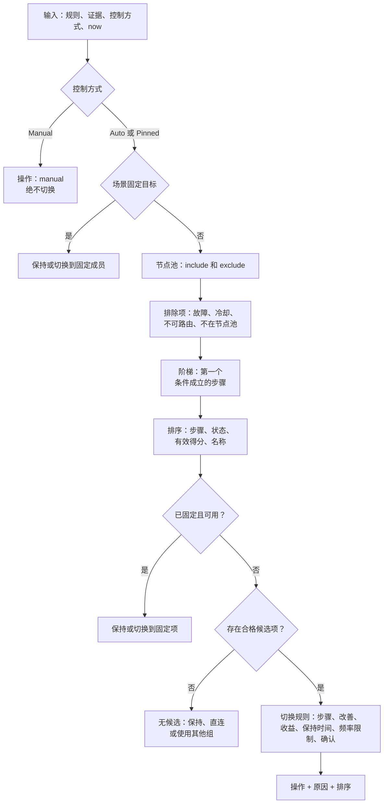
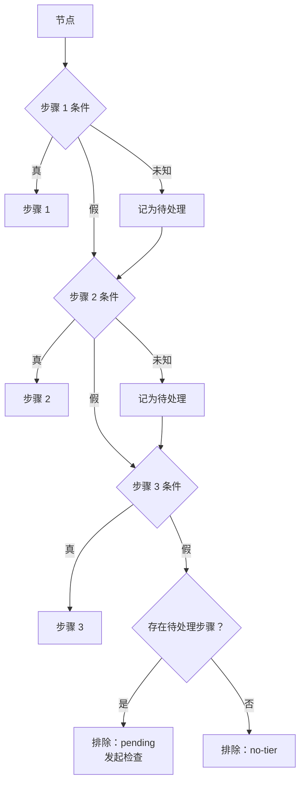
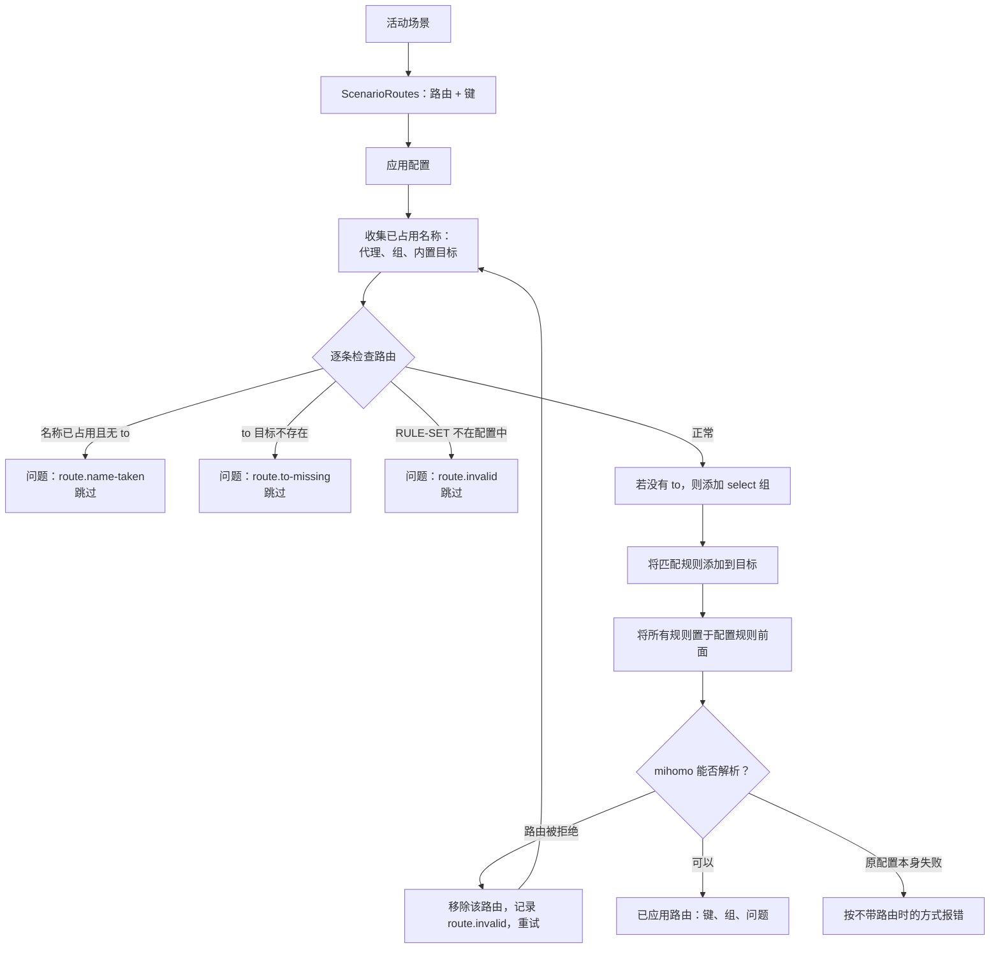

# 引擎的工作方式

本页沿着一次决策，从首次测量一直跟踪到应用显示所选服务器。相关语言参考：[配置](profiles.md)、[条件](conditions.md)和[场景](scenarios.md)；本页解释引擎为何如此运行。

目录：[组](#组与成员) · [证据](#证据) · [检查与能耗](#检查何时运行与能耗预算) · [故障暂存](#故障暂存) · [决策](#决策) · [说明](#应用中的说明) · [控制](#控制) · [层](#层) · [授权](#服务商配置的授权) · [网络类型](#网络类型) · [直连分流](#直连分流) · [场景](#场景) · [路由](#路由) · [日志](#日志) · [保证](#保证)

## 组与成员

**智能组**是带有 `rcx` 键的 `select` 代理组。引擎负责选择该组当前服务器（mihomo 称之为 `now`）。组可直接或通过服务商访问的每台服务器都是一个**成员**。成员保留自己的名称、服务器地址和流量经过的链路。

每个智能组恰好由一个配置驱动。具体配置由组的**绑定**决定：

1. 用户为该组选择的配置；
2. 若无，则服务商声明的默认配置；
3. 若仍无，则 `builtin/simple`。

如果所选配置缺失、无效或需要授权，组不会悄悄回退。它会使用 `builtin/simple`，并显示明确的问题：`profile.missing`、`profile.invalid` 或 `profile.consent`。组中没有可用成员时会报告 `group.unavailable` 或 `group.empty`。

## 证据

证据是引擎针对某个网络已知的成员信息。证据按成员和**网络环境**分别保存（最多 16 个环境；优先删除最近最少使用的环境），因为某台服务器在家中很快，到了移动网络下可能会被屏蔽。

| 事实 | 保存方式 |
| --- | --- |
| 延迟 | 最近 6 小时内最多 8 次测量的中位数（p50）。 |
| 波动 | 同一组测量的 p90 减 p50。波动大的服务器不稳定。 |
| 故障记录 | 按时间归组，统计最近 24 小时的故障（最多 16 次）。 |
| 状态 | `alive`、`stale`、`unknown` 或 `dead`。 |
| 出口国家 | 流量实际离开的国家；需足够多的独立来源达成一致。 |
| 入口国家 | 服务器自身地址所在的国家。 |
| 检查结果 | 配置中每项命名检查的通过、失败或软失败结果。 |

证据来源由弱到强依次为：mihomo 定时 URL 测试、引擎主动发起的探测、经过节点的实际流量。实际流量是最强信号，还可以在不额外请求的情况下更新状态。

**时效性。** 测量结果在 45 分钟内为新鲜数据。网络稳定两小时后，引擎会将数据有效期延长至 3 小时，因为此时网络大概率没有变化。检查结果保存 6 小时。

**故障需要确认。** 20 秒内连续三次拨号失败，会让当前节点变为*可疑*，并触发一次确认检查。已通过的检查只有在连续第二次失败时才会被推翻；此前结果为未知。

**出口国家。** 配置使用 `exit.country` 时，引擎会请求 echo 服务（默认 `https://www.cloudflare.com/cdn-cgi/trace` 和 `https://ipinfo.io/json`）来查询它们识别的国家。只有 `agree` 个不同来源（默认 2，最多 3）报告相同的 ISO 国家代码时，答案才有效。`XX`、`T1`、`EU` 等占位代码会被拒绝。验证后的答案有效期为 24 小时；查询失败后会在 2 小时后重试。参阅 [`egress-verify`](profiles.md#egress-verify)。

**从名称识别国家。** `country` 字段优先使用已验证的出口国家，否则从服务器名称读取：先看国旗 emoji，再看独立的大写 ISO 代码，最后识别英文国家名或别名（如 `USA`、`UK`、`Korea`）。此字段不会是“未知”，因此不会触发检查。参见[条件](conditions.md#国家字段)。

## 检查何时运行与能耗预算

检查会消耗请求、设备电量，有时还会消耗服务商的耐心。因此，只有检查结果可能影响决策时，规划器才会发起检查。具体情况包括：

- 因事实未知而仍处于*待处理*状态的成员（“确认是否更优”的检查）；
- 当前成员或备用成员的数据已过期（维护检查）；
- 期望改善性能的配置中的最佳过期候选项（发现检查）；
- 没有任何已知可用节点的组（恢复检查）；
- 可疑的当前成员（与最佳备用节点一起进行确认检查）；
- 配置或场景声明的网络诊断。

### 模式

引擎始终处于一种模式。按表格顺序，采用第一个匹配项。

| 模式 | 条件 | 允许的检查 |
| --- | --- | --- |
| 已停止 | Core 未运行 | 无 |
| 休眠 | 设备处于 Doze | 无 |
| 后台 | 屏幕关闭 | 仅当实际流量失败时执行恢复检查 |
| Eco | 按流量计费的网络、省电模式、电量低或使用电池 | 维护与恢复；关闭发现；网络变化后执行一次诊断 |
| 活跃 | 使用窗口开启（见下文） | 预算范围内的所有检查 |
| 空闲 | 最近没有活动 | 仅当组没有已知可用服务器时执行恢复检查 |

当实际流量持续通过 10 秒，或网络发生变化后持续 30 秒，**使用窗口**就会打开。仅查看屏幕不会开启窗口：唤醒后，引擎会等待 10 秒防抖；窗口打开后才会进行任何检查。

### 预算

每种检查都从自己的**额度桶**中扣除，并按小时补充。可用额度由组的能耗等级（`eco`、`balanced`、`precise`；默认 `balanced`）决定。引擎采用所有组中的最高等级，但任何 Eco 信号都会强制采用 `eco`。

| 等级 | 维护 | 发现 | 恢复 | 网络 | 备用节点检查间隔 |
| --- | --- | --- | --- | --- | --- |
| `eco` | 4 | 0 | 12 | 8 | 2 小时 |
| `balanced` | 10 | 12 | 24 | 12 | 45 分钟 |
| `precise` | 20 | 40 | 40 | 20 | 30 分钟 |

上述数量均为每小时请求数，此外还有限制：

- **每日 20 MiB 上限**（每次探测计入 6 KiB）；只有用户主动操作和恢复过程可以超过此上限。
- 同时最多运行 **2 项检查**，每项 5 秒超时；同一成员每分钟最多探测一次。
- **用户主动操作不受限额约束**：在应用中点按“检查”会使用用户额度。
- fork 契约保证：屏幕关闭时不会检查，除非实际流量失败；Doze 或休眠期间不运行；简单配置每小时不超过 30 个请求，进阶配置不超过 80 个请求。在 250 个节点的 24 小时模拟中，内置进阶配置的峰值约为每小时 43 个请求。

## 故障暂存

故障暂存机制可以避免链路本身不可用时将健康服务器误判为故障。

引擎会追踪最近一分钟内是否有任何流量成功通过（即**链路已验证**）。只有链路已验证，且连续两次检查失败，节点才会被标记为故障。如果链路未验证，失败会暂存而不计入判断，不会判定任何节点故障。

对于当前节点，引擎会执行确认流程：同时检查可疑节点和最佳备用节点。如果两者都失败，问题是网络而非节点。日志记录 `network.suspect`，并在后续恢复检查之间依次等待 0、5、10、20、40 分钟。如果只有当前节点失败，它会被标记为故障（`failure.confirmed`），决策将切换到备用节点。

笔记本从休眠恢复后，链路验证状态会重置。因此，新网络中的首次故障会等到有流量证明链路可用后再作判断。

## 决策

决策由函数 `Decide(input) → Decision` 计算。它没有自己的时钟，也没有隐藏状态：输入为规则、证据、控制方式和当前时间，输出为操作、原因及完整排序。这就是**纯决策**保证，使工作台中的模拟可信。

### 第一步：节点池

**节点池**是组可以使用的成员集合。必须满足 `pool.include`，且不能满足 `pool.exclude`。对未知事实的条件会**允许**节点通过，因为依据猜测排除会隐藏服务器。池外节点会以 `pool.no-match` 或 `pool.excluded` 排除。完全无法承载流量的节点类型（reject、pass、direct 和 DNS）会以 `pool.unroutable` 排除。

### 第二步：排除项

成员为 `dead`，或用户点按“更换服务器”后处于 15 分钟的 `cooldown` 冷却期时，也会被排除。被排除的成员仍会显示在排序中，并附带原因，保证说明完整。

### 第三步：阶梯

**阶梯**是配置的 `prefer` 列表。节点进入第一个条件为*真*的步骤。如果更早步骤对该节点的条件为*未知*，则节点会标记为**待处理**（它可能应该进入更高优先级步骤）。若无步骤匹配但至少有一步待处理，则以 `pending` 排除；否则以 `no-tier` 排除。未设置 `prefer` 时，会自动生成名为“Working”、条件为 `not dead` 的单一步骤。

**逐级回退。** 故障节点会在排序前排除，因此若某一步的所有服务器都已故障，就不会留下候选项，排序会直接进入下一步。这就是**阶梯**保证：某一步的所有服务器都宕机后，服务器顺序会回退到下一步。

**最后手段。** 标记为 `last-resort: true` 的步骤会让位于其他所有步骤，包括写在它后面的步骤。配置编译时，这些步骤会移到所有其他步骤之后，并保留彼此顺序。此类步骤即便没有候选服务器，也不会触发工作台警告。

### 第四步：排序

合格节点依次按步骤编号、状态（`alive`、`stale`、`unknown`、`dead`）、**有效得分**和名称排序，以保证顺序确定。得分取决于 `rank.by`：

| `rank.by` | 得分 |
| --- | --- |
| `latency` | p50 + 波动 / 2 + 故障记录 × 50 |
| `stability` | p50 + 波动 + 故障记录 × 300 |
| 未测量节点 | 约一百万，因此在该步骤中排最后 |

当前节点会获得 `rank.tolerance`（毫秒）的容差：挑战节点必须领先超过该值才能排到它前面。这是防止频繁切换的第一道机制。

### 第五步：固定项与场景目标

应用切换规则之前，会检查两种覆盖设置。场景程序中的 `to` 指定一个**固定**成员，并让组保持使用它（`hold.fixed`、`switch.fixed`）；如果该成员不存在，组会变为无可用节点状态（`fixed.missing`）。用户**固定**会让组继续使用指定成员（`hold.pinned`、`switch.pinned`），只要该成员存在、未故障且未被排除；否则固定成员会加入待检查列表，决策恢复自动模式。用户固定优先级也高于场景固定目标。

### 第六步：无可用节点

没有合格候选项时，组处于**无可用节点**状态。配置的 `stranded` 选项决定处理方式：

| `stranded` | 结果 |
| --- | --- |
| `hold`（默认） | 保留当前服务器（`stranded.no-candidates`）。 |
| `direct` | 若有该成员，则切换到 `DIRECT`（`switch.stranded`）。 |
| `group:<name>` | 若该成员存在，则切换到该成员（另一个组）。 |

当前节点处于冷却期且没有替代项时，报告 `hold.no-alternative`。

### 第七步：切换规则

有候选节点后，引擎判断是否切换。按顺序检查，首个适用项决定原因。

| 情况 | 原因 |
| --- | --- |
| 组当前没有成员 | `switch.initial` |
| 用户点按“更换服务器” | `switch.change-server` |
| 当前节点故障 | `switch.failover`（关闭现有连接） |
| 当前节点已不在节点池中 | `switch.out-of-pool` |
| 最佳候选就是当前节点 | `hold.best` |
| 更优步骤有 5 分钟内的有效检查 | `switch.better-tier` |
| 有更优步骤，但其检查已过期 | `hold.checking`，等待检查结果 |
| `switch.improve` 为 false | `hold.working` |
| 挑战节点尚未测量 | `hold.best` |
| 性能收益低于门槛 | `hold.best` |
| 尚未达到最短保持时间 | `hold.dwell` |
| 已达到每小时切换上限 | `hold.flap-limit` |
| 新鲜样本中领先门槛的少于 `confirm` 个 | `hold.confirming` |
| 以上均不适用 | `switch.faster` |

**门槛**是 `max(min-gain-ms, score × min-gain-pct / 100, tolerance)`。除非显式覆盖，否则这些数值取自 `feel` 预设：

| `feel` | 保持时间 | min-gain-ms | min-gain-pct | confirm | max-per-hour |
| --- | --- | --- | --- | --- | --- |
| `calm` | 30 分钟 | 60 | 30 | 3 | 2 |
| `balanced` | 10 分钟 | 30 | 20 | 2 | 4 |
| `eager` | 2 分钟 | 15 | 10 | 2 | 8 |

故障切换和切换到更优步骤不受保持时间或收益门槛限制。故障服务器始终会被替换；更优步骤具有新鲜的可用检查时也始终优先采用。性能调优（`improve`）只在组当前使用的步骤内部生效。

## 应用中的说明

排序结果**就是决策说明**。每一行包含成员、步骤编号和标签、状态、延迟、波动、得分、故障次数、上次检查时间、是否为当前节点、排除原因（如有）、出口国家、检查结果及是否待处理。决策还会提供操作、原因代码；若组保持不变，还会提供等待内容（`until.dwell`、`until.check-better-tier`）。应用会将代码转换为用户语言的句子。

由于行为和各行结果由同一个函数生成，说明不会与实际行为矛盾。工作台可以对示例节点运行该函数，不会修改任何设置。

## 控制

每个组都有一个**控制方式**，决定谁可以更换选中的服务器。

| 控制方式 | 谁负责选择 | 行为 |
| --- | --- | --- |
| Auto | 引擎 | 完整执行决策流程。 |
| Pinned | 用户 | 保持固定成员，直到其故障或被排除。“仅此网络”会让其他网络恢复 Auto。 |
| Manual | 用户 | 引擎不切换服务器，也不对该组执行检查。 |

**在智能组中手动选择服务器会将其固定。** 用户在应用中点按服务器时，引擎会记录对应固定项。只有明确选择 `Manual` 才会让组完全不受引擎管理；此时既不切换，也不检查。选择 `Auto` 会清除固定项。“更换服务器”会将当前服务器排除 15 分钟，清除固定项并强制切换。

## 层

配置可来自以下三个层级，优先级从低到高：

1. **内置**：随应用提供（`builtin/...`）。
2. **服务商**：来自订阅（`provider/...`）。
3. **用户**：用户编写或导入（`user/...`）。

不带前缀的配置名称会解析为 `provider/<name>`。各层**只能缩小节点池**。服务商可以限制组可用的服务器，但不能扩大范围。用户设置会替换服务商设置（配置、节点池、`feel`、`energy` 和 `prefer` 服务器顺序）；场景为某组指定的程序优先于用户绑定。因此服务器顺序优先级为：**场景程序 > 用户绑定 > 配置**。

只有用户层可以启用直连分流。无效或不可用的配置始终显示明确的问题，不会静默替换。

`extends` 可继承另一份配置（最多 4 层）：节点池会合并（include 条件用 `and`，exclude 条件用 `or`，因此只能收窄）；标签按名称合并；子配置的 `prefer` 替换父配置；子配置的 `feel` 会将其他切换值重置为该预设。参见[配置](profiles.md#extends)。

## 服务商配置的授权

服务商配置可以定义检查、诊断或 echo 服务。如果它们访问服务商可注册域名及内置配置端点之外的主机，则需要用户授权。在授权前，该组会使用 `builtin/simple` 并显示问题 `profile.consent`，应用会询问允许访问哪些主机。允许列表按订阅保存。若服务商场景的网络诊断会访问第三方主机，也适用相同要求。用户自编配置无需授权。

## 网络类型

**网络类型**是 `cell`、`wifi` 或 `whitelist` 等标签，由配置（或场景）根据条件识别，以便针对不同网络改变行为。

- 配置或场景声明 `network.kinds` 列表，按顺序检查；第一个 `when` 成立的条目决定类型。设置 `pause: true` 的类型会暂停组（`hold.paused`），例如检测到强制门户时。
- 可用事实包括 `network.kind`、`network.transport`、`network.portal`、`metered` 和**诊断**结果（命名探测结果，如 `home ok`、`foreign fail`）。
- 新类型需连续 **两轮结果一致** 才会生效；如果组此前没有类型，则立即采用。这样可避免单次噪声探测切换行为。规则结果为未知时，类型保持未确定。
- 每个网络和策略都会单独记住网络类型。
- `on.<kind>` 块（配置中可设置 `pool`、`prefer`、`rank`、`switch`、`stranded`、`energy`；场景中可设置 `mode` 和 `groups`）仅在该类型激活时覆盖基础值。声明未定义的 `on.x` 会报错。
- 诊断是绕过隧道的直接请求，由所有组共享（相同端点只请求一次）。仅在用户活跃时运行；Eco 模式下网络变化后可运行一次，并按 5、10、30 分钟逐步延长重试间隔。

## 直连分流

当网络条件表明隧道没有必要或可能造成问题时，直连分流会将本地和国内目标直接发送。它由配置中的 `direct-split` 条件控制，例如 `home fail and foreign ok`。

- 只有用户可以启用，服务商不能启用。
- 状态包括 off、standby（条件不成立）和 active（条件成立）。第一个由用户启用且条件成立的组会提供规则。
- 本地目标和最终 MATCH 规则绝不会通过隧道。

## 场景

场景位于各组之上，可保持**隧道模式**、为组指定**程序**并包含**路由**。完整语法见[场景](scenarios.md)。

**保持模式。** 场景仅在用户尚未手动选择时设置模式（`rule`、`global` 或 `direct`）。有效模式依次为场景期望值、用户模式，默认 `rule`。手动设置会一直生效，直到再次按下 **Auto**，将控制权交还场景（“恢复自动”）。

**空闲组。** 当前模式下不承载流量的组处于空闲状态：不做决策、不执行检查，原因是 `hold.idle`。`GLOBAL` 在 global 模式之外空闲；direct 模式下所有组都空闲。

**按组指定程序。** 程序可按组名、`$main`（最终 MATCH 规则使用的组）、`*`（其他所有 select 组）或 `GLOBAL` 指定目标。程序可以替换配置、收窄节点池、替换服务器顺序，或通过 `to` 将组固定到某个成员。精确名称优先于 `$main`，而 `$main` 优先于 `*`。场景未指定的组会保留自己的配置。

**按网络改变行为。** 场景有自己的网络类型（保存为 `scenario:<id>`）。类型变化时会重建绑定，`on.<kind>` 会整体替换基础设置中同名组条目。

## 路由

**路由**将匹配一组规则的流量发送到专属组。该组由场景生成，而不是手动创建。

### 规则

- 路由在**应用配置时**应用，不是实时应用。引擎将路由传给配置构建器，由其添加组并将规则置于前面。
- 仅在 **rule 模式**下分流。global 或 direct 模式下，路由仍保留在场景中但不生效，状态会显示 `route.not-rule-mode`。
- 不带 `to` 的路由会创建一个同名 `select` 组，并设置 `include-all: true`。该组是智能组，可以由程序控制。
- 带 `to` 的路由不创建组，规则直接发送到目标（`DIRECT`、现有组或服务器）。
- 规则按路由顺序**插入配置规则之前**。第一个匹配的路由获胜，路由优先级高于配置原有规则。
- 路由不会接管配置中已有的组（`route.name-taken`）。

### 配置应用流程

如果 mihomo 拒绝某条路由的规则或组，只会移除该路由并重新解析。如果无法确认错误是否由路由导致，则将所有路由标记为无效并使用原始配置，避免路由错误导致连接失效。

### 实时更改与 reload 标志

已应用的路由会带有一个**键**，即所有路由名称、匹配列表和 `to` 的哈希值。修改路由的*程序*（配置、节点池或服务器顺序）不在键中，因此无需重新加载配置即可实时生效。修改名称、匹配条件或 `to` 会改变键。状态随后报告 `reload: true`，应用执行**一次**防抖后的重新应用。即使路由被拒绝，它也仍计入已应用路由（键覆盖的是**被提供的**路由），因此不会引起重复重新加载。

### 为什么有这些限制

路由需要写入 mihomo 配置的真实组和规则，而这些仅在配置解析后才存在。在配置阶段应用路由可以让 fork 保持精简：引擎只需添加普通组和规则，无须修改路由器钩子。

## 日志

引擎保存最近 **200** 条事件的环形日志，并在屏幕关闭、停止和刷新状态时与其他状态一起保存。事件类型包括 `switch`、`stranded`、`change`、`pin`、`auto`、`manual`、`network`、`mode`、`split` 和 `failure`。每条记录含时间、组、旧成员、新成员、原因代码和参数。应用会将其显示为服务器切换历史，用于追查“为什么凌晨三点切换服务器”。

## 保证

以下保证来自 fork 契约 `.fork/features/routing.auto.yaml`，并由测试覆盖。

| 键 | 保证 |
| --- | --- |
| `pure-decision` | 决策是策略、证据和上下文的纯函数，说明就是决策生成的排序结果。 |
| `energy` | 屏幕关闭时不检查，除非实际流量失败；Doze 和休眠期间不运行；简单配置每小时最多 30 个请求，进阶配置最多 80 个。 |
| `escrow` | 没有流量通过时发生的故障不会导致任何节点被判定为故障。 |
| `layers` | 服务商和用户层只能缩小配置的节点池；无效配置或不可用组会显示问题，不会静默回退。 |
| `manual-control` | 在智能组中手动选择会固定服务器；Manual 模式不会切换。 |
| `thin-fork` | mihomo fork 只包含按服务商抑制健康检查、端点指纹和用于路由的直连分流钩子。 |
| `direct-split` | 只有用户可以启用直连分流；本地目标和最终 MATCH 规则不会通过隧道。 |
| `consent` | 服务商配置只有在用户授权后，才能访问服务商网站和内置端点以外的主机；授权前组使用 `builtin/simple` 并说明原因。 |
| `studio` | 检查、模拟、格式化和合并均为只读；配置只有保存后才会影响组。 |
| `profile-text` | 配置包含自身翻译；应用显示用户语言，缺少翻译时回退到源文本。 |
| `scenario` | 场景仅在用户手动选择模式之前设置隧道模式，并且只控制明确指定的组；其他组使用自身配置。 |
| `routes` | 场景路由仅在应用配置时生成组和规则，只在 rule 模式下分流，不会覆盖配置已有组；无法应用的路由会明确显示问题。 |
| `ladder` | 某一步所有服务器都故障时，服务器顺序会转至下一步；场景程序顺序优先于用户绑定，用户绑定优先于配置。 |
| `bundle` | 导出的设置会携带所有引用的非内置配置；导入不会覆盖用户已有配置。 |
